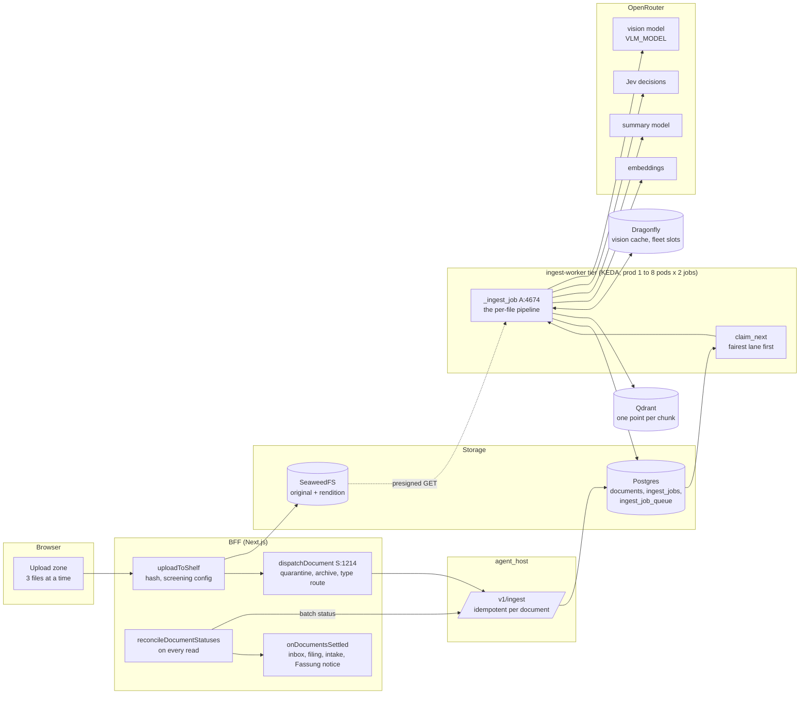
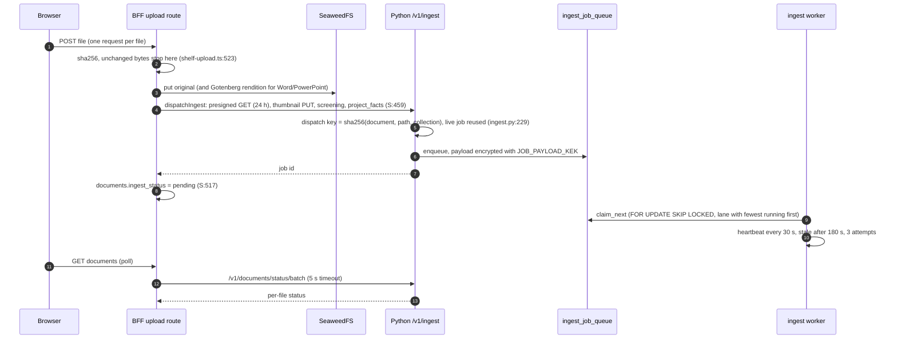
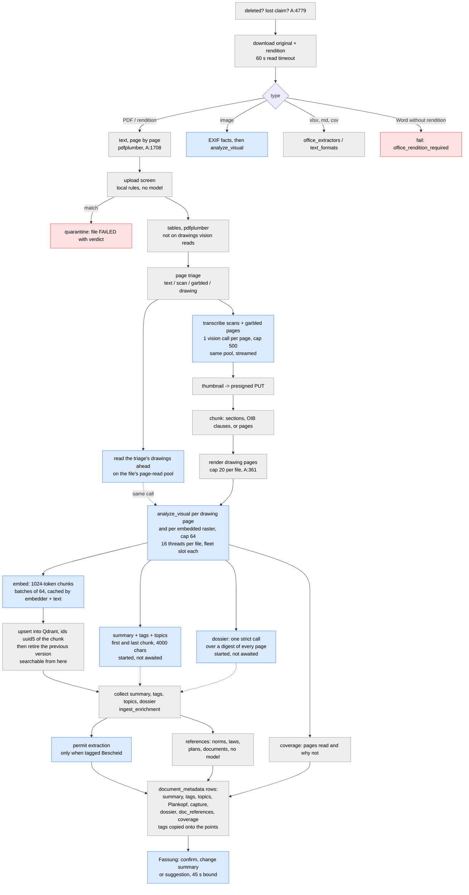
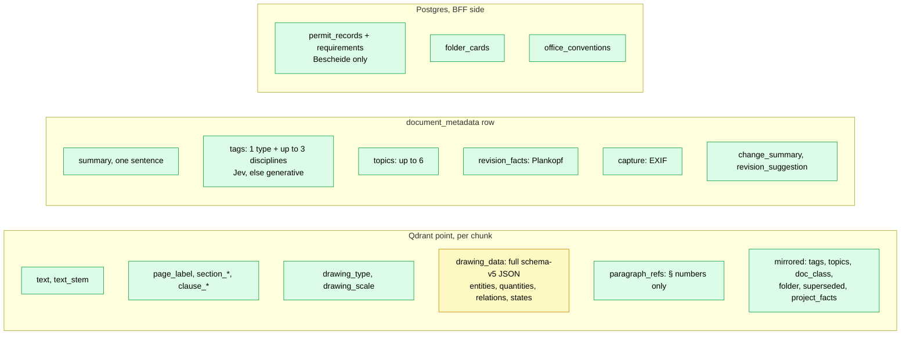
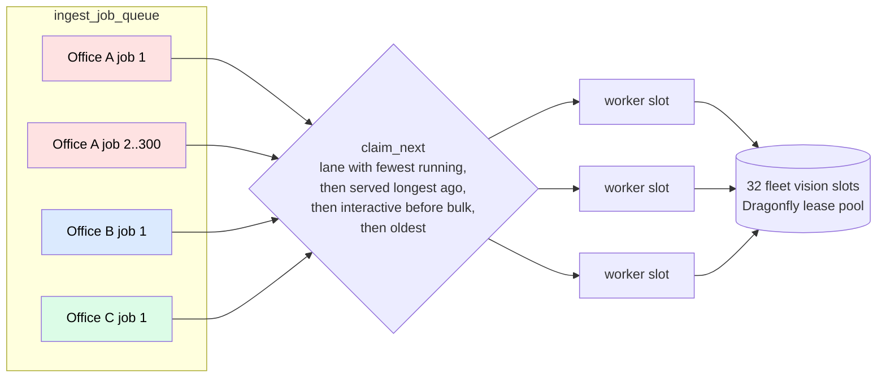

# How a document is read: the ingestion pipeline, drawn

What happens between "an architect drops a file" and "Piloti can cite it", as the
code does it on 2026-10-27. Every box below names the function that owns it, so a
diagram that goes stale is a diff away from being caught. Where this pipeline goes
next is [`docs/roadmap/ingestion-north-star.md`](../roadmap/ingestion-north-star.md).

Older, deeper material is still right and is linked rather than repeated:
[`technical-reference/document-ingestion.md`](../technical-reference/document-ingestion.md)
(the step-by-step reference, with the history of each fix),
[`visual-ingestion.md`](visual-ingestion.md) (the drawing schema and its rules),
ADR-0076 (the claim queue, superseded), ADR-0117 (the page pipeline, proposed,
not built), ADR-0150 (Hatchet, which now runs the job: section 7).

Short forms: **A** is `packages/knowledge-layer/src/llamaindex/adapter.py`, **S** is
`apps/workspace/bff/documents/service.ts` as it stood before it was split (its `S:N` line references are from then; `dispatchDocument` is now in `document-dispatch.ts`, `dispatchIngest` in `ingest-dispatch.ts`), **D** is
`apps/agent-host/src/agent_host/jobs/ingest_dispatch.py`.

## 1. The whole thing on one page

Three things in this picture decide almost everything about speed and reliability:

1. **One document is one queue row, one claim, one worker thread.** Nothing inside a
   document runs on a second machine (ADR-0117 keeps it that way).
2. **Every vision call in the fleet holds one of `VLM_FLEET_CONCURRENCY` slots**
   (32 by default, a lease pool on Dragonfly, A:419). That pool is shared by every
   office on the platform. It is the throughput ceiling, not CPU.
3. **Status is pulled, never pushed.** The BFF learns a document is done when someone
   reads the document list (`reconcile-status.ts:829`), polled every 5 s and then
   every 60 s by an open tab. ADR-0150 adds a push when a job ends
   ([section 7](#7-who-runs-the-job)); the read and the sweep stay as fallbacks.

## 2. How a file reaches the queue

Every entry point ends in `dispatchDocument` (S:1214): a person's upload, a folder
upload, a new Fassung (`revision_of`), "Erneut lesen", a project re-index (`bulk`
priority), mail import, a quarantine release, an unarchive, a published agent
version. IFC models take a side road (`bim_extract`) and come back as a Markdown
digest. A failure to start is final at once: `markDocumentIngestFailed("Ingestion
could not be started")` (S:526).

A queue row moves through four statuses, and the database holds it to them
(`common/claim_queue_schema.py`, a trigger installed with the table): a row is born
`queued`; a live row (`queued` or `claimed`) may be claimed, given back, cancelled
or retired `dead`; a retired row (`dead` or `cancelled`) never changes status again
and leaves only when `purge_retired` deletes it. Any other write fails with
`check_violation`, whichever code path issued it. The status store's `ingest_jobs`
has no such guard on purpose: there the owner's late write wins over a row another
replica settled as interrupted.

## 3. Inside one file

The order below is the order the code runs, with what each stage costs and what
happens when it fails. Grey boxes run on the worker's CPU; blue boxes are a model
call; the dashed line is where the file can stop.

**One page-read pool per file** (`llamaindex/page_reads.py`,
`INGEST_PAGE_READ_PARALLELISM`, 16). Every page read of a file, a scan's
transcription and a drawing's, an image's or a raster's analysis, is one call
on the same pool, submitted as soon as its page is rendered: no batch waits for
its slowest call, and at most twice the pool's size of rendered pages are held.
The drawings the triage already knows are rendered and read on the pool before
the scans are transcribed, so the two run at once; the vision batch later asks
for the same bytes and gets that call (`FilePageReads.single_flight`), and its
renderer takes the page already rendered. The answer is the one the serial
order gave; only a page the transcription itself calls a drawing (`[ZEICHNUNG]`)
still waits for the transcription. Results come back in page order. The pool
bounds a file's threads and memory; the calls in flight are capped by the
fleet's lease pool (`VLM_FLEET_CONCURRENCY`), whose slots are shared fairly
between offices. One consequence: a file the screen of its transcribed text
holds may already have had its triage drawings read (their results are dropped
with the file, and what has not started is cancelled); those pixels were never
screenable, like an embedded raster's.

**Searchable before it is described.** The summary, tags, topics, dossier and a
base-corpus Dokumentart suggestion start once the text and visuals are read, and the
chunks are embedded and written while they run (`llamaindex/ingest_enrichment.py`):
no chunk carries them (`stamp_chunk_metadata` reads only the Dokumentart and the
provenance). They are collected after the write, within their own bounds, and their
rows are registered then; the tags reach the points through `register_summary`'s copy
(`writes.refresh_facts`), the way a person's edit does. The permit extraction, which
needs the tags, follows them. The job's terminal status, and so the settle push, comes
only once all of it is done, so the coverage and the status are unchanged. Measured with
each enrichment call stubbed to 2 s on the offline test harness: the write landed
3.7 s after the job started before, 0.9 s after; the job settled at the same 4.3 s.

**A chunk's id is what it is** (`llamaindex/chunk_identity.py`). It is `uuid5` of
the collection, the document (its id, else its name), the version (the file's
content hash), the chunk's ordinal and the hash of its text, no longer the
splitter's random node id. A retried write of the same version writes the same ids
and overwrites instead of adding a second copy; retiring the previous version leaves
out the ids the new write holds (a re-read of the same bytes lands on them), and
discarding a failed attempt leaves out the ids the kept version holds, so both are
idempotent. The chunk's embedding is cached on Dragonfly by the embedder's
fingerprint (model and endpoint, the identity `check_identity` enforces) and the
hash of the text it embeds, as float32, for `INGEST_EMBED_CACHE_TTL_SECONDS`
(30 days): a retry or a re-read embeds only the chunks whose text changed. On the
offline harness, two attempts of one 40-line PDF embedded 3 + 3 chunks and left
6 distinct ids before, 3 + 0 and 3 ids after.

What fails the file, and what only makes it poorer:

| Stage | On failure | User sees |
|---|---|---|
| Download, unreadable PDF, binary or empty content, Word without rendition, no vision key for an image or a scan | the **file** fails, its partial points are discarded, a previous version stays | "Fehlgeschlagen" with a reason; "Erneut lesen" is offered by `retry-policy.ts` |
| Screening match | the file is held in quarantine | the uploader and reviewers see it; nobody else does |
| Metadata header over the chunk size | the long keys leave the embedded header, longest first; last of all the always-rendered ones such as `file_name` (`chunk_metadata._fit_rendered_metadata`). All stay stored. The splitter would otherwise raise `Metadata length (n) is longer than chunk size` and fail the whole file | nothing; a warning in the log names the keys |
| One OCR page, one vision page, one embedded raster | that **page** is skipped; the file goes on | the file's coverage says how many pages were not fully read, and why |
| Summary, tags, topics, dossier, permit, Fassung, thumbnail | skipped after a 30 s (60 s, 90 s, 45 s) bound | a file with no summary, no tags or no dossier |
| Pages over the render cap (20) or the raster cap (64) | counted on the file and in its coverage, not read | "n Seiten nicht vollständig gelesen" |
| A worker dies or stalls | the claim goes stale after 180 s and another worker takes the job, up to 3 times, then `dead` | "unterbrochen" |

A 429, an in-flight-credit 402 ("would exceed your available credits given your
current in-flight requests", for at most 60 s from the first attempt, the transport's
own 7 s of retries included) or a timeout inside a vision call is retried in place
(`llamaindex/vision_calls.py`); a plain "insufficient credits" 402 is final. A page
still unread after that is counted in the coverage, and a standalone image, whose
only content is that reading, fails with `not_read: 1` (`vision_failed`) on its trace
and job status. Every vision call carries a sticky-routing prompt-cache key built
from the organization, the model and the prompt's identity (never the page). A
zero-data-retention organization keeps the EU-first `provider.order` on its page
reads, which switches OpenRouter's sticky routing off, so it caches less: the
owner's decision on 2026-11-03, EU hosting over the cache. An organization without
ZDR sends no order, and its page reads stay on their cache's shard. A standalone
image's reading is screened once it exists, like a scan's transcription: `partial`
when clean, quarantined on a match, and its thumbnail drawn only after that. A file whose
read failed for a passing reason (`transient`: an interruption, a timeout, a download
or provider error) is retried by its Hatchet task (`ingest-document`, with backoff);
a deterministic failure is not retried. Every other failure waits for a person or
the `reingest_failed` job.

## 4. Where the time goes

Measured on 2026-10-27 in a dev container, on public documents, with the production
code paths (no Qdrant, so no write stage):

| Document | Pages | Text | Tables | Triage | Pages sent to vision |
|---|---|---|---|---|---|
| OIB-RL 2.1 Erläuterungen 2023 | 18 | 2.2 s | 1.3 s | 0.1 s | 2 drawing |
| WKO slides on OIB-RL 2 | 107 | 1.7 s | 1.5 s | 0.1 s | 9 drawing + 10 scan |

| One vision call, production prompt and model | Seconds |
|---|---|
| HABS sheet, 5 views (`openai/gpt-6-luna`) | 25.4 |
| HABS sheet, 9 views: truncated at 3000 tokens, asked again at 6000 | 56.0 |
| Jev 1.14, same kind of sheet, page kind + views + two boxes | 0.4 to 0.9 |

Production numbers already on record: median job 138 s, mean 154 s, max 427 s; a
133-page CAD PDF spends 103 s in the text pass and 125 s in the table pass before
its first model call (ADR-0117). Vector CAD is where pdfplumber is slow; ordinary
text PDFs are not.

So the shape of a document's wall time is:

```mermaid
gantt
  dateFormat  s
  axisFormat  %S s
  title 20-page drawing set, cold cache, one job (illustrative, from the numbers above)
  section CPU
  text + tables + triage        :a1, 0, 8s
  render 20 pages               :a2, after a1, 6s
  section Vision (16 threads, one pool with OCR)
  pages 1-16, read ahead         :v1, after a1, 25s
  pages 17-20 (one truncation)   :v2, after v1, 56s
  section After
  embed + write (searchable)     :s2, after v2, 5s
  summary, tags, topics, dossier :s1, after v2, 4s
```

The vision phase is most of a drawing set's time. It used to be serial in rounds of
four, after the OCR phase, which ran in batches of eight that each waited for their
slowest call: on 2026-11-02 a 458 s file made 115 vision calls summing 1,219 s, an
effective parallelism of 2.7, while 25 of the fleet's 32 slots were free. Since the
page-read pool, OCR and vision stream through one pool of 16, and the triage's
drawings start before the first scan is transcribed. Measured with the model call
stubbed to a fixed 1 s, on a 52-page PDF of 12 CAD sheets and 40 scanned pages
built from the test fixtures (`build_drawing_sheets_pdf`, a scan of rasters): 14.9 s
before, 4.3 s after, for the same 52 calls (16 in flight at the peak, 4 before). The
fleet sees it differently: **every one of those 20 calls holds one of
the 32 slots every office shares**. At 25 s a call, the whole platform reads about
4,600 drawing pages an hour, and at most 16 documents are in flight at once in
production (8 pods × 2 jobs, `Pulumi.prod.yaml`; the code default in
`deploy/pulumi/src/config/workers.ts` is 5 × 3). That is the number to watch
when many offices upload at the same time, and why a cheaper first look at every
page is the first move in the roadmap.

What is measured in production today:

- A Langfuse trace per file, `ingest-file`: its status, every stage's seconds, its
  pages, drawings read and pages not fully read, with every vision call
  (`ingest-vision`) and the dossier (`document-dossier`) nested under it as
  generations (`direct_trace.observed_span`). A nested generation writes no
  `langfuse.trace.*` attribute, so it cannot rename its file's trace. Filter by
  `file_type`, `organization_id` or `priority` to see where a kind of document
  spends its time.
- `[ingest-perf]` log line per file at INFO: text, tables, screen, ocr, renders,
  rasters, vision, summary, dossier, embedding, write. The same seconds and the
  coverage counts are on the job status's `metadata` (`stage_seconds`, `coverage`,
  `llamaindex/ingest_measures.py`) and so on `document_ingest_finished` as `*_s`
  and `pages_not_read` and its siblings.
- `llm_usage_events` with `activity = ingest` per job: the one queryable cost
  breakdown (roles `ingest_vision`, `ingest_transcription`, `embedding`).
- `document_ingest_finished` in PostHog, one per settled document
  (`bff/analytics/ingest-events.ts`), with `document_id`, `attempt`,
  `failure_category` (failed only, the stored category), `settled_by` and two
  durations:
  - `processing_ms` is the job's own `started_at` to `completed_at`, from the
    backend's batch status: what the worker spent, queue wait excluded. Absent
    when the status carries either end not.
  - `duration_ms` is `now − documents.updated_at` at the reconcile that settled
    the row, so it includes the queue wait and every hour nobody looked. A
    rename, move or other write to the row during the ingest moves `updated_at`,
    and the value then starts there. On 2026-11-02, 59 PDFs read in 18 s each
    (p50 of their `ingest-file` traces) reported about 21,600 s, because no read
    reconciled them until a chat turn six hours later.
  - `settled_by` says which path noticed: `push` (the worker's
    `POST /api/internal/ingest/settled` when the job ended), `read` (a listing,
    a detail or another read that reconciles in passing), `sweep` (the upload and
    placement sweeps). With the push working, `duration_ms − processing_ms` is
    the queue wait; a large gap on `read` or `sweep` rows is a push that did not
    arrive.
- `grid.queue.job_duration_seconds` and claim latency (OTel).

## 5. What is stored, and who reads it

Green is read by retrieval, the UI or the agent; yellow is stored and almost never
read. The structured reading of every drawing (`drawing_data`: rooms, quantities
with units, relations as triples, the author, the location) sits on the chunk as an
unindexed JSON string; its printed room heights, building heights and storey counts
now reach the dossier's facts, and the rest is still read only by the revision diff
and the drawing detail view.

Since 2026-10-27 the row also carries what the ingest read of the whole document
([`document-dossier.md`](document-dossier.md)):

- `dossier`: the document type (24 kinds), parties, dates, place and facts with page
  and quote, from one strict call over a digest of every page;
- `doc_references`: norms, laws with their `§`, plan numbers and named documents it
  points at, read with patterns and no model;
- `coverage`: how many pages were fully read, and why the rest were not.

The BFF derives the project's findings from them (a referenced document the project
lacks, a plan number no document carries, two documents stating one fact
differently, a document not fully read), `list_files` shows them to Piloti, and the
per-turn inventory carries the type and the unread pages.

Still **not** extracted at ingest: storey (Geschoss) per page, a computed scale, a
plan number per chunk.

## 6. Fairness across offices

On Hatchet the order below is the `ingest-document` task's `GROUP_ROUND_ROBIN`
concurrency on `input.organization_id` and its run priority (section 7). The
drawing is the claim queue's, kept for the rows left in `ingest_job_queue` until
the cutover drains them.

The claim order (ADR-0076) keeps a newcomer's single upload from waiting behind
another office's folder of 300. Below it, the 32 vision slots are shared by lane
too (`lease_slots.FAIR_ACQUIRE_LUA`): an office alone takes every slot, and once a
second office waits, an office holding more than its share (the pool over the
offices holding or waiting) gives the next free slot up. Office B's first drawing
page no longer competes with office A's fourteen running documents for a slot; it
gets the next one. The 15 document slots are still first come within the claim
order, so B's document waits for one document of A's to finish before it starts.

## 7. Who runs the job

Hatchet runs the job (ADR-0150), a self-hosted workflow engine in the
`background-work` namespace ([`docs/deployment/hatchet.md`](../deployment/hatchet.md)).
There is no switch per tier: every stack runs it.

| Tier | Hatchet task | Worker pool |
|---|---|---|
| Ingestion | `ingest-document` | `ingest-worker` |
| Research runs | `research-run` | `agent-worker` |
| BFF jobs | `bff-job` (the job kind in the input) | `bff-jobs` |

Where sections 2 to 6 name `ingest_job_queue`, `claim_next` or a lane, they
describe the claim queue Hatchet replaced. Its table is kept until the cutover
drains it, and a later migration drops it; what it held at the cutover is
re-dispatched to Hatchet.

How Hatchet holds it:

- **The pipeline is the same code.** Section 3 runs unchanged; only a thin layer
  registers it as the `ingest-document` task, and the pipeline never imports
  `hatchet_sdk`.
- **Fairness is a concurrency strategy.** `GROUP_ROUND_ROBIN` keyed on
  `input.organization_id` replaces the lane order of section 6, and Hatchet run
  priority replaces `interactive` before `bulk`.
- **Retries are the engine's.** A failed attempt is retried with backoff and its
  error is kept on the run, instead of waiting for the BFF sweep.
- **The input carries ids, the priority and the encrypted payload** (`JOB_PAYLOAD_KEK`),
  never document text or file names.
- **The vision ceiling stays the Dragonfly pool** until page reading is its own task.
  A Hatchet concurrency key holds only inside one task definition
  (hatchet-dev/hatchet#4237), so a constant-key cap must sit on the task that makes
  every vision call.

A job that reaches a terminal status calls
`POST /api/internal/ingest/settled` with its job id. The BFF runs its reconcile for
those documents at once, which emits `document_ingest_finished` with `settled_by:
push`. The call is best effort: when it fails, the next read or the sweep settles the
document as before (`settled_by: read` or `sweep`).

## 8. The code, by question

| Question | Where |
|---|---|
| Why did this file fail? | `documents.ingest_error`, the job's `file_details`, `[ingest-perf]` and the worker log for the job id |
| Why is this page missing from search? | page triage (`page_triage.classify_page`), the render cap (`MAX_RENDERED_PAGES`), a skipped vision or OCR call (warning in the log only) |
| What did it cost? | `llm_usage_events` where `activity = 'ingest'` and the job id |
| Who decides the order of jobs? | The `ingest-document` task's concurrency strategy and run priority, ADR-0150; for rows left in `ingest_job_queue` until the cutover drains it, `agent.knowledge.ingest_queue.claim_next` (ADR-0076) |
| Where is the Hatchet client? | `agent.common.hatchet_client.client`, ADR-0150; runbook `docs/deployment/hatchet.md` |
| Where is the vision prompt? | `visual_analysis.build_prompt` over `visual_domains` |
| What runs after a document settles? | `apps/workspace/bff/upload-batches/settle.ts` (`onDocumentsSettled`) |
