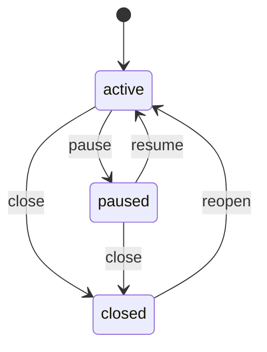
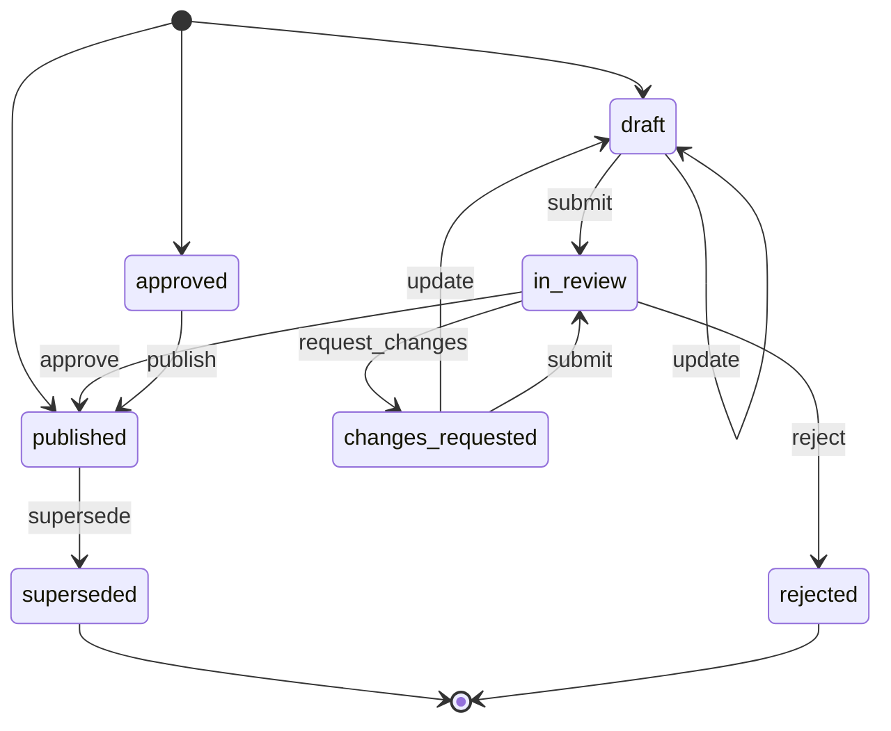
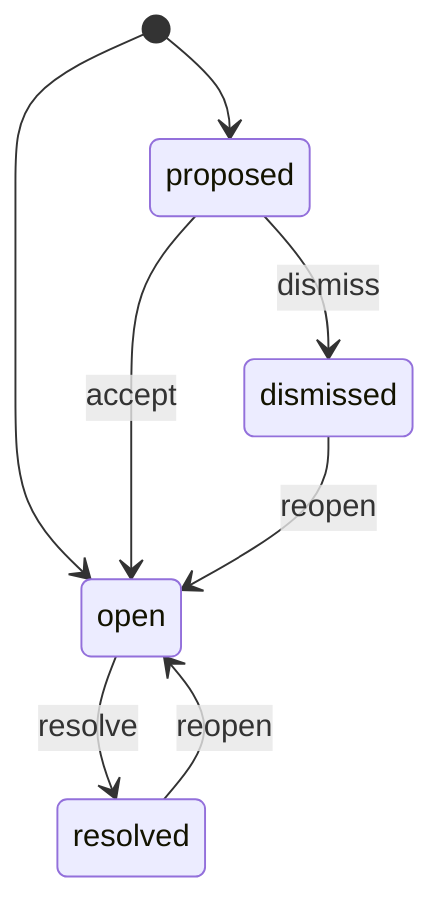
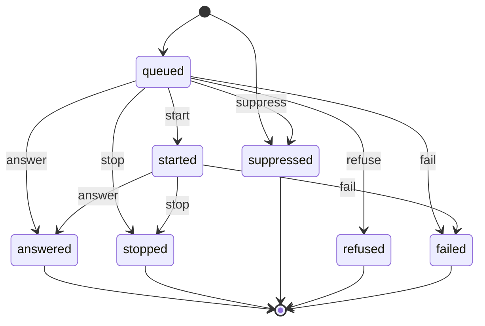
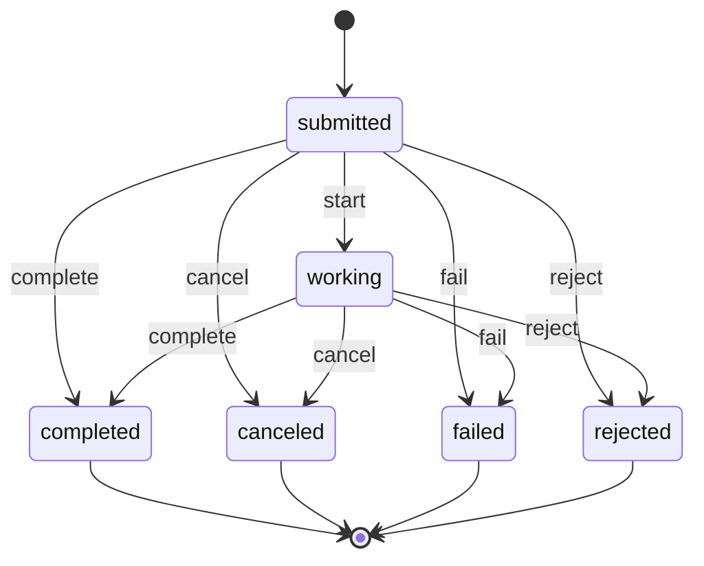
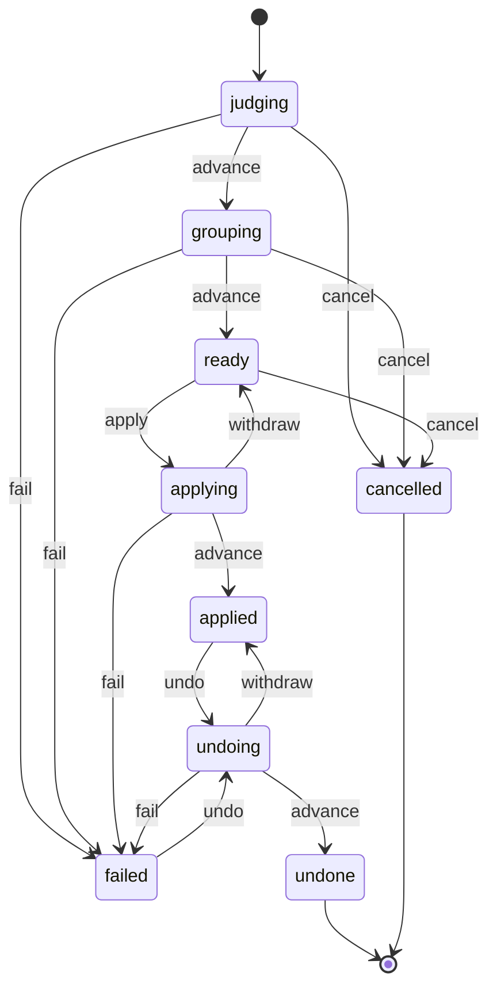
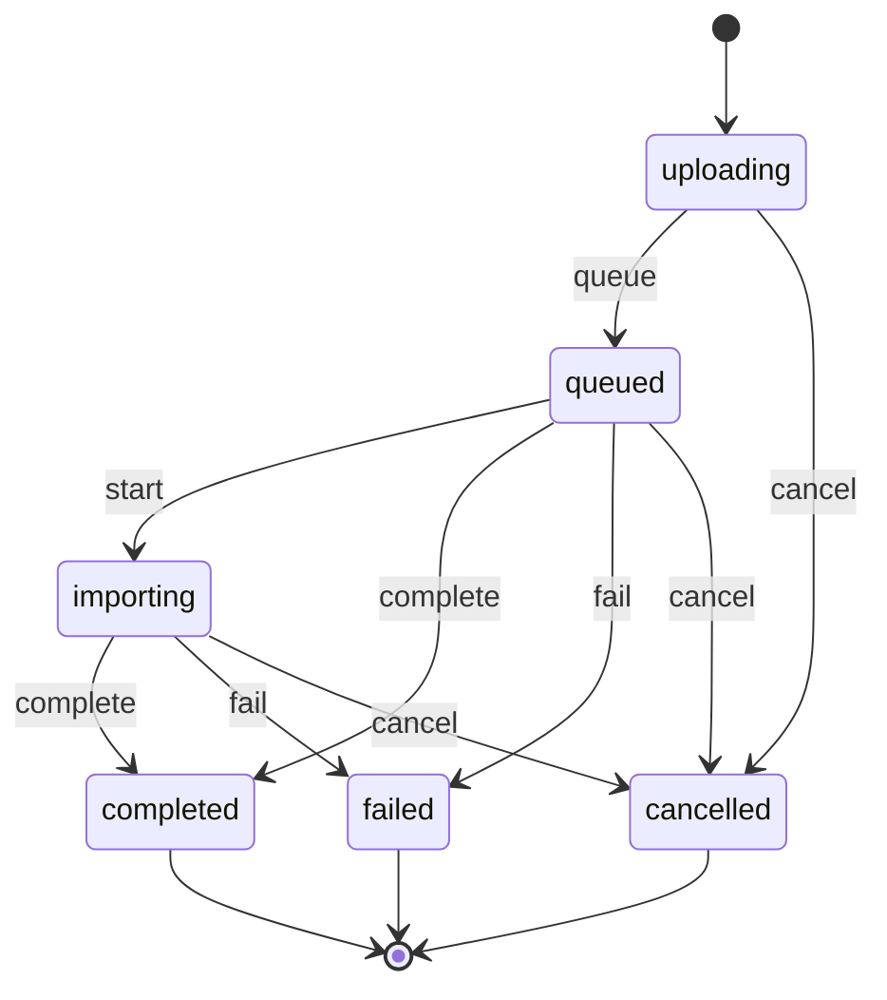

# Lifecycles

<!-- Generated by apps/workspace/bff/lifecycles/registry.spec.ts from the declarations in code. Do not edit;
     change the declaration and run: UPDATE_FIXTURES=1 bunx vitest run bff/lifecycles/registry.spec.ts -->

Every record whose states and legal moves are declared in code, as the code declares them. Why they are
declared this way, and which machines are not here yet: [ADR-0178](../adr/0178-lifecycles-are-declared-as-statechart-tables.md).

## project

A project: running, parked, or finished and kept as the reference of the office (ADR-0098).

Stored in `projects.status`. Declared in [`bff/projects/project-status.ts`](../../apps/workspace/bff/projects/project-status.ts).

Born as `active`. Final: none.

| From | Move | To |
|---|---|---|
| `active` | `pause` | `paused` |
| `active` | `close` | `closed` |
| `paused` | `resume` | `active` |
| `paused` | `close` | `closed` |
| `closed` | `reopen` | `active` |

## document-version

One version of a document on its way through review to publication (ADR-0104).

Stored in `document_versions.state`. Declared in [`bff/documents/version-lifecycle.ts`](../../apps/workspace/bff/documents/version-lifecycle.ts).

Born as `draft`, `published`, `approved`. Final: `superseded`, `rejected`.

| From | Move | To |
|---|---|---|
| `draft` | `update` | `draft` |
| `draft` | `submit` | `in_review` |
| `in_review` | `approve` | `published` |
| `in_review` | `request_changes` | `changes_requested` |
| `in_review` | `reject` | `rejected` |
| `changes_requested` | `update` | `draft` |
| `changes_requested` | `submit` | `in_review` |
| `approved` | `publish` | `published` |
| `published` | `supersede` | `superseded` |

## annotation

A mark on a page of a document: proposed by the agent or set by a person, then resolved or dismissed.

Stored in `document_annotations.status`. Declared in [`bff/annotations/lifecycles.ts`](../../apps/workspace/bff/annotations/lifecycles.ts).

Born as `proposed`, `open`. Final: none.

| From | Move | To |
|---|---|---|
| `proposed` | `accept` | `open` |
| `proposed` | `dismiss` | `dismissed` |
| `open` | `resolve` | `resolved` |
| `resolved` | `reopen` | `open` |
| `dismissed` | `reopen` | `open` |

## agent-wake

One time the agent was woken on a mark (a mention, a reply, a delegation) and what came of it (ADR-0106).

Stored in `agent_wakes.status`. Declared in [`bff/annotations/lifecycles.ts`](../../apps/workspace/bff/annotations/lifecycles.ts).

Born as `queued`, `suppressed`. Final: `answered`, `stopped`, `suppressed`, `refused`, `failed`.

| From | Move | To |
|---|---|---|
| `queued` | `start` | `started` |
| `queued` | `answer` | `answered` |
| `queued` | `stop` | `stopped` |
| `queued` | `suppress` | `suppressed` |
| `queued` | `refuse` | `refused` |
| `queued` | `fail` | `failed` |
| `started` | `answer` | `answered` |
| `started` | `stop` | `stopped` |
| `started` | `fail` | `failed` |

## agent-ask

A question another agent put to the agent, as an A2A task.

Stored in `agent_asks.state`. Declared in [`bff/agent-asks/ask-wire.ts`](../../apps/workspace/bff/agent-asks/ask-wire.ts).

Born as `submitted`. Final: `completed`, `canceled`, `failed`, `rejected`.

| From | Move | To |
|---|---|---|
| `submitted` | `start` | `working` |
| `submitted` | `complete` | `completed` |
| `submitted` | `cancel` | `canceled` |
| `submitted` | `fail` | `failed` |
| `submitted` | `reject` | `rejected` |
| `working` | `complete` | `completed` |
| `working` | `cancel` | `canceled` |
| `working` | `fail` | `failed` |
| `working` | `reject` | `rejected` |

## root-sort-run

A run that sorts the loose files at the root of a shelf into folders, for a person to review, apply and undo.

Stored in `root_sort_runs.status`. Declared in [`bff/filing/root-sort-types.ts`](../../apps/workspace/bff/filing/root-sort-types.ts).

Born as `judging`. Final: `undone`, `cancelled`.

| From | Move | To |
|---|---|---|
| `judging` | `advance` | `grouping` |
| `judging` | `cancel` | `cancelled` |
| `judging` | `fail` | `failed` |
| `grouping` | `advance` | `ready` |
| `grouping` | `cancel` | `cancelled` |
| `grouping` | `fail` | `failed` |
| `ready` | `apply` | `applying` |
| `ready` | `cancel` | `cancelled` |
| `applying` | `advance` | `applied` |
| `applying` | `withdraw` | `ready` |
| `applying` | `fail` | `failed` |
| `applied` | `undo` | `undoing` |
| `undoing` | `advance` | `undone` |
| `undoing` | `withdraw` | `applied` |
| `undoing` | `fail` | `failed` |
| `failed` | `undo` | `undoing` |

## mail-import

The import of one mail archive into a project.

Stored in `mail_imports.status`. Declared in [`bff/db/schema/mail-imports.ts`](../../apps/workspace/bff/db/schema/mail-imports.ts).

Born as `uploading`. Final: `completed`, `failed`, `cancelled`.

| From | Move | To |
|---|---|---|
| `uploading` | `queue` | `queued` |
| `uploading` | `cancel` | `cancelled` |
| `queued` | `start` | `importing` |
| `queued` | `complete` | `completed` |
| `queued` | `fail` | `failed` |
| `queued` | `cancel` | `cancelled` |
| `importing` | `complete` | `completed` |
| `importing` | `fail` | `failed` |
| `importing` | `cancel` | `cancelled` |
