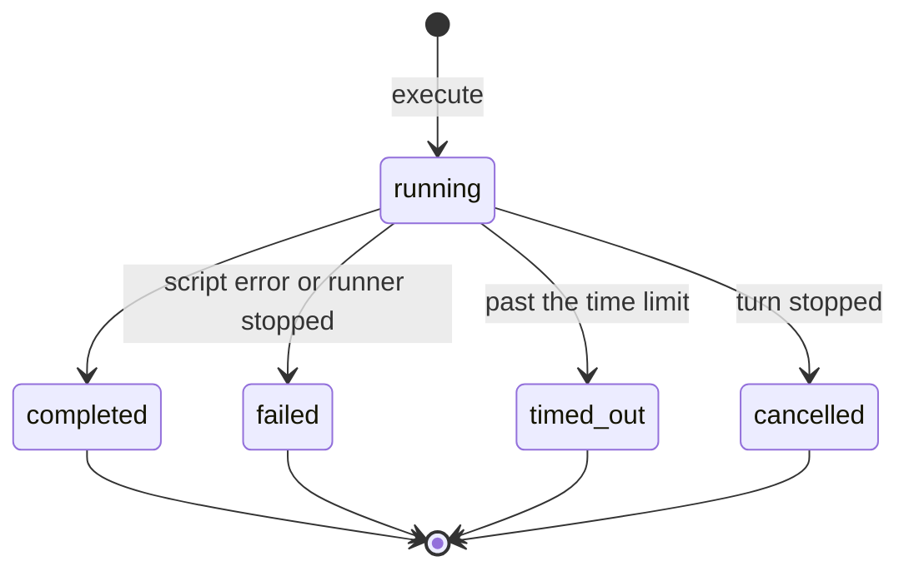

# The agent's `execute` tool: code in an isolate, nothing more

**Status:** proposed, 2026-11-12. Nothing here is built. It runs in our cluster; the
numbers marked *measured* were taken on a development machine to size that
deployment.

## Summary

| | |
|---|---|
| **What** | The agent gets one tool, `execute`. It runs a short JavaScript program the agent wrote, with the documents it needs, and returns the files the program made. |
| **Why** | Today the agent reads and writes about the work. With `execute` it does the work: totals and ratios from code instead of the model's head, documents checked against each other, Word and Excel files the office opens without explanation. Large documents are processed in code, so less of an office's text reaches the model provider. |
| **How** | Each run gets a fresh isolate with no network, thrown away afterwards, inside a pod that holds nothing worth taking. Files in, files out, nothing kept in the runtime. The shape of Anthropic's code execution tool, on our own cluster. |
| **Effort and cost** | A handful of small pieces, most beside things that exist. A run takes a fraction of a second; the runner is stateless and scales with KEDA. No new vendor, no new processor of office data, nothing to ask IPAX. |
| **What it can make** | Whatever the approved libraries can build: Word, Excel, PowerPoint, PDF and charts to start. A new file type is a library and a skill, never a new tool. |
| **Needs a decision** | The isolate engine (a one-day test of two candidates decides), where `/workspace/` files are stored, and the limits per run. |

## What this is

The agent gets one new tool, `execute`. It runs a short JavaScript module the agent
wrote, with the files it needs handed in, and returns the files the module wrote.
The module runs in a fresh V8 isolate with no network, which is thrown away
afterwards. Nothing lives in the runtime between runs.

That is the shape of Anthropic's code execution tool and of Cloudflare's Code Mode:
one verb, files in, files out, the sandbox someone else's concern. State stays in the
stores the product already has; the runtime only computes.

## What this enables

Office files instead of Markdown is the first use, not the reason. The reason is that
the agent can now *compute* instead of *write about computing*: arithmetic, tables,
comparisons and files come out of code that ran, so they are exact, repeatable and
inspectable. Each example below names the part of the product it builds on. They
are examples to justify the capability, not a roadmap.

### Files the office already uses

| Example | What happens | Builds on |
|---|---|---|
| The Aktenvermerk on the office's Briefpapier | The agent writes the text, the script lays it into the office's Word template from the Büroablage, the person files it | Writing (VISION.md), the Büroablage, filing (ADR-0054) |
| The Flächenaufstellung as Excel | The script reads the model's published quantities and writes one sheet per storey with real `SUM` formulas, rooms without an area listed and counted | `bff/bim/schedule.ts`, which already computes it and offers only CSV |
| The Bauherrenbesprechung deck | Five slides: status, open points, cost development as a chart, next dates | Project memory, tasks, the inbox |
| The Planliste in the office's own layout | Every drawing in the project with index, date and status, in the office's Excel template | Documents and Fassungen |

### Numbers that have to be right

| Example | What happens | Builds on |
|---|---|---|
| Ratios and totals for an Einreichung | BGF, NGF, GFZ, the share of usable area, computed from the model's quantities with each input shown | The model's Raumbuch; the OIB checks already name thresholds |
| A requirement that is a calculation | Parking spaces, bicycle spaces or playground area from the uses and areas the project records, with the rule's clause cited | The Einrichtung's facts, the legal corpus |
| Checking the agent's own arithmetic | Before an answer states a total, the script recomputes it from the cited figures; a mismatch is reported, not smoothed over | The Herleitung: the run becomes a row of the derivation, so the work is visible and repeatable |

A model adding up forty room areas in its head is a guess. A script doing it is a
result, and the script is the proof.

### Checking and reconciling many documents

| Example | What happens | Builds on |
|---|---|---|
| Planliste against the files | Compare the drawing register with the documents actually filed: missing drawings, stale indices, dates that disagree | Documents, versions |
| Areas across sources | The areas in the Baubeschreibung against the model and the drawings' area tables, with every difference listed | Grounding with citation keys (ADR-0061) |
| Consultants' figures | Merge the cost estimates of three consultants, each in its own Excel layout, into one table by ÖNORM B 1801-1 cost group | Uploads, the Büroablage |

In a run the documents are processed by code, and only the findings reach the model.
That is faster, cheaper, and sends less of an office's text to the model provider
(ADR-0167).

### Work in the background

| Example | What happens | Builds on |
|---|---|---|
| The Raumbuch for every project, tonight | A Hatchet parent task fans out into one agent run per project | Aufgaben, Zeitpläne, Hatchet (ADR-0150) |
| A monthly status for the office | Open points, deadlines and recent filings per project, as one Excel and one PDF | Tasks, inbox, project memory |
| After a model revision | Regenerate the Flächenaufstellung and the Planliste, file them as new Fassungen for review | Model revisions, versions |

### The agent's own work

- **An office's own procedures as code.** A skill can carry a script: the office's
  way of laying out a Raumbuch, its fee calculation sheet, its export for the
  authority's form.
- **Interactive outputs.** A run can write an HTML page: a table to filter, a chart
  to hover, a checklist to tick. Showing it beside the chat is a later step (MCP
  Apps, ADR-0142); producing it is this one. Until that step, the output check
  accepts an HTML file only as a file to download, never rendered inside the app.
  When it is shown, it is served from an origin separate from the application, in a
  frame sandboxed with `allow-scripts` alone (no `allow-same-origin`, popups, forms or
  top navigation), under `default-src 'none'; script-src 'unsafe-inline';
  style-src 'unsafe-inline'; img-src data: blob:; font-src data:; form-action 'none';
  base-uri 'none'`. Its scripts run but cannot read the app, and no fetch, image,
  font, style or form can reach another host. One channel stays open, because CSP
  has no directive for it since `navigate-to` was dropped: the frame can navigate
  itself to a URL that carries data. What it could leak is the file's own content,
  which the viewer can already see, so the risk is a page that a prompt injection
  filled with something the person did not mean to send. Accepted when the display
  step is designed, or HTML is shown without scripts.
- **The builtin research skills** that call Deep Agents' shell `execute` and are
  switched off in production (`configs/config_oib_openrouter.yml`: "it needs a
  sandbox this config does not run") are written for Python. They would need a
  JavaScript version to run here; see "Two `execute` tools" below.

### What it does not enable

- **Python and LibreOffice inside a run.** The runtime is JavaScript and
  WebAssembly. JavaScript counterparts of the office libraries (ExcelJS, docx, a PDF
  and a chart library) are preloaded; Word and Excel files were produced in the test.
  Conversion to PDF stays with Gotenberg.
- **Reading IFC inside a run.** The schedule the BFF already computes is handed in.
- **Large scans and models.** A run's memory is limited; files above the size limits
  below stay with the services built for them.

## The tool

| Tool | One-line description for the model | Change |
|---|---|---|
| `ls`, `glob`, `grep`, `read_file` | Read any mount: `/project/`, `/office/`, `/chat/`, `/law/oib/`, `/skills/`, and `/workspace/`, your own files. On a document mount the result is cited; a `/workspace/` file is your own work, never evidence | `/workspace/` added as a mount |
| `write_file`, `edit_file` | Create or change a file under `/workspace/`, the only writable folder | Reach `/workspace/` instead of `/drafts/` |
| `execute` | Run a JavaScript module (not a shell command) with no network. It sees `/workspace/`, and each document named in `inputs` read-only at its own path. Files it writes under `/workspace/` are kept | New |
| `file_to_project` | File a `/workspace/` file into the project after the person's yes; `submit` sends it for review | Replaces `file_draft`, which files only `/drafts/<name>.md` |

- **`/workspace/` replaces `/drafts/`.** One writable folder per conversation. A draft
  is an `.md` file in it. Existing draft paths are mapped the way `/entwuerfe/` was
  mapped to `/drafts/` (`modernize_draft_path` in
  `packages/agent/src/agent/tools/documents/draft_store.py`).
- **One document, one path.** A document named in `inputs` appears inside the run at
  the path `read_file` uses, `/project/…/Plan.pdf`, read-only, and its text at
  `/project/…/Plan.pdf.md`. The model never maps between two names for one file.
- **What a run's figures cite.** Each run is one row of the Herleitung: the script,
  its inputs with their citation keys, its outputs. A file the office kit writes
  carries a sources sheet listing those keys. The script's own arithmetic is shown,
  not cited.
- **Two `execute` tools.** Deep Agents' own `execute` runs a shell command over
  `/shared/` in deep research, when a sandbox is configured; production configures
  none. Ours runs JavaScript. The rule: the two are never bound in the same agent, and
  our description says "JavaScript module, not a shell command" in its first line,
  because models are trained on `execute` and `Bash` taking shell commands. Deep
  Agents' composite backend sends its `execute` only to the default backend
  (`deepagents/backends/composite.py`), which for chat is the read-only estate, so
  ours is a tool of our own either way.

## Libraries and skills

**A new file type is a library and a skill, never a new tool.** The libraries are
what the agent can build with; the skills teach it how.

**The approved set.** The runner image carries a fixed set of libraries, pinned in one
manifest beside the runner. Each is bundled ahead of time into one module and handed
to every isolate as a preloaded module, which the script imports by name. A run has no
network and no package manager, so nothing outside the manifest exists inside a run:
the allowlist is enforced by construction, not by a check that could be skipped. Only
the modules a script imports are loaded, which keeps a run fast.

**What a library must pass to be admitted,** each checked in CI by the PR that adds it:

| Check | Why |
|---|---|
| A permissive licence: MIT, Apache-2.0, BSD or ISC (a dual MIT-or-GPL package taken under MIT) | The runner ships it |
| Pure JavaScript or WebAssembly, no native add-on | An isolate has no Node native modules |
| Runs without generating code from strings | The isolate forbids `eval` and `new Function`. Vega fails without its interpreter mode; found in the test |
| A smoke script that produces its file type in a fresh isolate | The only proof that it works where it runs |
| A size budget and the repository's vulnerability scan | Load time per run, and known holes |

**The starting set** (npm, read on 2026-11-12):

| File type | Library | Licence | Status |
|---|---|---|---|
| Word | `docx` 9.15.3 | MIT | Tested: a Word file in 72 ms |
| Word, the office's own templates | `docxtemplater` 3.71.1 with `pizzip` 3.3.0 | MIT (pizzip MIT or GPL) | Candidate |
| Excel | `exceljs` 4.4.0 | MIT | Tested: a sheet with a `SUM` formula in 188 ms. Last release 2023; already a dependency of the workspace app |
| PowerPoint | `pptxgenjs` 4.0.1 | MIT | Candidate |
| PDF | `pdf-lib` 1.17.1 | MIT | Candidate; last release 2021. Word to PDF can instead go through Gotenberg after the run |
| Charts | `vega` 6.4.0, `vega-lite` 6.5.0, `vega-interpreter` 2.3.2 | BSD-3-Clause | Tested: a bar chart as SVG in 102 ms, with the interpreter |
| Numbers and data | `decimal.js` 10.6.0 (exact decimals for areas and money), `papaparse` 5.7.1 (CSV), `date-fns` 4.4.0 | MIT | Candidates |
| Office kit | Ours: the office's branding, area schedules, the sources sheet | | To build |

**Skills per file type.** A builtin skill collection, `office`, with one skill each
for Word, Excel, PowerPoint, PDF and charts, loaded through the skills middleware the
agent already runs (ADR-0135), so the model reads only the one it needs. Each says
when to use it, which library and kit functions to call, a worked example, and the
pitfalls of its type: Excel saves formulas without computed values, German number
formats, A4, ÖNORM B 1801-1 cost groups for costs, and what the output check refuses.
Anthropic's Apache-2.0 document skills are source material; they assume Python, a
shell and LibreOffice, so they are rewritten for this runtime.

The `execute` description stays short: JavaScript, no network, the list of libraries,
and "read `/skills/office/<type>/` before writing a file of that type".

## One run

1. The model calls `execute(code, inputs)`.
2. The workspace backend fetches each input's original bytes and text through the
   workspace API, as the person, so folder rights and licensed-copy refusals apply
   and the download log records each one.
3. It sends the module, the conversation's `/workspace/` files and the inputs to the
   runner.
4. The runner loads a fresh isolate with no network, runs the module with a time and
   memory limit, collects what it wrote under `/workspace/`, and discards the
   isolate.
5. Each new or changed file passes the output check (allowed types, no macros, no
   external links or embedded objects, size limits). The backend stores the files
   that pass and records the run in the Herleitung.
6. The model gets the module's return value, its log, and the list of files written.

**One run at a time per conversation.** The backend runs a conversation's `execute`
calls one after another, so two calls in one model response never write back from
the same snapshot of `/workspace/`. The second starts from the files the first kept.
Runs of different conversations still run side by side.

Nothing persists in the runner. A second run sees the files the first one kept,
because they are in `/workspace/`, not because the isolate survived.

## Isolation

Two layers. Each stops the ordinary failure; what they leave open is stated below:

| Layer | What it stops |
|---|---|
| **A fresh V8 isolate per run**, no network (`globalOutbound: null` or no network binding at all), a time limit and a memory limit | The script reaching anything beyond its inputs, looping forever, or exhausting memory |
| **A runner pod with nothing in it**: no egress, no secrets, no service account token, no stored files, no other tenant's data at rest | A script that escaped its isolate finds no data at rest and no route out |

**What the two layers do not stop.** Runner pods are shared, so runs of different
offices can be in flight on the same pod at once. A script that escaped its isolate
could read another run's inputs in that pod's memory and copy them into its own
output files, which go back to its own office; the missing network does not stop
that path. Accepted for now, because an escape needs a bug in the isolate engine.
The window is not small: the office files measured take well under a second, but the
limit lets a run hold a pod for 60 s by default and 180 s at most, so an escaped
script can wait for other runs to arrive. The output check sees only file types,
not contents, so it does not catch the copy. The way to close it is one runner deployment per organization: each office's
runs on pods of its own, at the cost of a minimum of pods per office instead of a
shared pool. This is decision 5 below.

The isolate engine is the open choice:

| Engine | For | Against |
|---|---|---|
| workerd with its dynamic Worker loader | Cloudflare's own runtime and the base of Code Mode. Tested on 2026-11-12: Word in 72 ms, Excel with a formula in 188 ms, `fetch` refused | Self-hosted workerd refuses to start this without `--experimental`, an "experimental feature which may change or go away"; its README says an isolate alone is not hardened against untrusted code; Check Point published an escape in 2026, since fixed |
| isolated-vm in a Node service | V8 isolates in our own Node process, ISC, 7.0.2 of 2026-10-30, no experimental flag | Not tested with the office libraries; no Node APIs inside, so `fs` is ours to provide |

A one-day spike runs the same Word and Excel scripts on both and decides.

## State and lifecycle

**Executions** have one short lifecycle and are not stored:

A stopped turn cancels its run. A runner stopped mid-run fails the run, and the agent
may try once more; it never retries silently twice.

**Files** live in the conversation's `/workspace/`, in the store the drafts use today:
a LangGraph store on the Python service's checkpoint database, namespaced by
conversation, capped at 256 KB per conversation for Markdown
(`draft_store.py`, `MAX_DRAFT_BYTES`). Office files are larger and binary, so
`/workspace/` needs either a higher cap there or its bytes in the object store the
documents already use, keyed by conversation. That is the one storage decision this
design leaves open. Either way, `/workspace/` is deleted with its conversation, and a
filed file is a project document with the project's own versions, backups and
deletion.

## Running it in the cluster

- **A plain Deployment.** The runner holds no state, so pods are interchangeable: no
  volume, no handoff, no bucket.
- **Scaling with KEDA** on CPU and memory (the cluster serves `metrics.k8s.io`
  through metrics-server and has no Prometheus adapter, see
  [`kubernetes.md`](../deployment/kubernetes.md)), plus a trigger on Hatchet's
  backlog for file-producing background runs through the existing
  `hatchetBacklogQuery` (`deploy/pulumi/src/app/keda-scaling.ts`). At least 2
  replicas so a restart never stops all runs.
- **A NetworkPolicy** with no egress at all, and ingress only from the agent tiers.
- **Hatchet runs whole agent runs, not each `execute`.** A run inside a turn takes a
  fraction of a second; a queue hop would make the person wait. Background work
  ("the Raumbuch for every project tonight") is a Hatchet parent task fanning out into
  agent runs, with per-organization round-robin concurrency and retries (ADR-0150).

## Limits (proposed)

| Limit | Proposed | Why |
|---|---|---|
| Run time | 60 s default, 180 s maximum | Office files take well under a second (*measured*); this is a ceiling against loops |
| Memory per run | 128 MB | Cloudflare Workers' own per-isolate limit; enough for the tested files |
| Concurrent runs per pod | 8 | Worst case: 70 MB for workerd + 8 × (128 MB per isolate + 50 MB of inputs held for it) ≈ 1.5 GB, inside a 2 GiB limit. The measured peak (925 MB for 20 runs) is typical use, not the budget |
| Concurrent runs per organization | 4 | One office cannot starve the others |
| Inputs per run | 50 MB in total | Drawings and scans stay with the services built for them |
| Output files | all checked before the card | The output check is not optional |

## Resources

*Measured* on a development machine, 2026-11-12:

| Measure | Value | Setup |
|---|---|---|
| One run writing a Word file | 72 ms | workerd isolate, no workspace |
| One run writing an Excel file with a formula | 188 ms | same |
| 20 runs at once | 2.7 s for all twenty, 925 MB peak | workerd with Cloudflare Computer's workspace, an upper bound for a stateless runner |
| Idle workerd | 67 to 70 MB | same |

So a pod requests 1 vCPU and 1 GiB, with a 2 GiB limit sized from the worst case above;
KEDA adds pods for bursts. Next to the model tokens of the turn that writes the script, a run
costs little, and it lowers those tokens: documents are processed in the run and only
a summary reaches the model.

## Observability

- **Langfuse:** one span per `execute` (module size, inputs, duration, files written
  and their sizes, outcome) under the turn's trace
  ([`langfuse.md`](../observability/langfuse.md)).
- **Metrics:** runs per minute, duration p50 and p95, failures by kind (script,
  timeout, memory, output refused), replicas.
- **Alerts:** failure rate above its baseline, replicas at the maximum.

## Considered and dropped

Each rejection names the premise it rests on, so a later reader re-checks the premise.

- **Cloudflare Computer's durable workspace** (`@cloudflare/computer` 0.11.2, tested
  on self-hosted workerd: a workspace survived a restart). Its workspace lives in the
  runtime, which brought a bucket, workerd's experimental cluster mode, a retention
  sweep with its own states, and a backup question for IPAX, and left bucket
  credentials in every runner pod. *Premise:* runs need state that lives in the
  runtime between calls. Our state already has stores.
- **A container per conversation with gVisor** (kubernetes-sigs/agent-sandbox).
  *Premise:* runs need Python, LibreOffice or a shell. If they do, this comes back as a
  second backend behind the same `execute`.
- **Hosted sandboxes** (Anthropic's code execution, OpenRouter's shell tool, E2B,
  Modal, Cloudflare Containers). *Premise:* no new processor receives an office's
  documents.

## Decisions for the owner

1. The isolate engine: workerd or isolated-vm, decided by the one-day spike.
2. Where `/workspace/` bytes live: a higher cap in the draft store, or the object
   store. Whichever it is, its backups and its deletion with the conversation are
   checked before real documents go in.
3. The limits above.
4. Whether runs count toward an office's credits (ADR-0053).
5. Shared runner pods (the cross-office exposure under Isolation, accepted for now)
   or one runner deployment per organization.

## Verified and assumed

| Claim | Basis |
|---|---|
| A workerd isolate with no network writes Word and Excel files with unmodified libraries | Run on 2026-11-12: `docx` and ExcelJS, 72 ms and 188 ms; `fetch` refused |
| Dynamic loading on self-hosted workerd needs `--experimental` | workerd refused to start without it |
| A chart library runs in an isolate only without string code generation | Vega 6.4.0 failed with "Code generation from strings disallowed"; with `vega-interpreter` it rendered an SVG bar chart in 102 ms |
| The candidate libraries are pure JavaScript with permissive licences | npm registry metadata, 2026-11-12; only `docx`, `exceljs` and Vega were run in an isolate |
| Deep research's sandbox is Modal only, and production runs none | `deepagents_runtime.py` (`provider: Literal["modal"]`); `configs/config_oib_openrouter.yml` |
| Deep Agents' sandbox base runs its file commands as `python3` inside the sandbox | Installed `deepagents/backends/sandbox.py` |
| The drafts store is a LangGraph store on the checkpoint database, 256 KB per conversation | `draft_store.py` |
| isolated-vm runs the office libraries | Not tested; the spike decides |
| Models write good JavaScript against the office kit | Not measured; step 1 measures it |
