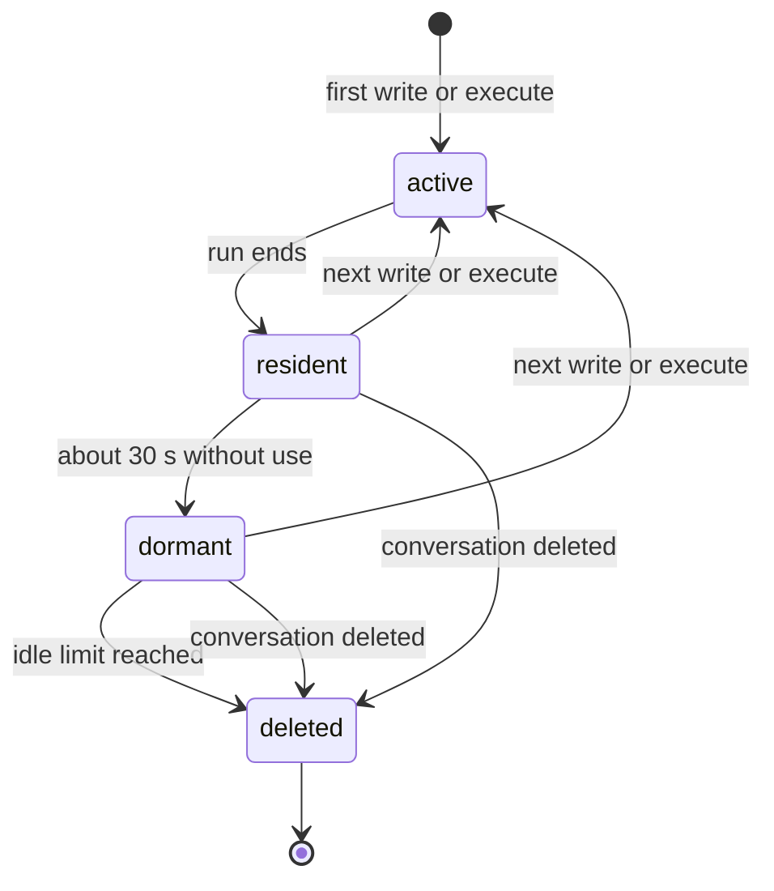
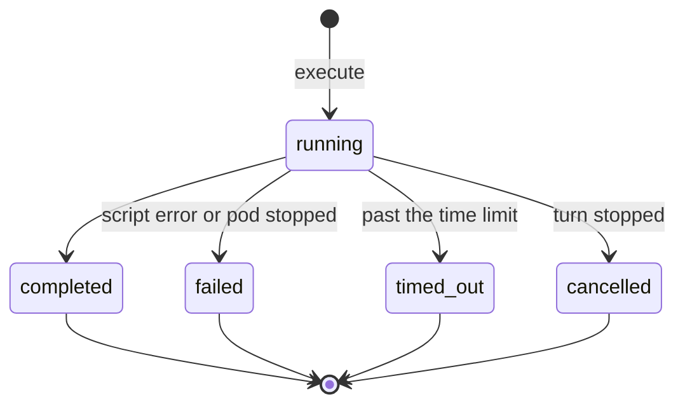

# The agent's computer: what it enables, lifecycle, state and scaling

**Status:** proposed, 2026-11-12. Nothing here is built. It runs in our cluster. The
numbers marked *measured* were taken on a development machine to size that
deployment, with `@cloudflare/computer` 0.11.2 on `workerd` 1.20261112.1; step 1
of the plan repeats them in the cluster.

## What this is

The agent gets one writable folder, `/workspace/`, beside the read-only mounts it
already reads ([ADR-0133](../adr/0133-piloti-reads-the-estate-through-standard-filesystem-tools.md)),
and one new verb, `execute`, that runs a script it wrote against that folder. What
the script writes passes an output check and is filed into the project after the
person's yes.

The runtime is Cloudflare Computer (`@cloudflare/computer`, MIT) on `workerd`,
Cloudflare's open-source Workers runtime, as a deployment in our cluster. We use the
two parts its status table marks stable:

- **Workspace**: a filesystem per conversation, kept in a Durable Object as SQLite.
- **Code Mode backend** (`CodemodeBackend`): each run is a fresh isolate with no
  network (`globalOutbound: null`), a fixed set of preloaded libraries, and the
  workspace visible through `node:fs`.

The container and shell backends, R2 mounts and the AI SDK tools need Cloudflare's
hosted products, are experimental, or are for JavaScript agents, and are left out.

## What this enables

Office files instead of Markdown is the first use, not the reason. The reason is that
the agent can now *compute* instead of *write about computing*: arithmetic, tables,
comparisons and files come out of code that ran, so they are exact, repeatable and
inspectable. Each example below names the part of the product it builds on. They
are examples to justify the capability, not a roadmap.

### Files the office already uses

| Example | What happens | Builds on |
|---|---|---|
| The Aktenvermerk on the office's Briefpapier | The agent writes the text, the script lays it into the office's Word template from the Büroablage, the person files it | Writing (VISION.md), the Büroablage, filing (ADR-0054) |
| The Flächenaufstellung as Excel | The script reads the model's published quantities and writes one sheet per storey with real `SUM` formulas, rooms without an area listed and counted | `bff/bim/schedule.ts`, which already computes it and offers only CSV |
| The Bauherrenbesprechung deck | Five slides: status, open points, cost development as a chart, next dates | Project memory, tasks, the inbox |
| The Planliste in the office's own layout | Every drawing in the project with index, date and status, in the office's Excel template | Documents and Fassungen |

### Numbers that have to be right

| Example | What happens | Builds on |
|---|---|---|
| Ratios and totals for an Einreichung | BGF, NGF, GFZ, the share of usable area, computed from the model's quantities with each input shown | The model's Raumbuch; the OIB checks already name thresholds |
| A requirement that is a calculation | Parking spaces, bicycle spaces or playground area from the uses and areas the project records, with the rule's clause cited | The Einrichtung's facts, the legal corpus |
| Checking the agent's own arithmetic | Before an answer states a total, the script recomputes it from the cited figures; a mismatch is reported, not smoothed over | The Herleitung: the script and its output become rows of the derivation, so the work is visible and repeatable |

A model adding up forty room areas in its head is a guess. A script doing it is a
result, and the script is the proof.

### Checking and reconciling many documents

| Example | What happens | Builds on |
|---|---|---|
| Planliste against the files | Compare the drawing register with the documents actually filed: missing drawings, stale indices, dates that disagree | Documents, versions |
| Areas across sources | The areas in the Baubeschreibung against the model and the drawings' area tables, with every difference listed | Grounding with citation keys (ADR-0061) |
| Consultants' figures | Merge the cost estimates of three consultants, each in its own Excel layout, into one table by ÖNORM B 1801-1 cost group | Uploads, the Büroablage |

These are the jobs where reading 300 pages into the model is slow, expensive and
error-prone. In the workspace the documents are processed by code, and only the
findings reach the model. That also sends less of an office's text to the model
provider (ADR-0167).

### Work in the background

| Example | What happens | Builds on |
|---|---|---|
| The Raumbuch for every project, tonight | A Hatchet parent task fans out into one agent run per project, each with its own workspace | Aufgaben, Zeitpläne, Hatchet (ADR-0150) |
| A monthly status for the office | Open points, deadlines and recent filings per project, as one Excel and one PDF | Tasks, inbox, project memory |
| After a model revision | Regenerate the Flächenaufstellung and the Planliste, file them as new Fassungen for review | Model revisions, versions |

### The agent's own work

- **Skills that can finally run.** Six of the builtin research and synthesis skills
  are written to call `execute` and to read and write `/shared/`, and are marked as
  unable to run in a chat turn for exactly that reason
  ([ADR-0046](../adr/0046-agent-skills.md)). They are written for Python; on this
  runtime they need a JavaScript version, or stay in deep research.
- **An office's own procedures as code.** A skill can carry a script: the office's
  way of laying out a Raumbuch, its fee calculation sheet, its export for the
  authority's form.
- **Interactive outputs.** The same workspace can write an HTML page: a table to
  filter, a chart to hover, a checklist to tick. Showing it beside the chat is a
  later step (MCP Apps, ADR-0142); producing it is this one.

### What it does not enable

- **Python and LibreOffice inside a run.** The runtime is JavaScript and
  WebAssembly. The Python libraries the hosted sandboxes use (pandas, python-docx)
  are not available; their JavaScript counterparts (ExcelJS, docx, a PDF and a chart
  library) are, and were tested. Conversion to PDF stays with Gotenberg.
- **Reading IFC inside a run.** The schedule the BFF already computes is handed in.
  Parsing IFC in the isolate would need a WebAssembly IFC library; not tested.
- **Large scans and models.** A run's memory is limited; files above the size
  limits below stay with the services built for them.

## The objects and how long each lives

| Object | Where it lives | Born | Ends | Who ends it |
|---|---|---|---|---|
| **Isolate** | Memory of the pod serving the run | Each `execute` | When the run returns, fails or times out; unloaded about 30 s later (*measured*) | Code Mode backend |
| **Execution** | The workspace's run journal | Each `execute` | Disposed as soon as the agent has read its result | The agent's workspace backend (`disposeExec`) |
| **Workspace** | A Durable Object: its data in the workspace bucket, cached on the disk of the pod that serves it | The agent's first write to `/workspace/` or first `execute` in a conversation | When its conversation is deleted, or after the idle limit, whichever comes first | Hatchet (`workspace-retention`) and the conversation's deletion path |
| **Workspace record** | A row in Postgres (`agent_workspaces`), owned by the BFF | With the workspace | With the workspace | Same as the workspace |
| **Output file** | Inside the workspace, under `/workspace/out/` | Written by a script | With the workspace, unless filed | Filing copies it out |
| **Filed document** | A document version in the project | The person's yes | Under the project's own rules | Nothing here: once filed it is a project document like any other |
| **Background run** | Hatchet task | A scheduled or delegated task | Hatchet's own retention | Hatchet (ADR-0150) |

The workspace is scratch. The record of what the office keeps is the filed document,
which already has versions, review, backups and deletion.

## Workspace states

| State | Memory | Storage | What happens there |
|---|---|---|---|
| `active` | Isolate plus the Durable Object | Bucket, cached on the pod | A script runs, or the agent reads or writes a file |
| `resident` | The Durable Object only | Same | Between runs within a turn |
| `dormant` | None that counts (see the memory floor below) | Bucket | Most workspaces, most of the time. Reopens on demand, on any pod |
| `deleted` | None | None | The Durable Object's storage is cleared, the record row removed |

When this is built, `active`, `dormant` and `deleted` become a declared lifecycle in
code ([ADR-0179](../adr/0179-lifecycles-are-declared-as-statechart-tables.md)) on the
`agent_workspaces` row. `resident` is workerd's business and is not recorded.

## Execution states

- **Time limit:** Code Mode's defaults are 60 s per run and 180 s at most. Office
  files take well under a second (*measured*: 272 ms for a Word file including the
  workspace round trip), so 60 s is a ceiling against loops, not a budget.
- **Stopped turn:** the agent kills the run (`handle.kill()`).
- **Pod stopped mid-run** (scale-in, upgrade, node replacement): Computer reconciles a
  run that was live across a restart to `failed`; the workspace moves to another pod
  intact. The agent sees a failed run and may try once more; it never retries
  silently twice.
- **Journal:** the agent disposes every run after reading its result, so the journal
  does not grow with the conversation.

## Limits (proposed)

Starting values for the owner to confirm, each one constant in one place.

| Limit | Proposed | Why |
|---|---|---|
| Run time | 60 s default, 180 s maximum | Code Mode's defaults; office files take under a second |
| Concurrent runs per pod | 16 | Memory: about 25 MB per concurrent run on top of the floor |
| Concurrent runs per organization | 4 | One office cannot starve the others |
| Workspace size | 250 MB | Drawings and scans can be large; above that is not a job for this runtime |
| Single file into a workspace | 50 MB | Same reason |
| Idle limit | 14 days since the last write or run | A person comes back to "add a column" within days; filed files are safe in the project |
| Output files checked before the card | all | The output check is not optional |

## Who does what

**The BFF owns the record.** `agent_workspaces` (conversation, organization, created,
last used, bytes, state) is the list of what exists. workerd's own storage is keyed
by hashed object ids and cannot be listed by conversation, so the record is the only
way to find a workspace to delete, to count bytes per office, or to answer a
data-protection officer.

**Hatchet removes.** Same shapes as existing pieces:

| Task | Shape | Like |
|---|---|---|
| `workspace-retention` | Cron, hourly: claim workspaces past the idle limit, delete each, then the row; also delete any whose conversation no longer exists | `download-log-retention`, `inbound-mail-sweep` (`apps/workspace/bff/scheduling/tasks.ts`) |
| Deletion with a conversation | A `bff-job` kind enqueued by the conversation's deletion path, so a computer that is briefly unavailable does not block the deletion; the sweep catches anything left | The `bff-job` pattern (`apps/workspace/bff/jobs-queue/`) |

**Hatchet does not run each `execute`.** A run inside a turn takes a quarter of a
second, and a queue hop would make the person wait for nothing. Hatchet runs whole
agent runs in the background, as it does for research today, with
per-organization round-robin concurrency, retries and KEDA scaling (ADR-0150).

**The agent's workspace backend** creates the record on first use, updates `last
used` on each run, disposes every execution, and is the only caller of the computer.

## Running it in the cluster

workerd has a **cluster mode** for exactly this. Read in workerd's source
(`src/workerd/server/cluster/`, commit `81d1f18` of 2026-11-12):

- Each Durable Object runs on one instance at a time, and any instance routes a
  request to the owner.
- An object's data lives in an S3-compatible bucket: "A commit is acknowledged once
  the bucket holds it" (`owner.rs`). An instance's local disk is a cache; a takeover
  restores the object from the bucket (`lib.rs`).
- A stopping instance hands its objects to its peers within `stopTimeoutMs` (8 s by
  default, inside Kubernetes' 30 s grace period), and `GET /ready` on the cluster
  port is a readiness probe for rolling restarts.

So the computer is a plain **Deployment** of interchangeable pods: workspaces in a
bucket on SeaweedFS (S3-compatible, already in the cluster), an `emptyDir` as each
pod's cache, nothing pinned to a pod. That is what lets it scale.

**Scaling with KEDA.**

- A ScaledObject on the pods' CPU and memory. The cluster serves `metrics.k8s.io`
  through metrics-server, and has no Prometheus adapter for custom metrics
  ([`kubernetes.md`](../deployment/kubernetes.md), the scaling notes).
- At least **2** replicas, so a stopping pod always has a peer to hand its workspaces
  to. The maximum is set from the per-pod run limit and the load step 1 measures.
- A second trigger on Hatchet's backlog for the file-producing task kind, through the
  existing `hatchetBacklogQuery` (`deploy/pulumi/src/app/keda-scaling.ts`), so a
  nightly fan-out adds pods before the runs arrive.
- Per pod: request 1 vCPU and 1 GiB, limit 2 GiB (*measured* basis below).

**Upgrades** are rolling restarts: each pod hands off its workspaces and leaves.
Runs in flight on it fail once and are retried by the agent.

**Pinned versions.** workerd refuses to load isolates dynamically without
`--experimental` ("may change or go away in the future"), and cluster mode needs the
same flag. `@cloudflare/computer` was first published on 2026-07-29. Both are pinned;
an upgrade is a deliberate change with the measurements rerun.

## Storage, backups and data protection

- **Where the data is:** the workspace bucket on SeaweedFS, in the cluster at IPAX,
  already a processor. No new recipient. The workspace becomes one more in-cluster
  store in the deletion section of
  [`dpa-subprocessor-annex.md`](../compliance/dpa-subprocessor-annex.md), with its
  bound: deleted with the conversation, or after the idle limit.
- **Backups:** IPAX's Velero copies every persistent volume nightly and keeps it 30
  days ([`kubernetes.md`](../deployment/kubernetes.md#cluster-backups-ipax-velero)).
  A bucket on the existing SeaweedFS volume is therefore in those backups, and a
  deleted workspace stays in them for up to 30 days. Either state that in the annex,
  or give the workspace bucket its own SeaweedFS volume labelled
  `velero.io/exclude-from-backup=true` (the standard Velero exclusion; confirm IPAX's
  schedule honours it). Workspaces are scratch, so excluding them loses nothing.
- **What a pod holds:** the cluster key and credentials for the workspace bucket only,
  no other secret, no service account token, no egress beyond the bucket and its
  peers. A script that escaped its isolate could read other workspaces through those
  credentials. The bounds above keep that set small (scratch, 14 days). If an office
  asks for more, the next step is one deployment per organization; the agent's side
  does not change.
- **Traffic between pods** is authenticated with the cluster key and not encrypted
  (workerd's own note); it stays on the cluster's pod network.

## What it costs, in resources

### Measured

On a development machine, 2026-11-12, one workerd process with workspaces on local
disk, a Word file built by the `docx` library in each run. Inputs were a few KB, so
disk figures are a floor.

| Measure | Value |
|---|---|
| workerd idle, nothing loaded | 67 to 70 MB |
| One run: write inputs and build a Word file | about 200 to 270 ms |
| 20 runs at once, each in its own workspace | 2.7 s for all twenty, 925 MB peak |
| Memory after a burst, 30 s idle | drops (463 MB to 325 MB after 20 workspaces) |
| Memory floor after 40, 80, 120, 160 workspaces, 45 s idle each time | 495, 511, 514, 516 MB |
| Disk for 51 small workspaces | 12 MB |

The floor levels off: idle workspaces leave memory and reopen from storage. **Memory
scales with runs happening at the same moment, not with workspaces that exist.**

### Formulas

- **Memory per pod** ≈ 0.5 GB floor + 25 MB × concurrent runs on it.
- **CPU** ≈ runs per second × 0.25 s; one vCPU serves about four runs per second.
- **Pods** = what KEDA decides from CPU and memory, at least 2.
- **Bucket** ≈ new workspaces per day × average size × idle limit in days. Average size
  is dominated by the input files the agent hands in; the record table gives the real
  figure within a week of use.

Next to the model tokens of the turn that writes the script, a run costs little. It
also lowers those tokens: large documents are processed in the workspace and only a
summary reaches the model.

## Observability

- **Langfuse:** one span per `execute` (script size, duration, files written and
  their sizes, outcome), under the turn's trace
  ([`langfuse.md`](../observability/langfuse.md)).
- **Metrics:** workspaces by state, bucket bytes in total and per organization, runs
  per minute, run duration p50 and p95, failures by kind (script, timeout, pod
  stopped, output refused), replicas and pod memory.
- **Alerts:** run failure rate above its baseline, replicas at the maximum, bucket
  growth above the expected curve.

## Decisions for the owner

1. The idle limit: 14 days proposed.
2. The size limits: 250 MB per workspace, 50 MB per file proposed.
3. Workspaces in IPAX's backups, or a volume excluded from them.
4. Whether runs count toward an office's credits (ADR-0053) or are free beside the
   model tokens they save.
5. When one deployment per organization becomes the default instead of the exception.

## Verified and assumed

| Claim | Basis |
|---|---|
| Computer's workspace and Code Mode run on self-hosted workerd | Run on 2026-11-12: a script read a workspace file with `node:fs` and wrote a Word file back |
| Runs have no network | Same run: `fetch` was refused by workerd |
| Workspaces survive a restart | Same file, byte for byte, after restarting workerd |
| Dynamic loading needs `--experimental` | workerd refused to start without it |
| Memory floor levels off | Four measurements up to 160 workspaces, above |
| Cluster mode keeps objects in a bucket and hands them off on stop | workerd source, `src/workerd/server/cluster/` (`lib.rs`, `owner.rs`) and `workerd.capnp`; **not run yet** |
| Commit latency with a bucket behind every write | Not measured; step 1 measures it against SeaweedFS |
| Deleting a workspace removes its log and snapshots from the bucket | Not checked; must hold before real documents go in |
| Velero honours the exclusion label on IPAX | Not checked; ask IPAX |
| The examples above work end to end | Only the Word and Excel files were produced in the test |
