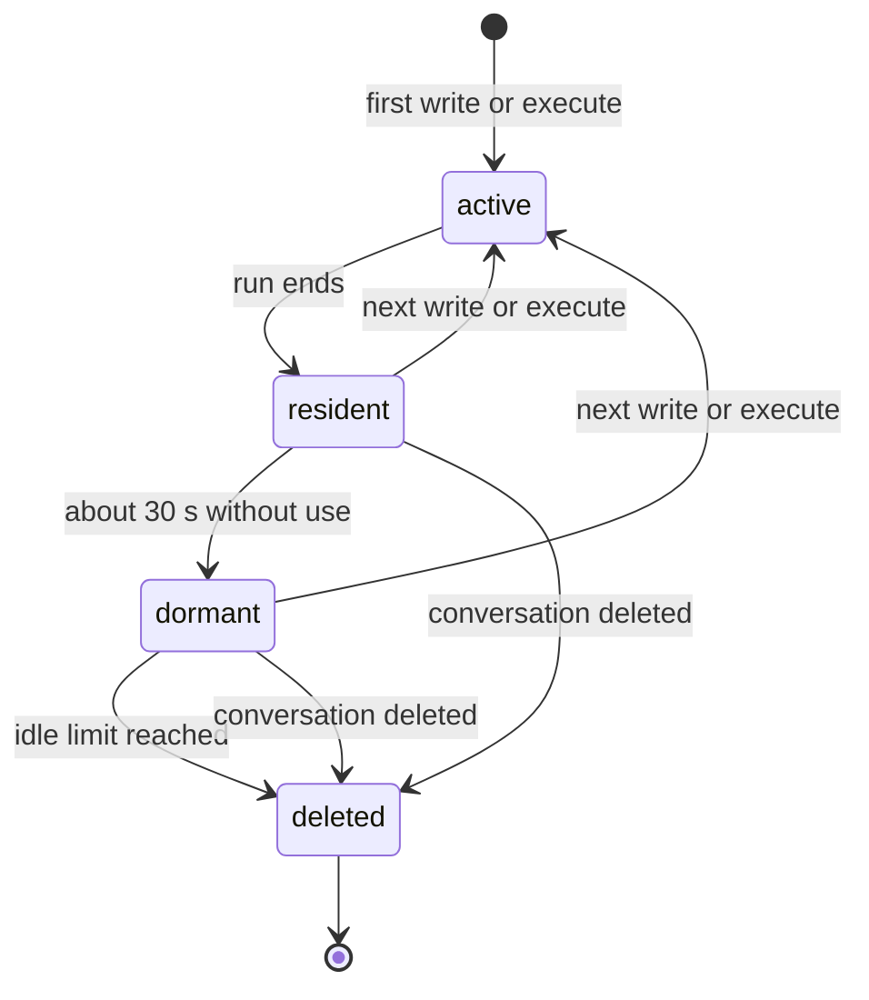
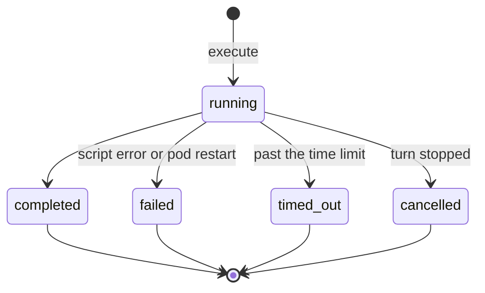

# The agent's computer: lifecycle, state and cost

**Status:** proposed, 2026-11-12. Nothing here is built. The numbers marked
*measured* come from a test of `@cloudflare/computer` 0.11.2 on self-hosted
`workerd` 1.20261112.1 on one development machine, not on the cluster.

## What this is

The agent gets one writable folder, `/workspace/`, beside the read-only mounts it
already reads ([ADR-0133](../adr/0133-piloti-reads-the-estate-through-standard-filesystem-tools.md)),
and one new verb, `execute`, that runs a script it wrote against that folder. Office files
(Word, Excel, PowerPoint, PDF) come out of the script, pass an output check, and are
filed into the project after the person's yes. The office stops seeing Markdown drafts.

The runtime is Cloudflare Computer (`@cloudflare/computer`, MIT) running on `workerd`,
Cloudflare's open-source Workers runtime, in one pod in our own cluster. We use two of
its parts that its status table marks stable:

- **Workspace**: a filesystem per conversation, stored in a Durable Object as one
  SQLite file.
- **Code Mode backend** (`CodemodeBackend`): each run is a fresh isolate with no
  network (`globalOutbound: null`), a fixed set of preloaded libraries, and the
  workspace visible through `node:fs`.

Everything else (container and shell backends, R2 mounts, the AI SDK tools) needs
Cloudflare's hosted products, is experimental, or is for JavaScript agents, and is
left out.

This page is about what lives how long, who removes it, and what it costs. The
architecture sketch, the tool surface and the threat model belong in the ADR that
accepts this design.

## The objects and how long each lives

| Object | Where it lives | Born | Ends | Who ends it |
|---|---|---|---|---|
| **Isolate** | Memory of the computer pod | Each `execute` | When the run returns, fails or times out; workerd unloads it about 30 s later (*measured*) | Code Mode backend |
| **Execution** | The workspace's run journal | Each `execute` | Disposed as soon as the agent has read its result | Workspace backend in the agent (`disposeExec`) |
| **Workspace** | One Durable Object, one SQLite file on the pod's volume | The agent's first write to `/workspace/` or first `execute` in a conversation | When its conversation is deleted, or after the idle limit, whichever comes first | Hatchet sweep (`workspace-retention`) and the conversation's deletion path |
| **Workspace record** | A row in Postgres (`agent_workspaces`), owned by the BFF | With the workspace | With the workspace | Same as the workspace |
| **Output file** | Inside the workspace, under `/workspace/out/` | Written by a script | With the workspace, unless filed | Filing copies it out |
| **Filed document** | A document version in the project | The person's yes | Under the project's own rules | Nothing here: once filed it is a project document like any other |
| **Background run** | Hatchet task (`research-run` today; a task kind for file-producing runs later) | A scheduled or delegated task | Hatchet's own retention | Hatchet (ADR-0150) |

The workspace is scratch. The record of what the office keeps is the filed document,
which already has versions, review, backups and deletion. Nothing in a workspace is
the only copy of anything a person decided to keep.

## Workspace states

| State | Memory | Disk | What happens there |
|---|---|---|---|
| `active` | Isolate plus the Durable Object | SQLite file | A script runs, or the agent reads or writes a file |
| `resident` | The Durable Object only | SQLite file | Between runs within a turn |
| `dormant` | None that counts (see the floor below) | SQLite file | Most workspaces, most of the time. Reopens on demand: a file written before a restart came back byte for byte (*measured*) |
| `deleted` | None | None | The Durable Object's storage is cleared, the record row removed |

When this is built, `active`, `dormant` and `deleted` become a declared lifecycle in
code ([ADR-0179](../adr/0179-lifecycles-are-declared-as-statechart-tables.md)) on the
`agent_workspaces` row. `resident` is workerd's business and is not recorded.

## Execution states

- **Time limit:** Code Mode's own defaults are 60 s per run and 180 s at most. Office
  files take well under a second (*measured*: 272 ms for a Word file including the
  workspace round trip), so 60 s is a ceiling against loops, not a budget.
- **Stopped turn:** the agent kills the run (`handle.kill()`), so a stopped turn
  leaves no script running.
- **Pod restart mid-run:** Computer reconciles a run that was live across a restart to
  `failed`. The workspace itself survives. The agent sees a failed run and may try
  once more; it never retries silently twice.
- **Journal:** Code Mode keeps a run's events until `disposeExec`. The agent disposes
  every run after reading its result, so the journal does not grow with the
  conversation.

## Limits (proposed)

These are starting values for the owner to confirm, chosen against the measurements
below. Each is one constant in one place.

| Limit | Proposed | Why |
|---|---|---|
| Run time | 60 s default, 180 s maximum | Code Mode's defaults; office files take under a second |
| Concurrent runs, whole pod | 16 | Memory: about 25 MB per concurrent run on top of the floor |
| Concurrent runs per organization | 4 | One office cannot starve the others |
| Workspace size | 250 MB | Drawings and scans can be large; a model or scan set above that is not a job for this runtime |
| Single file into a workspace | 50 MB | Same reason |
| Idle limit | 14 days since the last write or run | A person comes back to "add a column" within days, not months; filed files are safe in the project |
| Output files per run checked before the card | all | The output check is not optional |

## Who does what

**The BFF owns the record.** `agent_workspaces` (conversation, organization, created,
last used, bytes, state) is the list of what exists. workerd's own storage is a
directory of hashed SQLite files that cannot be listed by conversation, so the
record is the only way to find a workspace to delete, to count bytes per office, or
to answer a data-protection officer.

**Hatchet removes.** Two pieces, both the same shape as existing ones:

| Task | Shape | Like |
|---|---|---|
| `workspace-retention` | Cron, hourly: claim workspaces past the idle limit, delete each in the pod, then the row | `download-log-retention`, `inbound-mail-sweep` (`apps/workspace/bff/scheduling/tasks.ts`) |
| Deletion with a conversation | A `bff-job` kind enqueued by the conversation's deletion path, so a pod that is down does not block the deletion; the sweep catches anything left | The `bff-job` pattern (`apps/workspace/bff/jobs-queue/`) |
| Orphan sweep | Inside `workspace-retention`: a record whose conversation no longer exists is deleted | `reconcile-background-work` |

**Hatchet does not run each `execute`.** A run inside a turn takes a quarter of a
second, and a queue hop would make the person wait for nothing. Hatchet runs whole
agent runs in the background, as it does for research today: a parent task fanning
out into one agent run per project ("the Raumbuch for every project tonight") gets
per-organization round-robin concurrency, retries and KEDA scaling from ADR-0150.

**The agent's workspace backend** creates the record on first use, updates `last
used` on each run, disposes every execution, and is the only caller of the pod.

## Storage, backups and data protection

- **Volume:** one persistent volume for the pod, sized from the formula below.
  workerd stores each workspace as its own SQLite file (`durableObjectStorage.localDisk`).
- **Backups: exclude this volume.** IPAX's Velero copies every persistent volume in
  every namespace nightly and keeps it 30 days (see
  [`kubernetes.md`](../deployment/kubernetes.md#cluster-backups-ipax-velero)). A
  workspace is scratch, and a backup would keep deleted workspaces for 30 more days
  and cost backup storage, which IPAX bills per GB and hour. Label the volume
  `velero.io/exclude-from-backup=true`, the standard Velero exclusion, and confirm with
  IPAX that their schedule honours it.
- **Processor:** the volume is in the cluster at IPAX, already a processor; no new
  recipient. The workspace becomes one more in-cluster store in the deletion section
  of [`dpa-subprocessor-annex.md`](../compliance/dpa-subprocessor-annex.md), with its
  bound: deleted with the conversation, or after the idle limit.
- **What an escaped script could read:** unlike a stateless runner, this pod holds
  other conversations' workspaces on its disk. The bounds above keep that set small
  (scratch only, 14 days). If an office asks for more, the next step is one pod per
  organization, routed by organization id; the agent's side does not change.

## Restarts, upgrades and growth

- **One replica.** A Durable Object runs on one instance at a time, and the volume is
  read-write-once, so the pod is a single-replica StatefulSet. A restart or upgrade
  is seconds of downtime: runs in flight fail and the agent retries once; workspaces
  survive (*measured* across a restart).
- **Pinned versions.** Self-hosted workerd refuses to start this without
  `--experimental` and says dynamic loading "may change or go away in the future".
  `@cloudflare/computer` was first published on 2026-07-29 and is at 0.11.2. Both
  are pinned, and an upgrade is a deliberate change with the measurements below rerun.
- **Growth, in order:** a bigger pod (memory is the limit, see below); then workerd's
  cluster mode, which spreads Durable Objects over several instances and keeps their
  shared state in an S3 bucket (SeaweedFS speaks S3), also experimental; then one pod
  per organization.

## What it costs

### Measured

On a development machine, 2026-11-12, with a Word file built by the `docx` library in
each run. Workspaces were small (a few KB of input), so disk figures are a floor.

| Measure | Value |
|---|---|
| workerd idle, nothing loaded | 67 to 70 MB |
| One run, write inputs and build a Word file | about 200 to 270 ms |
| 20 runs at once, each in its own workspace | 2.7 s for all twenty, 925 MB peak |
| Memory after a burst, 30 s idle | drops (463 MB to 325 MB after 20 workspaces) |
| Memory floor after 40, 80, 120, 160 workspaces, 45 s idle each time | 495, 511, 514, 516 MB |
| Disk for 51 small workspaces | 12 MB |

The floor levels off: idle workspaces leave memory and reopen from disk. **Memory
scales with runs happening at the same moment, not with workspaces that exist.**

### Formulas

- **Memory** ≈ 0.5 GB floor + 25 MB × concurrent runs. With the proposed cap of 16:
  about 1 GB. Request 1 GiB, limit 2 GiB.
- **CPU** ≈ runs per second × 0.25 s. One vCPU serves about four runs per second,
  far beyond what a few hundred people ask for.
- **Disk** ≈ new workspaces per day × average workspace size × idle limit in days.
  Average size is dominated by the input files the agent hands in.

| New workspaces per day | Average size | Idle limit | Disk |
|---|---|---|---|
| 200 | 10 MB | 14 days | 28 GB |
| 200 | 10 MB | 7 days | 14 GB |
| 1,000 | 20 MB | 14 days | 280 GB |
| 1,000 | 20 MB | 7 days | 140 GB |

These rows are assumptions to show the shape, not forecasts. The record table gives
the real numbers within a week of use; size the volume from those.

### In money

IPAX does not publish node prices. The pod at 1 vCPU and 1 to 2 GiB is about a
quarter of one `k8s1.gp.large` node (4 vCPU, 16 GB) in the `Node` group, plus the
volume. Fill in IPAX's price per node and per GB of volume to get euros.

For comparison, the plan this replaced (a pod per conversation with LibreOffice and
Python, gVisor, a warm pool) would hold a container of at least several hundred MB
for every conversation with an open workspace. Here the same work is a share of one
pod. The model's tokens for the turn that writes the script cost more than the run
itself; Code Mode lowers them, because large documents are processed in the pod and
only a summary reaches the model.

## Observability

- **Langfuse:** one span per `execute` (script size, duration, files written and
  their sizes, outcome), under the turn's trace, as every agent step is
  ([`langfuse.md`](../observability/langfuse.md)).
- **Metrics from the record and the pod:** workspaces by state, bytes on the volume
  and per organization, runs per minute, run duration p50 and p95, failures by kind
  (script, timeout, pod restart, output refused), pod memory.
- **Alerts:** volume above 80%, run failure rate above its baseline, pod memory near
  its limit.

## Decisions for the owner

1. The idle limit: 14 days proposed.
2. The size limits: 250 MB per workspace, 50 MB per file proposed.
3. Excluding the volume from IPAX's backups: proposed yes.
4. Whether runs count toward an office's credits (ADR-0053) or are free beside the
   model tokens they save.
5. When one pod per organization becomes the default instead of the exception.

## Verified and assumed

| Claim | Basis |
|---|---|
| Computer's workspace and Code Mode run on self-hosted workerd | Run on 2026-11-12: a script read a workspace file with `node:fs` and wrote a Word file back |
| Runs have no network | Same run: `fetch` was refused by workerd |
| Workspaces survive a restart | Same file, byte for byte, after restarting workerd |
| Dynamic loading needs `--experimental` | workerd refused to start without it |
| Memory floor levels off | Four measurements up to 160 workspaces, above |
| Velero honours the exclusion label on IPAX | Not checked; ask IPAX |
| Behaviour in the cluster under real load | Not measured; step 1 of the plan measures it |
| Workspace sizes in practice | Not known; the record table gives them |
