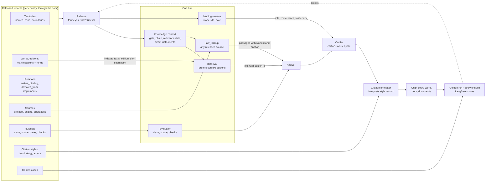
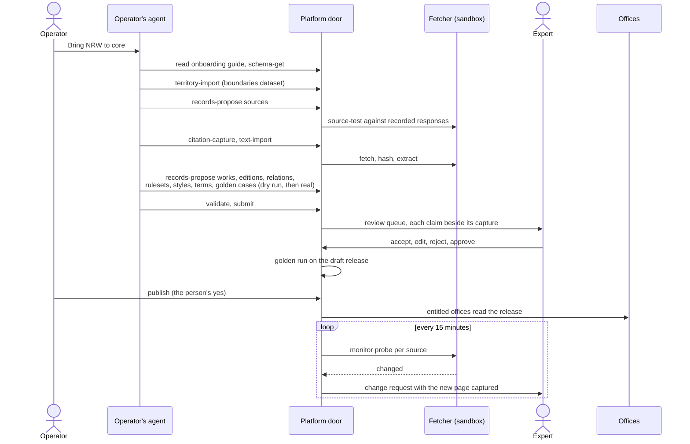

# A country is data: where develop stands, what the target is, and the path

Read at `origin/develop` `36dcfe7231` (2026-11-11). Marks: **V** read in the code at that commit, **I** inferred (from the design, from domain knowledge of the foreign legal systems, or from absence of evidence I could not make complete). Paths are relative to the repo root. Nothing in the repo was changed.

**Owner decisions, 2026-11-11.** No second country is planned now: plan row 10 (Germany) is deferred, and every other row is built country-neutral and proven with the synthetic test country instead of German fixtures; site placement by boundaries (row 8) waits for the second country, the address register as a record does not. The CI ratchet `scripts/check_country_in_code.py` (#1618) holds the line meanwhile; its burn-down is in `docs/architecture/country-extensibility.md`.

The founding idea (a country is data) holds up under every country I tested it against. The record model (works, editions, relations, rulesets, territories, change requests) carries Germany, Switzerland and the EU without a new concept. What does not hold yet is the half of the product that answers. Onboarding is data. Answering is still Austria in code.

---

## 1. The target, in one scene

An operator tells her Claude, on the platform door: "Bring Nordrhein-Westfalen to core." Claude reads the onboarding guide, imports the territories, proposes three source records (the federal law API, the Land portal, the DIBt page with the MVV TB), tests each against recorded responses, captures the pages, and proposes 190 records: the BauO NRW, the VV TB NRW with its deviations from the MVV TB, the DIN designations it lists as works without text, the building-class table of § 2 Abs. 3 as a ruleset, the German citation style, the NRW terms, twenty golden questions with their expected answers. A practitioner in Köln reviews each claim beside the captured page and approves. Publish. No pull request, no deploy.

Next morning an architect in Köln asks how long the escape route to the stair may be. The answer says 35 m and beside the number stands the line she would write herself: **§ 33 Abs. 2 BauO NRW 2018, in der Fassung vom …, zuletzt geprüft am …**. One click opens the paragraph on the Land's own portal. A question about sound insulation names DIN 4109-1:2018-01 as binding through the VV TB NRW, says its text is licensed and not held, and quotes from the office's own copy if the office uploaded one, never beyond what its licence allows. The same morning an architect in Lausanne gets "art. 22 al. 1 LAT (RS 700)" in French, from the same code.

When Salzburg moves its OIB adoption date, a monitor opens a change request with the new gazette page captured. The expert approves one relation record. Every answer and every old citation in Salzburg reads the new date from that moment, and a thread from last month still shows what bound on its day.

The golden questions of each country run on every release and on every change to prompt, retrieval or model. A country that drops below its own bar does not publish.

---

## 2. Starting point against target, by capability

"Old" is the Austria-only product before ADR-0175. "Develop" is today.

| Capability | Old product | Develop today (verified) | Target | Gap |
|---|---|---|---|---|
| Which law and edition binds at a site | Hand-written chain text and OIB verdicts in code (`common/applicability.py`, `country_profile.py`, deleted in `67f855cf1c`) | Records resolved by the BFF into one `knowledgeContext` per turn (`bff/base-knowledge/context/resolve.ts`, `chain/resolve.ts`). **V** | Same, queried on demand for any work and date | Small. Limits and one-site, today-only resolution (rows 3.5, 3.6) |
| Onboarding a country's records | Code change | Platform door, 31 `platform-*` knowledge operations, change requests, four eyes (`bff/agent-api/catalog/platform-*.ts`). **V** | Same | Missing on the door: golden cases, citation style, per-record draft read. **V** (no `golden` in the catalog or `base-knowledge/`) |
| Live legal-database lookup | `ris_lookup`, RIS only | `law-lookup` is `ris_lookup_tool`, summary "Look up Austrian law in RIS" (`bff/agent-api/backend-operations.ts:242-246`, `exposure.config.ts:461`). The gate maps tool to country in code: `LAW_SOURCE_COUNTRIES = {"ris": "AT"}` (`common/law_gate.py:30`). A published source record is read only by capture, test and monitor routes (`apps/agent-host/.../public_source_capture.py`), by no answer-time tool. **V** | One `law_lookup` tool that reads any released source record of the turn's countries | **The largest gap.** A German source record gives Germany no lookup |
| Sources | YAML and adapter package | Two kinds: records through the door, and "built-in" repo files for RIS and Fedlex whose hosts no record can override (ADR-0174 Consequences, `configs/sources/at/ris/source.yml`, `packages/ris-adapter` 3,000 lines, `client.py:80-81`). **V** | Records only. Engines in code | Contradiction 3.1 |
| Corpus texts and retrieval | One OIB collection, all editions, edition by file name | One shared corpus, each point marked `country_id` (`vector_store/schema.py:132`, filter `scope.py:249-267`) and `knowledge_edition_id` (`schema.py:129`). No reader of the edition field in search. Passage to edition still by OIB file-name table (`common/oib_file_names.py:36-52`, `citations/roles.py:55`). A platform manifestation must be a `.pdf` (`platform/wire.ts:156-160`). **V** | Hits carry edition id. Retrieval prefers the editions the context names. Any text format | Rows 3.4, 5 |
| Setup facts and building class | `intake-definition.ts` | Ruleset records exist, but setup and classification read three Austrian seed files compiled into the build (`rulesets/shipped.ts:25-29`, default in `project-intake/setup-scope.ts:75`, no caller passes published records). Result type has a `hochhaus` boolean and a numeric class (`rulesets/building-class.ts:32-34`). **V** | Read from released records | Published German facts are never read |
| Site to jurisdiction | Bundesland dropdown | Leaf from register id, else the Austrian `federal_state` token map, else country (`context/site.ts:22-29`). Address register is a code object per country with functions (`bff/site-resolution/registers.ts:44-59`, `bev.ts`). Time zones are a table in code (`time/today.ts:10-19`). **V** | Point in territory polygon from a boundary dataset record. Zone on the territory record | Germany needs code today |
| Time: as-of and editions in force | Newest edition, everywhere | Half-open intervals, as-of route and `as_of` on the RIS tool. The turn itself resolves on today, reference dates are always `undetermined` (`context/service.ts:139-140`). **V** | The turn resolves on the procedure's reference date | A8 passes only through the as-of tool, not through citations |
| Citation role and form | Host regex badge | Role from the context's uses (`citations/roles.py`). Identifier schemes are a closed enum of two, one Austrian: `['ris_gesetzesnummer', 'eli']` (`wire/vocab.ts:210`, strict object `platform/wire.ts:109-126`, mirrored `roles.py:76`). Citation form is Austrian in code (`ui/features/chat/lib/source-citation.ts:29-32, 88-109, 292-299`). **V** | Role by the hit's edition id. Form from a citation style record | Section 5 |
| Languages | German | Work `title`, territory `name` are single strings, manifestation `language` defaults to `de` (`platform/wire.ts:87, 154, 176`). Prompt fixes "Austrian technical German (Geschoß, Stiege, Einreichung, Bauwerber)" (the chat agent's `prompts/chat_static.md:30`). `terminology.v1` and `advice_policy.v1` records are accepted and read by nothing in `context/` or `chain/`. **V** | Names per language. Register and terms from the context | Switzerland needs schema and prompt changes |
| Licensed norms | Not held, said so | Office copies behind the licensed seam (ADR-0164). Platform manifestations may only be `public_open` or `public_restricted` and carry no quote limit (`platform/wire.ts:155`). **V** | Per-manifestation terms: may index, quote ceiling, attribution | DIN and SIA listing works. Quote limits for restricted public texts do not |
| Quality gate per country | Answer suite, OIB retrieval eval | Edition set for Austria (`tests/fixtures/editions/at_edition_questions.yaml`), expected values read from `configs/knowledge-packs/at.json`. No golden-case record, no run on the door. **V** | Golden cases are records, run before every publish and by the answer suite | A country cannot bring its own bar |
| Austria in source | everywhere | 524 non-test source files under `apps/` and `packages/` match OIB, RIS, Bundesland or ÖNORM (my grep, excluding tests, fixtures, migrations, i18n, website). 52 files import `norm_registry`. **V** | Names for what a thing does. Austria only in records and i18n | Mostly naming. About 40 files decide behaviour (section 4) |

---

## 3. Contradictions and weak or overbuilt decisions, ranked by what a user feels

### 3.1 The answering half is Austria in code. A published country cannot be looked up. (contradiction)

**Today. V.** `law-lookup` is the RIS tool. Its description, argument grammar ("§ 63 BO Wien", Bundesland, the applications `Vfgh`, `LgblAuth`), its planner, picker and paragraph cutter live in `packages/ris-adapter` (`lookup/tool.py:40-63`, `register.py` 995 lines). ADR-0174 then writes the exception into the architecture: a source is "built in" when "the agent's tools read it on every turn". That rule says every country with a live legal database gets a package. `docs/architecture/country-extensibility.md` says it outright in its Phase 2: "the one real code artifact, a source adapter, following `packages/ris-adapter` as the template". You caught this one. It is the centre of the whole problem, and the plan to add OIB as a repo source came from the same rule.

**Better.** One model tool, `law_lookup`, with no country in it. Its inputs are a question, an optional instrument reference, an optional territory and an optional date. It works in four steps, each reading records.
1. It parses the reference with the citation grammar of the turn's countries (section 5, the style record parses as well as renders).
2. It finds the work by identifier or designation in the released records. This replaces the norm registry's pointer index (`configs/norms/at/registry.yml`).
3. It asks the work's source record for the text. The source record declares which operations its protocol supports (`fetch_by_identifier`, `search`, `as_of`) and the parameter tables it needs, keyed by territory id (the nine Bundesland parameters are already such a table in `source.yml`).
4. The engine returns anchored passages. Cutting "§ 63 Abs. 1" out of a document is an anchor lookup, the same for every engine.

RIS becomes a source record with `rest` access and the `ris_xml` engine, which both exist (`packages/public-sources/src/access/rest.py`, `engines/ris_xml.py`). What is Austrian in `ris-adapter` splits three ways: protocol quirks go into the engine, parameters into the record, and the search planning stays as the generic tool's one model call. Delete the "built-in" class from ADR-0174, `LAW_SOURCE_COUNTRIES`, and the package.

**Why.** It is the only design under which "Germany onboarded with no code" is true for an answer and not only for a database row. It also fixes the door: an outside agent gets one `law-lookup` that names the countries the office may read.

**Risk, and the guard.** The RIS tool is the best-tuned piece of the old product (B5: 12.7 s, high confidence, one source). The generic tool replaces it only when it matches on the RIS questions of the scorecard and the edition set, measured, with the old tool deleted in the same PR that passes.

### 3.2 Setup, classification and site placement read code, not the records that were built for them (contradiction)

**Today. V.** Rows "Setup facts" and "Site to jurisdiction" in section 2. ADR-0169 decided setup facts are country records. The records exist and the readers still import JSON seeds. A German `fact_definitions` or classification ruleset, reviewed and published, changes nothing in a German project.

**Better.** `setupScopeOf` and `buildingClassificationOf` read released rulesets through `store/rulesets.ts` (`readRulesetsInForce` already serves time and competence). The three seed files become the Austrian change request and leave the build. The class is a code string from the ruleset ("GK 4", "Gebäude mittlerer Höhe"), and "high-rise" is one of the codes, not a boolean field. Site placement becomes one generic path: an address is geocoded inside the cell to a point, and the point is placed in the territory tree by polygons from a boundary dataset the country's records name (a `bulk_file` source with a column map). The BEV register stays as an optional precision source for Austria, described by the same kind of record. Zone and subdivision vocabulary come from the territory record.

**Why.** Germany has no single open national address register (**I**), so "an importer beside `bev.ts`" would be sixteen importers. Boundaries are open everywhere in the EU and Switzerland (**I**: GISCO, BKG VG250, swissBOUNDARIES3D). Buy the geocoder (Photon or Nominatim self-hosted, already listed as a subprocessor file).

### 3.3 A country cannot bring its own quality bar (missing piece)

**Today. V.** No golden-case record, no golden run on the door. The design had both (§4.4, §4.6) and they were not built. The scorecard that is meant to prove "better than before" has 20 Austrian questions, one Munich question, and the after-run holds one answer (section 6 of this document, "Measuring better than before").

**Better.** `golden_case` as a record type: question, site, date, expected value, expected edition, expected citation line, must-not list. `platform-knowledge-golden-run` executes a country's cases against a draft release through the ordinary answer path and writes Langfuse scores per case. A publish to `core` needs the run green. The answer suite reads the same cases, so a prompt or model change is held to every country's bar.

**Why.** Without it "at least as good as Austria" is an opinion for country two. This is also the cheapest protection for Austria during 3.1.

### 3.4 The turn's chain is pre-rendered into the prompt and capped. Germany exceeds the caps and loses all law. (weak decision, ADR-0173)

**Today. V.** `loadGraph` loads every relation the office can read, not the site's (`chain/load.ts:248`), at most 2,000 rows of each type (`:31`). At the limit the gate becomes `knowledge_unavailable` and all law is withheld (`context/resolve.ts:226, 247`). The context carries at most 40 uses and 16,000 characters (`context/wire.ts:16, 60`). Austria alone is 136 relations and 27 works (`configs/knowledge-packs/at.json`). The MVV TB lists several hundred technical rules (**I**), times the Länder an office is entitled to. A citation's role is found by matching the passage against those 40 uses, so use number 41 gets no role.

**Better.** Keep the one context per turn, and shrink what it is. It carries the gate, the territory chain, the reference date, and the instruments that bind directly at the site (law and ordinances, a few dozen). Everything reached through a relation is resolved on demand by one resolver call, `binding-resolve(work or edition, site, date)`, which returns role, route, since-when and last check. Two callers use it: the model, as a tool, when it needs to know whether DIN 4109 binds here, and the citation verifier, once per cited passage, keyed by the hit's edition id. Relations load by walking from the chain's instruments, bounded by depth, never by tenant.

**Why.** Correctness stops depending on a prompt budget. The static prompt stays cacheable (ADR-0177). The verifier's role lookup no longer depends on URL or file-name matching, which is the cause of G3 in the citations spec.

### 3.5 Identifiers, names and text formats are Austrian-shaped in the record schema (weak)

**Today. V.** Section 2, rows "Citation role" and "Languages". `identifiers` is a strict object with two keys. A CELEX number, an SR number, a BGBl. Fundstelle, an ECLI or a DIN designation with date have no field. `title` and `name` hold one language. A manifestation must be a PDF, so a statute in Akoma Ntoso or HTML cannot be a held text at all.

**Better.** `identifiers: [{scheme, value}]` with the scheme list as data on the source record that issues it (the source says how its scheme maps to a URL). `title` and `name` become maps by BCP 47 tag with one required default. A manifestation names a media type the ingest reads (PDF, AKN XML, HTML through an engine), and carries `terms: {mayIndex, quoteMaxChars, attribution, validTo}` as design §3.4 already specified.

**Why.** Each is a small schema change now and a migration of every record later.

### 3.6 The turn does not know the project's reference date (weak)

**Today. V.** `context/service.ts:139-140`. The context resolves on today. "What applied at our submission" works through the as-of route only.

**Better.** Until `reference_date` rulesets exist, a filed procedure's `filedOn` is the stated date of resolution, labelled as an assumption ("Stichtag: Einreichung 01.06.2023, Übergangsrecht nicht geprüft"). The wire already allows `basis: 'filed_on'` (`context/wire.ts:106`).

**Why.** An answer about a project filed in 2023 that cites the 2026 edition as binding is wrong for that project, and the citation line would repeat the error.

### 3.7 Governance has more states than the company has reviewers (overbuilt)

**Today. V.** Four eyes in the database (0218), approve-alone with a deferred second review and five second-review states (`wire/vocab.ts:240-251`, 0214), three source origins that decide whether a fetch "counts as fetched" including retroactive holds when a source release is rolled back (0224). The architecture review already called approve-alone a second state machine (finding 11). It is still there.

**Better.** Two rules. A release needs two different people. One person may release alone only what the machine verified: every claim's quote found in bytes the fetcher itself fetched from a source two people released. The owed second look is an ordinary later approval on the same request, shown as a list, not a state. Drop `SECOND_REVIEW_STATES`, the preview channel and the retroactive hold.

**Why.** Four eyes on legal content is right and should stay hard. The rest guards against an insider forging a PDF, at the cost that the owner could not publish Austria on dev for a day (build-split, "Where the build stopped"). Simpler rules get reviewed content to offices faster, which is the bottleneck the design itself names.

### 3.8 Austria's dataset lives in the repo as well as in the records (contradiction, mild)

**Today. V.** `configs/knowledge-packs/at.json` (213 records), `at-scopes.json`, `eu.json`, `configs/norms/at/registry.yml`, `configs/norms/at/vocabulary.yml`, the website's coverage copy generated from the pack files. Tests and the edition set read expected values from the file.

**Better.** The released records are the only dataset. `platform-knowledge-pack-export` writes a release as a file. The repo keeps one exported snapshot as a test fixture, under `tests/fixtures/`, named as a snapshot with its release sequence. The website reads `coverage-get`. The retrieval vocabulary (the English to German bridge, measured MRR 0.293 to 0.674 in the file's own header) becomes a `terminology` record with a `retrieval` use, because Switzerland needs the same bridge for French and Italian.

### 3.9 Decisions that hold. Keep them.

| Decision | Verdict |
|---|---|
| Sources as platform records, hosts read from records, monitors that open change requests and never publish (ADR-0162, 0174) | Right. Remove the built-in exception (3.1). Monitor state per manifestation is the one open item |
| Texts attached in the change request, pinned by sha256 (#1608, ADR-0165) | Right. The reviewed bytes are the published bytes. Widen beyond PDF (3.5) |
| Editions, relations and routes decide what binds (ADR-0168) | Right, and the strongest part. Germany's MBO, LBO, MVV TB and VV TB fit as works and `makes_binding` and `deviates_from` relations (**I**, same judgement as the November review) |
| Edition scope on the edition, as a decision table (ADR-0178) | Right. One evaluator |
| Rulesets on one three-valued evaluator (ADR-0166) | Right. Facts already carry UCUM units (`wire/setup-facts.ts:38`) |
| Entitlements as rows, never switches (ADR-0175) | Right |
| The `ZZ` mark for unreleased texts and the country mark written at publish | Done with row 7: `released` on the point and the corpus row, false for a rollback and an ingest no release names, read by `corpus_country_condition`. A point or row from before it has no flag and reads by its country, so nothing is rewritten and no readable text is hidden at any point of the rollover; while an older image serves, the BFF refuses its answers to a withdrawal or a release so the job retries (`oib-sync.md`). The contract step (read only `released == true`, after a backfill of the flag) waits for the legacy deletions of the rollover's step 11 |
| The agent door, one operation per capability (ADR-0122) | Right. `law-lookup` must lose Austria from its description |
| Fail closed when the context cannot be read | Right. But truncation is a budget, not a failure (3.4) |

---

## 4. What is data and what is code

The test for every line of code: would a second country change it? If yes, it is data in the wrong place.

**Code, once, for every country**
- Access types, one per protocol: `rest`, `http_eli`, `web_document`, `ogc`, `bulk_file`, and `sparql` when Fedlex or EUR-Lex CELLAR need it (**I**, `ch/fedlex/source.yml` already carries a SPARQL fixture).
- Format engines, one per format: `akn` (Akoma Ntoso, which covers Fedlex, LegalDocML.de and AKN4EU, **I**), `ris_xml`, `html_statute`, `pdf_document`, `geojson`, and Formex for EUR-Lex if AKN is not offered for a text (**I**).
- The decision-table evaluator and the expression language.
- The resolver: in-force edition at a date, routes through relations, transitions, competence.
- The site resolver: point in polygon over territory boundaries.
- The citation renderer and parser: an interpreter for style records (section 5), built on a CSL processor rather than written (buy, not build; `citation-js` or `citeproc`, **I**, to be checked for legal styles).
- The conformance kit, the door, the review queue, the fetcher and its guard.
- The legal method in the prompt, which holds in every country (`law_gate.LEGAL_METHOD`).

**Data, per country, through the door**
- Territories with names per language, zone, parents, boundaries dataset.
- Works, editions, manifestations with media type, language, text status and terms.
- Relations, with clause-level deviations.
- Sources: protocol, engine, hosts, operations offered, parameter tables keyed by territory, identifier schemes and their URL templates, licence, monitor.
- Rulesets: classification, derivation, reference date, competence, fact definitions and sources, edition scopes, check rules (the model check's thresholds, which are OIB 2023 values in `bff/bim/rules.ts` today, per the citations spec G21).
- Citation styles per work kind and language. Terminology per language, with the register an answer is written in and the retrieval bridge.
- Advice policy. Golden cases. Coverage level.
- Document roles of a text (normative, explanatory, amendment, guide), set on the manifestation, replacing the OIB file-name reader (`oib_doc_class`).

**The precise line.** A new protocol or a new format is code. A new publisher that uses a known protocol and format is a record. A source that needs logic in its request template is a new access type, never a cleverer template (the rule in `packages/public-sources/README.md` is right). A citation form no style record can express is a gap in the interpreter and is fixed there, for all countries. A field an engine did not read before is engine code. Nothing else is code.

**What is not on either list and must go:** `packages/ris-adapter`, `LAW_SOURCE_COUNTRIES`, `rulesets/shipped.ts` and its seeds, `oib_file_names.py`, `ZONE_BY_COUNTRY`, `FEDERAL_STATE_TERRITORIES`, `registers.ts` as functions, `SOURCE_REF_SCHEMES` as an enum, the OIB and RIS constants in `source-citation.ts`, the Austrian sentence in `chat_static.md:30`, the Austrian classification prompt (`knowledge/document_classification.py:152, 262`), `configs/norms/`, `configs/knowledge-packs/`, `configs/sources/`.

### The four stress tests

| | Data today | Needs code today | After the plan |
|---|---|---|---|
| **Germany** (16 Länder, MBO and LBOs, MVV TB and Land VV TBs, DIN licensed) | Territories, works, editions, relations, competence and reference-date rulesets, source records for portals, DIN as text-less works with office copies attached, entitlements | Live lookup (3.1). Setup facts and building class (3.2). Site placement and zone (3.2). Identifier schemes (3.5). Citation form (5). Chain limits (3.4). German register in the prompt. Model-check thresholds | A Land portal on a new format is one engine, once. Everything else is records. DIN text is never indexed by the platform. A DIN quote comes only from an office copy, capped by `quoteMaxChars` |
| **Switzerland** (cantons, three languages, Fedlex, SIA licensed) | Territories, relations (IVHB accession as dated `makes_binding`), Fedlex source record exists as a fixture (`configs/sources/ch/fedlex`) | All of Germany's, plus names per language (3.5), answer language and terms per language, a `sparql` access type (**I**), three manifestations per edition each authentic | Records. The citation style is one record per language: "Art. 22 Abs. 1 RPG (SR 700)", "art. 22 al. 1 LAT (RS 700)", "art. 22 cpv. 1 LPT (RS 700)" (**I**) |
| **EU layer** (EUR-Lex, CPR, EPBD, transposition) | `EU` territory as dated parent, `eu.json` records, directive as information | No EUR-Lex reader (spec G30, **V** there). No CELEX identifier (3.5). No relation type for transposition, so "EPBD is transposed in Wien by OIB-RL 6:2025" cannot be stated | One source record, plus an `implements` relation type from the national instrument to the directive. This is the one new concept I found in all four tests |
| **A second Austrian Land changes its OIB adoption date** | Entirely data: one relation ends, one begins, monitor opens the request, as Salzburg and Burgenland already did in the pack | Nothing for the record. But the OIB file-name table needs a code edit when a new edition's PDF has a new spelling (`oib_file_names.py:36-52`), and the edition set reads the repo file | Nothing |

---

## 5. The citations spec, judged against this

The spec's diagnosis is right and its gap table is the best inventory of the answering side that exists. Its slices would make Austrian citations correct and would cement three Austrian assumptions. Change these before more of PR 1, 4 and 5 lands.

**PR 1 (a citation carries edition, role, route, dates).** Build it on the hit's edition id, not on a public address. The spec fixes G3 by giving RIS hits a URL so `roles.py` can match it against `sourceRefs`. That keeps role resolution as string matching and keeps `ris_gesetzesnummer` as a scheme the agent must "learn". Instead: every hit, from the corpus or from a live source, carries the work and edition id it was read as (the corpus point already has `knowledge_edition_id`; the live lookup knows the work because it found the text through the work's record, 3.1). The role comes from `binding-resolve` by id (3.4). The public address is a display field computed from the source record's URL template and the anchor. The parity test and the wire fields in the spec stay as written. Add `language` and `text_status` to the citation object now. Switzerland needs them and adding a field later means rewriting stored citations.

**PR 2 (one formatter).** Right goal, wrong home for the forms. A "golden table per kind" in `apps/workspace/shared/` is the Austrian style in code a second time. Make the formatter an interpreter. A `citation_style` record per work kind and language holds the pattern, the locus vocabulary and order (§, Abs., Z, lit. for Austria; §, Abs., Satz, Nr. for Germany; Art., Abs., lit. or al., let. for Switzerland), the abbreviation rule (the "Abs." with or without dots question becomes a field of the Austrian style, decided once by the reviewer, not a product-wide constant), the edition phrase ("Ausgabe Mai 2023", "in der Fassung vom", "Stand am"), and the date and number format. The same record gives the parser its grammar for `law_lookup` and for the locus check of PR 3. Austria's styles are the first records and the spec's section 3 table is their content. Until PR 9 of the plan below makes it a published record, ship it as a fixture the formatter reads through the same loader, so no second formatter appears.

**PR 3 (what the sentence says is what opens).** Keep as written, with two changes. Edition agreement compares edition ids, and reads "Ausgabe … 2019" from prose with the style record's edition phrase, not an Austrian regex. The locus check takes its unit vocabulary from the style record.

**PR 4 (law from the law's own source).** Keep the rule. Change the mechanism: "a copy of a work the records hold" is decided by the works' designations and the hosts of released source records read from the database, never from `configs/sources/` as the spec says. The spec's instruction to find out first why the live § 50 lookup did not read RIS stands. The gate is not the cause at coverage `none` (`common/knowledge_context.py:45` allows reading law). **V** for the policy, the actual cause is unmeasured.

**PR 5 (a corpus PDF is served to whom it is released).** Keep. Serve by manifestation id resolved through the visibility predicate, and rename the route off `oib` while it is open (`/v1/oib/documents`).

**PR 6 (documents and checks cite like answers).** Keep, after the deferral below comes in.

**Deferrals that must come in for citations to be right**
- **Retrieval that prefers the binding edition.** In. Without it the verifier of PR 3 catches drift after the answer is written, the citation is removed, and the reader gets a value with no Fundstelle (G13). The field is on every point. Do it as a boost and a fallback, not a hard filter, so a question about the 2019 edition still finds it. Gate: the OIB retrieval eval and the answer suite, before and after.
- **Rules evaluated per binding edition.** In, before PR 6. A model check that says "fail" against 2023 thresholds in Styria, where 2019 binds, with a correct-looking citation, is the worst outcome on the list. The thresholds become `check` rulesets attached to an edition.
- **EUR-Lex.** In with the EU source record (plan PR 10). It is one record once `law_lookup` is generic. Until then an EU citation opens nothing and the spec says so.
- **Hint instead of verdict.** In as a default, and it costs little: where the gate is not `core` or `full`, or the edition scope is `check`, a card renders as a hint with its Fundstelle and no pass or fail. That is E4 and it is what GGP asked for.
- **Link liveness.** Stays deferred for web sources. For record sources the monitor already probes the source, so the citation line's "zuletzt geprüft" is truthful.
- **Accessibility.** Stays after PR 2, as the spec says. One condition now: the citation line is text, generated by the formatter, and the chip's accessible name is that line. That is free if PR 2 does it and expensive later.
- **CSL export formats.** Free if the interpreter is a CSL processor.

**Per-country style, as the profession writes it (I, to be confirmed by each country's reviewer and stored as records)**

| Country, language | Law | Technical rule | Standard |
|---|---|---|---|
| AT, de | § 63 Abs. 1 Z 2 lit. a BO für Wien, LGBl. Nr. 11/1930 idF LGBl. Nr. 37/2023 | OIB-Richtlinie 2, Ausgabe Mai 2023, Pkt. 5.1.1 | ÖNORM B 1600:2023-03-01, Pkt. 5.3.2 |
| DE, de | § 33 Abs. 2 Satz 1 BauO NRW 2018; Art. 31 Abs. 2 BayBO | MVV TB 2025/1, Abschnitt A 2.1.3; VV TB NRW, Anlage A 2.1/1 | DIN 4109-1:2018-01, Abschnitt 6.2 |
| CH, de / fr / it | Art. 22 Abs. 1 RPG (SR 700) / art. 22 al. 1 LAT (RS 700) / art. 22 cpv. 1 LPT (RS 700) | VKF-Brandschutzrichtlinie 16-15, Ziff. 3.4 | SIA 500:2009, Ziff. 3.2 |
| EU, any | Art. 5 Abs. 1 der Verordnung (EU) Nr. 305/2011, ABl. L 88 vom 4.4.2011, S. 5 | | EN 13501-1:2018 |

---

## 6. Better than before: what Austria did well, and whether the scorecard sees it

**What the old product did that the new path must match**

| Strength | Evidence | State on develop |
|---|---|---|
| RIS answers fast and from RIS | B5 before: 12.7 s, high, 1 source, 2 calls (`scorecard/table.md`) | Regressed on dev: 58.7 s, low, three web sources, not RIS (`scorecard/after/compare.md`). Cause unmeasured |
| Deterministic paragraph lookup by a verified pointer | `norm_registry` pointer index, `ris-adapter/lookup/grammar.py` | Kept, as Austrian code. Must survive 3.1 as work identifiers and anchors |
| An OIB list narrowed by the building, with a reason on each chip, three-valued | deleted `common/applicability.py`, `bff/oib/` | Gone until ADR-0178's scopes are published (PR #1589 open). ADR-0175 says so itself |
| Cross-law hints from four yes/no facts (Kleingartengesetz as lex specialis, DMSG, GewO §§ 74 ff, Garagengesetz) | deleted `applicability.py:76-108` | I found no record that carries them. **I**: lost. They belong in `fact_sources` or as works with a scope |
| English questions find German text | `configs/norms/at/vocabulary.yml`, MRR 0.293 to 0.674 | Kept, as an Austrian file |
| Leitfaden and Erläuterung never carry a requirement | `oib_doc_class` by file name | Kept, by OIB file name only |
| Every office answered without anything being published | no gate | By design gone. The price is the release order in ADR-0175 |

**Does the scorecard measure it?** No. It records seconds, the model's own confidence, a source count and a call count for 20 questions. None of the four is correctness. The before-run has no expected value per question, so "after" can only be compared for speed and for whether confidence moved. `compare.py` adds regex checks for a handful of RIS facts, which is the right idea applied to six questions. The after-run holds one answer of twenty. No question tests the citation line, the click target, a second language, a German site with German records, or cost.

The dev-acceptance table is better: A1 to A8 state expected values and "fails if" rules. It is eight rows, run by hand, Austria only.

**The gate that would prove the bar.** One table of golden cases per country (3.3), each with expected value, expected edition, expected citation line and a must-not list, run by the answer suite and by the golden run. Scores in Langfuse per answer: `edition-named`, `citation-role-resolved`, `claim-citation-resolves`, `edition-agrees`, `law-cited-from-web`, `binding-claim-without-records` (all from the citations spec, none exist yet, **V** for the absence: only `advice-policy-held` and `freshness-lag-days` of the design's scores are declared, `observability/langfuse_catalog.py:126`, `onboarding_scores.py:20-30`), plus latency and cost per answer from the ledger. "Better than before" then means: no golden case that passed on the old path fails, median seconds and median cost do not rise, and the six scores are at or above their thresholds. The 20 scorecard questions and A1 to A8 become the first 28 Austrian cases, with expected values written from the released records.

---

## 7. The plan: from today to Germany with no code change

Each PR is one deployable step. "Serves" names the part of the scene in section 1. Every PR that changes what shapes an answer runs `task be:eval:answer-suite` before and after and attaches the report.

| # | PR | Serves | Gate that proves no regression |
|---|---|---|---|
| 1 | **Golden cases as records, and the golden run.** Record type, `platform-knowledge-golden-run`, the answer suite reads them. Seed Austria's 28 from the scorecard and A1 to A8, expected values from the released records. Declare the six citation scores. | "A country that drops below its own bar does not publish" | The run reproduces the before-baseline's known faults (B1, B9, B10, B11 high confidence with gaps). This is the yardstick for every later row |
| 2 | **Hits carry work and edition id. Role by id.** `binding-resolve` in the BFF, called by the verifier. Citations spec PR 1 on top of it, with `language` and `text_status`. Delete `oib_file_names.py` and URL matching in `roles.py`. | The citation line with its role and route | `citation-role-resolved` at least 95% on the Austrian cases. A5 shows the RIS role. Edition set unchanged |
| 3 | **Readers read released records.** Setup facts, classification, subdivisions, zone from records. Delete `rulesets/shipped.ts`, the seeds, `ZONE_BY_COUNTRY`, `FEDERAL_STATE_TERRITORIES`. Publish Austria's as a change request first. Class as a code string. | "No pull request, no deploy" | A6 passes from the published ruleset. `setup-countries.fixtures.ts` German and Swiss fixtures resolve from a test database, not from an injected array |
| 4 | **One `law_lookup`, RIS as a record.** Source records declare operations and territory parameter tables. Work identifiers as `{scheme, value}`. Reference parser from the style fixture. Delete `packages/ris-adapter`, `LAW_SOURCE_COUNTRIES`, the built-in class in ADR-0174, `configs/sources/`. | "One click opens the paragraph on the Land's own portal" | Every RIS golden case at or under its old seconds and at its old confidence (B5 at 12.7 s is the number to beat). `law-cited-from-web` is 0 on them. The synthetic country `XA` in `synthetic-country-door.integration.spec.ts` answers a lookup from its record, with no code naming it |
| 5 | **The context shrinks, the resolver is a tool.** Relations walked from the chain, no tenant-wide load, no withholding on a budget. Turn resolves on the filed date as a labelled assumption. Citations spec PR 4 with hosts read from records. | "Names DIN 4109 as binding through the VV TB" | A fixture country with 3,000 relations and 400 listed standards answers with gate `core`. A8 passes through the citation line. Static prefix size test unchanged |
| 6 | Citation styles as records, the formatter as their interpreter (spec PR 2 and 3). Terminology and answer register reach the turn. Names per language. | The line "she would write herself", and Lausanne | One fixture of citation objects with expected lines per country and language, on every surface |
| 7 | Retrieval prefers the context's editions. Manifestations of any ingestible media type with `terms`. Released flag replaces `ZZ`. Spec PR 5. (Preference and flag built; `terms` per manifestation is the next slice.) | "Never beyond what its licence allows" | OIB retrieval eval MRR not lower. `edition-agrees` at least 95% |
| 8 | Site placement by boundaries. Address register as a record. | Köln resolves to its Land and Gemeinde | A1 to A3 unchanged. A German and a Swiss address place correctly in a spec with fixture boundaries |
| 9 | Check rules per edition (model check, spec PR 6), hint by default where the gate is not settled. Governance reduced to two rules (3.7). Pack export, repo dataset removed (3.8). | Checks that hold in Styria | Rule catalogue spec: every rule names an edition in a released pack. Publishing Austria on a fresh database takes one person and one reviewer, timed |
| 10 | **No code.** EU source record and the `implements` relation type land in PR 5 or 6 at the latest. Then the operator's agent onboards `de` at `open`, NRW at `core`, through the door. | The whole scene | `git diff` empty under `apps/` and `packages/` between the start and the end of the onboarding. NRW's golden cases green. Austria's golden cases unchanged in the same run |

PRs 1 to 5 are the critical path. After PR 5 a German office gets live law with correct roles from records alone. PRs 6 to 9 make it as good as Austria and can run in parallel in two sessions (6 and 7 touch the agent and citations, 8 and 9 the BFF). The German content work (counsel, the practitioner's review days, the sixteen portals' terms) can start today on the door as it is, since records proposed now stay valid.

One caution on load. PRs 1, 4 and 5 of the citations spec are being built now on the URL-matching design. PR 2 of this plan replaces that mechanism. Stop spec PR 1 at the wire fields and rebase it on edition ids before it merges. Reworking it after merge costs more.

---

## 8. Diagrams

### Target data flow

### Onboarding flow

---

## 9. What I could not verify

- Whether `citation-js` or another CSL processor handles legal locus forms well enough to be the interpreter. Check before PR 6.
- The size of a Land's VV TB in relations. The 3,000 in PR 5's gate is a guess at an upper bound.
- Fedlex, NeuRIS and EUR-Lex terms and exact protocols. The design marks them "[verify]" too.
- Why B5 regressed on dev. The gate policy allows reading law at coverage `none`, so the cause is elsewhere.
- Whether the four cross-law hints of the old product exist in any published record on dev. They are not in the repo's pack file.
- The model check's rule file (`bff/bim/rules.ts`) is cited from the citations spec, not re-read.
