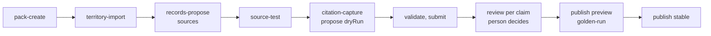

# Country base knowledge: the international foundation

Design v7, 2026-11-05, checked against commit `4fb7b836`; nothing in the repo was changed. v7 answers the sixth review round (12 blocking, 52 major) and the founder's correction that **the product contains no onboarding agent of its own**: headless-first means Claude, or any MCP client on the platform door, is the onboarding agent. Appendix B logs every round.

**How to read this.** Part I (sections 0 to 11) is built from 2026-11-09 to spring 2027; each of its columns and enum values has a consumer that changes an answer or a decision, and a test that fails without it (3.10). Part II lists deferred items with their triggers. Markers: [V] read in code at `4fb7b836`; [S] scout claim; [verify] check at the source before it becomes product data. No identifier carries the product name (ADR-0149).

---

# Part I. Foundation

## 0. Executive summary

**Adding a country is a data release that an external agent drafts and an expert approves.** The product ships no onboarding agent, prompt or model call. An operator works with Claude (or any MCP client) on `/api/platform/mcp` (ADR-0126): Claude creates the pack, imports territories, registers official sources as configured instances of a few protocol types, uploads what sources miss, and proposes records in batches, each claim citing a snapshot the server captured itself. The product provides the operations, a dry-run conformance kit, a review queue and publishing. An expert accepts each claim beside its captured span; the server asks the person directly for approval, publish and rollback. The normal case needs zero code and zero deploys; code is written only for a new protocol or format.



**A country costs expert review time**: claims × about 4 minutes + golden cases × about 10 + counsel (4.9). A state at `open` is about 0.2 expert days; a country at `open` about 1 day plus 0.2 per state, plus 1 to 2 counsel days (Germany: 3 to 4); a state to `core` about 2 (Zurich: 187 claims, 20 cases), to `full` 2 to 3 more. Engineering is 0. The operator's agent session is the operator's cost, outside our bill and register. Upkeep is 1 to 3 expert days per `full` node a year, 55 to 160 for DACH, so a node stays at `core` unless its office count pays for `full`.

**Coverage levels make a country usable on day one.** `open` serves live official law labelled "amtliche Quelle, nicht kuratiert", Stichtag open; `core` adds reviewed codes, technical rules and binding routes; `full` adds competence, classification, Stichtag rules and a signed golden set. A level change is a publish.

**One record model carries platform and office knowledge**: territories (with dated union memberships, so EU law has a home), authorities, works, editions and manifestations (FRBR, ELI), relations, rulesets, sources, format profiles, coverage and golden cases, each with append-only revisions in a pack. Territorial packs (`at`, `de-by`, `eu`) are selected by site and entitlement; standards-body packs (`std-asi`, `std-din`) only through relations. Law binds in its territory while in force; everything else only through a `makes_binding` route.

**The office layer is the same rows with another owner.** Ticket 32 is built in these tables in the week of 2026-11-09, as the first slice. An office's licensed ÖNORM copy attaches to the platform's text-less listing and answers for that office only.

**Residency is decided per flow and purpose**, with three enforcement layers (proxy host allowlist with default-deny, in-process egress clients, an include-only judge filter). PostHog is split into the four flows it really receives. AI Act marking lands by 2026-12-02; komoot is off in week 1.

**Plan in weeks**, about a week per ticket: ticket 32 except the Stichtag 2026-11-20; org country flag 2026-11-27; "what applied at our submission" for Austria 2026-12-11; Germany `open` 2026-12-18; ticket 31 for Austria 2027-01-22; Bavaria `full` March 2027. Expert review time and source quality are the bottleneck, not engineering. No hire is assumed.

**Founder decisions** (10.3): expert and counsel days, one-off and recurring; the excerpt wording; Bavaria first; entitlement pricing; backup key custody; the OpenRouter EU tier by 2026-11-23.

### What the customer experiences

From 2026-11-20, a feld72 architect asking about stair widths gets the answer from the office's own ÖNORM B 1600 copy, labelled "Norm, Büroexemplar Ausgabe 2017, zuletzt geprüft am 12.09.2026", and a week later also the route, "verbindlich in Wien über OIB-RL 4 Ausgabe 2023 und die WBTV"; no other office sees that text. From mid-December, a Cologne office gets the BauO NRW live, marked "amtliche Quelle, nicht kuratiert", the Bauaufsicht Köln marked "Zuständigkeit nicht geprüft", never Austrian law, and HOAI as information ("Anwendbarkeit hängt vom Bürositz ab"). A Vienna team asking "was galt bei unserer Einreichung im März 2025?" gets the editions in force on that date by name, with the transitional rule that picked them.

---

## 1. North star, then the slices

### 1.1 The scene if anything were buildable

An office signs up, names its home country and residency needs, and lands in a cell that meets them. For every Grundlage, the agent knows every edition, which one binds this site and procedure on the relevant date and why, and when it was last checked. When Tirol publishes an LGBl., a monitor opens a change request that day; the operator's agent proposes the transition and an expert approves it. Setup asks only what the agent cannot derive. Each office's own licensed knowledge sits on top, inside that office, and an office can build an uncurated canton and hand it to the platform. A new country is a few days of expert review.

The stars: ★1 right law for the site, procedure and date; ★2 setup from sources; ★3 the office overlay; ★4 data where promised; ★5 a country is a data release; ★6 quality per country.

### 1.2 The slices we ship now

| Week of | Track A (knowledge) | Track B (setup, residency, correctness) | ★ | Visible |
|---|---|---|---|---|
| 2026-11-09 | A1 store, office Grundlagen | B1 defects; org country flag; komoot off | 3 1 4 | office Grundlagen; no OIB in DE or CH turns |
| 2026-11-16 | A2 territories, AT authorities, minimal change requests, ÖNORM listing | B2 licensed seam | 3 4 | **ticket 32 except Stichtag** |
| 2026-11-23 | A3 relations, kinds, roles, OIB per Land, `eu` and standards packs | B3 residency, PostHog, AI Act, entitlements | 1 4 | route named |
| 2026-11-30 | A4 review queue, kit, golden cases, rollback | B4 connector types, fetcher sandbox, 16-portal classification | 5 4 | sales start |
| 2026-12-07 | A5 door contract for external agents | B5 time: procedures, Stichtag | 5 1 | **ticket 30, Austria** |
| 2026-12-14 | A6 Germany `open` (operator with Claude) | B6 addresses | 5 2 | **Germany `open`** |
| 2027-01-11 | A7 setup chain, AT parity | B7 default-deny egress | 2 4 | |
| 2027-01-18 | A8 location lookup, Steckbrief | B8 naming, labels, failure gate | 2 | **ticket 31, Austria** |
| 2027-01-25 | A9 office region records, contribution | B9 privacy inventory, erasure | 3 4 | |
| 2027-02 → 03 | content: DE-BY `core`, `full`; CH `open`; Länder `core` as days are booked | run work | 1 5 6 | Bavaria `full` |

The first slices serve DACH concretely: feld72 in Vienna, German offices from the 2026-11-30 sales start, then Bavaria.

---

## 2. Problem statement

### 2.1 What is Austrian today

| Layer | Coupling [V] |
|---|---|
| Detection | one `CountryProfile`; `resolve_country` maps `other` to `at` and `de`, `ch` to an AT fallback (`norm_registry.py:544-591`); no country in `RequestContext` |
| Prompt | `chat_static.md` (fallback of Langfuse `piloti-system-static`) hard-codes the Austrian chain and OIB few-shots | <!-- brand-history -->
| Rules | OIB verdicts without a country gate (`applicability.py:462-479`, `oib/applicable-standards.ts`); GK in `derivations.ts`; `bim/rules.ts` |
| Corpus | editions only in filenames, stripped from the family key (`clause_chunking.py:578`); `office_id` written, never filtered (`vector_store/scope.py`) |
| Setup | typed address stored as confirmed; `country=at` for `outside_austria` (`intake-seed.ts:66-76`); phase label "Einreichplanung" (`project-basis.ts:93-107`) |
| Organization | rows created only on the first settings write, so most orgs have none (`db/schema/organizations.ts`); `OFFICE_TIME_ZONE = 'Europe/Vienna'` |

### 2.2 Live defects

1. `resolve_country` routes `other`, `de` and `ch` to Austrian doctrine and collection.
2. `render_project_block` renders OIB verdicts for every country.
3. `intake-seed.ts` writes `country=at` for projects outside Austria and confirms typed addresses.
4. `applicability.py:77-96` cites Vienna's Kleingarten- and Garagengesetz in every Land.
5. `withDerivedClass` and the BIM rules derive OIB classes for any project.
6. The static `<building_law>` block applies to every turn.
7. OIB-RL 2023 counts as binding in every Land, although adoption differs; Tirol adopted RL 6:2025 (LGBl. 59/2026) [S].
8. Permit extraction assumes Austria (`permit_extraction.py:59, 200`); the intake prompt asks for Fluchtniveau (`system.j2`).
9. Address keystrokes go to `photon.komoot.io` by default (`deploy/pulumi/src/config.ts:578-584`), a processor in no sub-processor list [V].

"Gebäudeklasse" itself is no defect: German law has building classes too (MBO § 2 Abs. 3). The defect is the OIB definition and the OIB-only terms.

### 2.3 Notion against the code

- **Ticket 30.** Editions, Stichtag and binding relations do not exist. ADR-0111: "the corpus holds one" edition [V].
- **Ticket 31.** The intake agent's eight tools are project-scoped [V]: no register, law source or web search. `address-search` is withheld (`exposure.config.ts:470-474`) [V].
- **Ticket 32.** Office knowledge is a separate store; the rank `external_standard`, "kein Volltext", is unused [V].
- **Externe Quellen** is the right inventory but mixes subject, instrument and access form (3.8 separates them).
- **Customer promises** hold by default, not by enforcement [V]: ZDR is switchable per org; embeddings, reranking and VLM default to the global `openrouter.ai` (`app-services.ts:123-127`); PostHog receives logs, spans, exceptions and score comments (`otel-collector.ts:386`, `langfuse.md:349-356`); egress is open (`network-policies.ts:53-60`).
- **Both FAQ law claims are false** [V]. `configs/norms/` holds only `at/`, and no edition validity exists. From week 3 the copy is generated from `coverage-get`, and `check_coverage_copy.py` fails copy that claims more. For 2026-11-27:

> "Österreich: Baurecht aller neun Länder live aus dem RIS, in der heute geltenden Fassung, und die OIB-Richtlinien Ausgabe 2023. Welche OIB-Ausgabe in welchem Land gilt und welche Fassung an Ihrem Stichtag galt, zeigt {productName} ab Dezember 2026. Normen, Kommentare und Weisungen Ihres Büros: ab sofort."

### 2.4 The old contract and the deleted abstraction, as evidence

| Element of `country-extensibility.md`, `CountryProfile`, ADR-0025 | Verdict | v7 |
|---|---|---|
| "Every field has a named live consumer" | right, never tested: 6 of 11 profile fields have no reader [V] | kept, as a test (3.10) |
| Data over code; one adapter per legal database | right; half right | records; one engine per protocol or format |
| Country as the unit | wrong: law varies by Land, canton, union and standards body | territory nodes and packs |
| Prompt strings and hooks in a dataclass | nothing calls the hooks | prompt text rendered from typed records |

**The deleted abstraction.** ADR-0025 v1 had nested editions, a relation graph, an applicability DSL and a country plugin. A review cut it because the graph "computed nothing that reached the LLM", the chunker invented "Pkt 90" and the plugin "served exactly one country". Ticket 30 now asks for what was cut.

**How v7 avoids that fate.** Consumers first (ticket 32 ships in week 2); a deterministic test per element (3.10); one evaluator behind one API; anchors from the source; and deletion. v7 removes from v6 the built-in onboarding agent and everything around it, tenant preview opt-in, office releases, pack targets, the coverage ruleset, `prompt.doctrine`, `drafted_by`, `commissioned_by`, `app_author`, `platform_skills.pack_id`, the print-layout profiles, the GISCO import beyond DACH and v6's fictitious egress guards.

---

## 3. Core primitives and their invariants

### 3.1 Separate axes

| Axis | Held by | Decides | Never decides |
|---|---|---|---|
| Site and its chain | project territory leaves | territorial law, authority, Stichtag, classification | where data rests |
| Question place | a turn naming a place, no project | that turn's chain, "von Ihnen genannt" | project facts |
| Connecting factor | `works.connects_by` | which fact ties a work to a project; Part I resolves `site` only | residency |
| Home country | `organizations.home_country` | default entitlement, org clock, locale defaults, home advice hedges, DPA text | site law |
| Entitlements | `organization_countries` | which territorial platform packs resolve | law, residency |
| Residency cell | `organizations.residency_cell` | where content rests and is processed | law |
| Locale | person | UI and answer language | legal terms, law |
| Area of law | `areas[]` on a work | grouping, coverage page, golden strata | bindingness |

**Invariant A1.** No axis is inferred from another. A turn with no site and no named place gets `site_unknown`: no role is assigned, and home-country law is only labelled `information`. A typed address with a stated country and Land resolves there as `unverified`.

**Connecting factors.** HOAI § 1 attaches to an office seated in Germany, VgV to a public contracting authority above the thresholds, the RDG to where legal services are rendered, ÖNORM B 2110 to a contract. Such works carry `connects_by` (`office_seat`, `client`, `contract`, `professional`). Until P1 adds their date sources, they render as `information` with "Anwendbarkeit hängt von Bürositz, Auftraggeber oder Vertrag ab". Germany `open` therefore never tells a private client's project that VgV binds.

### 3.2 Territories

- **Ids.** ISO 3166-1 and -2 (`AT-9`, `DE-BY`, `CH-ZH`), `EU` for the union, then `<CC>:<scheme>:<code>` (`AT:gkz:90001`, `DE:ags:09162000`, `CH:bfs:261`). Ids are frozen and never parsed; NUTS, LAU, GKZ, AGS and BFS codes are aliases.
- **Shape.** `kind` (`union`, `country`, `state`, `district`, `municipality`, `city_district`, `unincorporated`), a localized `kind_label`, `parents: [{id, validFrom?, validTo?}]`, `names`, IANA `zone`, `legislates: areas[]`, and `valid_from`, `valid_to`, `successor_ids`. Intervals are half-open.
- **Unions are dated parents.** `AT` has parent `EU` from 1995-01-01. `GB` had it until 2020-12-31. An EU regulation is a `statute` with `territory_ids: ['EU']` and binds where the chain holds `EU` at the date. Liechtenstein has no EU parent: EU acts reach it through the EEA Agreement, an `intergovernmental_agreement` whose dated relations incorporate each act. Northern Ireland is Part II (P21).
- **`city_district`** exists where competence sits below the Gemeinde: Vienna's 23 Bezirke (`AT:gkz:90101` to `90123`), and the Bezirke of Berlin and Hamburg [verify source].
- **Import.** All ISO 3166-1 countries at depth 0 and coverage `none`, so "not covered" never reads as "no territory". DACH, LI and IT-BZ subdivisions come in A2 from GISCO and the national registers (Statistik Austria, GV-ISys, BFS) through one `bulk_file` source; any other country is one `territory-import` call.
- **Mergers.** A site keeps its register leaf; competence follows `successor_ids` to today's body; local law is looked up for the leaf valid at the Stichtag.
- **Coverage nodes** are the nodes a coverage record names; golden sets sample their children.

### 3.3 Authorities and competence

An authority is a record with `function_codes` (`building_permit`, `heritage`, `fire`…), seat and competence territories, dated `supervised_by`, and identifiers (PVOG, XZuFi, Behördenkennzahl).

Competence is a ruleset per node with purpose `competence`, evaluated on today's date. It returns `{bodies: [{authorityId, role: decides|consents|checks}]}`.
- **Austria.** The Bürgermeister. Exceptions: Magistrat Wien (MA 37), the Statutarstädte, BH delegations [S].
- **Germany at `open`.** The Kreis, unless the Gemeinde is kreisfrei or on the Land's list: Große Kreisstädte in Bavaria; große and mittlere kreisangehörige Städte under § 58 BauO NRW [verify]. In Berlin and Hamburg, the Bezirksamt, read from `city_district`. In Bremen, Bremen or Bremerhaven. Stubs are labelled "Zuständigkeit nicht geprüft".
- **Switzerland.** The Gemeinde. Outside the building zone, the canton decides on the exception (Art. 25 Abs. 2 RPG) and the Gemeinde stays a body of the procedure, so both are bodies of the authority function (as in Zurich), read from the fact `outside_building_zone`; centralised cantons name the canton alone (GE; BL by default, but in Reinach its own Bauinspektorat and, for the small works § 92b RBV BL lists, the Gemeinderat), so BL's rule reads the municipality and the project type.

Directives carry `addressees`. A directive applies when the competent body matches an addressee or is supervised by one, so an MA 37 directive never applies in Graz. An unknown authority is said.

### 3.4 Works, editions, manifestations

**The model follows FRBR and ELI.**

A **work** is the abstract instrument (BayBO, OIB-RL 2, ÖNORM B 1600, a MANZ commentary, an MA 37 directive). It carries `kind`, `areas[]`, `territory_ids[]` (empty for standards bodies), `connects_by`, `identifiers` (ELI, designation, ECLI, CELEX; the RIS law number and document), `issuer_authority_id` and `addressees`.

An **edition** is ELI's point-in-time version: the Ausgabe, not a Fassung. It carries `label`, `issued_on`, `in_force_from`, `in_force_to` (exclusive, the first day no longer in force, like every interval here), an `outline` and `applies_when`: its scope, which buildings it is written for, as a `decision_table.v1` over the building facts with a boolean output, each row citing the scope clause it encodes (ADR-0177). The scope sits on the edition, not the work, because a new edition can change it, and it is a decision table run by the one evaluator rather than free JsonLogic, so it carries its own examples (KC-5) and names the facts it waits for. This section first put `applies_when` on the work as JsonLogic; the review after Wave 5 moved it. There is one edition per distinct in-force date of the consolidated text. "Applies to procedures filed from X" is a transition, never a second date. The CPR 2024/3110, which applies article by article, gets one edition per date (KC-3; fixture `cpr-staggered`).

A **manifestation** is a text, dataset or link with `language` (BCP 47), `text_status` (`authentic`, `official_non_prevailing` for South Tyrol's German texts, `translation`), `licence_class` (`public_open`, `public_restricted`, `licensed`), `terms` (`mayIndex`, `quoteMaxChars`, `validTo`, attribution), `document_id` and `sha256`. An expression is the pair of edition and language and has no table.

**Anchors** follow the Akoma Ntoso eId convention in every format profile (`par_2__abs_3__lit_b`), with `pkt_2.3.4` for OIB Punkte and `cl_4.2` for standards; a fixture test holds every profile to it. An office copy adds an outline revision from its own clause numbers, visible to that office only.

**Every edition an answer cites has a row.** For point-in-time sources (RIS, NeuRIS, Fedlex) the resolver fetches the text at a date by ELI expression and mints the row on first citation; before `historyAvailableFrom` it returns `undetermined: history_not_held`. `web_document` captures become rows, indexed where `terms.mayIndex` allows, else `link` manifestations fetched by anchor.

**The platform lists eagerly**, in the issuer's pack: each designation a curated instrument cites gets a text-less work and edition (OIB norm lists into `std-asi`, MVV TB tables into `std-din`), to which office uploads attach. An office may own a work for an unlisted designation; its role comes from the same routes (4.7).

**Storage.** Each record type has a header, revisions and a typed body. Every table carries `organization_id` (NULL means platform) and a generated `owner_key = coalesce(organization_id, '')`. Scalar references are composite FKs; KC-1 checks array references.

```sql
CREATE TABLE knowledge_packs (id text PRIMARY KEY, organization_id text NULL, owner_key text GENERATED …,
  stable_seq int NOT NULL DEFAULT 0,                  -- cache keys, trace pack_seqs
  root_territory_ids text[] NULL, parent_pack_id text NULL, UNIQUE (id, owner_key));   -- roots, parent: A2
CREATE TABLE knowledge_records (id text PRIMARY KEY, pack_id text NOT NULL, organization_id text NULL, owner_key text GENERATED …,
  type text NOT NULL CHECK (type IN ('work','edition','manifestation')),   -- widened per slice
  head_revision_id uuid NULL,                          -- preview_revision_id: A4
  UNIQUE (id, type), UNIQUE (id, owner_key), FOREIGN KEY (pack_id, owner_key) REFERENCES knowledge_packs (id, owner_key),
  FOREIGN KEY (head_revision_id, id) REFERENCES knowledge_revisions (revision_id, record_id) DEFERRABLE INITIALLY DEFERRED);
CREATE TABLE knowledge_revisions (revision_id uuid PRIMARY KEY, record_id text NOT NULL, record_type text NOT NULL,
  organization_id text NULL, owner_key text GENERATED …, created_by text NOT NULL, created_at timestamptz NOT NULL,
  provenance jsonb NOT NULL,                           -- {citations: [{captureId, anchor?, quoteSpan}]}
  -- A2: change_request_id uuid NULL, via_client text NULL
  UNIQUE (revision_id, record_id), UNIQUE (revision_id, owner_key),
  FOREIGN KEY (record_id, record_type) REFERENCES knowledge_records (id, type),
  FOREIGN KEY (record_id, owner_key) REFERENCES knowledge_records (id, owner_key));
-- Each body: revision_id PK, record_id, organization_id, owner_key, FOREIGN KEY (revision_id, owner_key) → revisions.
knowledge_work_revisions(kind, areas, territory_ids, title, identifiers,
  connects_by DEFAULT 'site' CHECK (IN ('site','office_seat','client','contract','professional')),
  issuer_authority_id, addressees; an edition's applies_when, ADR-0177);
knowledge_edition_revisions(work_id → records (id,'work'), label, issued_on, in_force_from, in_force_to, outline, transition);
knowledge_manifestation_revisions(edition_id → records (id,'edition'), form CHECK (IN ('text','dataset','link')), language,
  text_status CHECK (IN ('authentic','official_non_prevailing','translation')),
  licence_class CHECK (IN ('public_open','public_restricted','licensed')), terms, document_id, sha256,
  CHECK (organization_id IS NOT NULL OR licence_class <> 'licensed'));   -- no platform licensed text before P12
knowledge_checks(id, organization_id, owner_key, target_id, target_type CHECK (IN ('edition','manifestation')),
  FOREIGN KEY (target_id, target_type) → records (id, type), checked_at, checked_by,
  result CHECK (IN ('current','newer_known','withdrawn','source_unreachable')), note);
-- refuse_cross_owner: platform rows reference platform records only; office rows reference platform or own records;
-- platform checks target editions, office checks the office's own manifestations.
```

**Append-only.** Revisions get `REVOKE UPDATE, DELETE`, and only `knowledge_erase()` changes one. Publication state lives outside the revision. An office confirmation moves `head_revision_id`. A platform publish appends insert-only release moves (4.4).

**Isolation.**
- **Layered tables.** Packs, records, revisions, bodies and checks use a new `secure_layered_table(target, platform_read)`, which generalises 0089's layered policy. A tenant reads `organization_id = current_org() OR (organization_id IS NULL AND <platform_read>)`. Every write checks `organization_id = current_org()`.
- **`platform_read`.** It is `true` for packs and checks, and `head_revision_id IS NOT NULL` for records. For revisions and bodies it is `knowledge_revision_released(revision_id)`, a `SECURITY DEFINER` function over the moves.
- **Platform-private tables** use `secure_table(t, 'false')`. `app_rw` reads nothing there. Platform routes run as the existing `app_platform` (NOLOGIN BYPASSRLS [V `rename-legacy-names.sh:171`]).
- **Tests.** `db:test:rls` plants a violation per table.

### 3.5 Norm against law: kinds, modes, roles

| Kind | Binds | Examples |
|---|---|---|
| `statute`, `ordinance` | intrinsically, in its territory while in force | BayBO, WBTV, BauGB, CPR (`EU`) |
| `administrative_regulation` | inward; outward only through a relation | BayTB |
| `directive` | never a project directly; its transposing law does | EPBD 2024/1275, as `information` |
| `intergovernmental_agreement` | through dated accession relations | IVHB, IVTH, EEA Agreement |
| `model_code`, `technical_standard`, `guideline` | only through `makes_binding` | OIB-RL, MVV TB, ÖNORM B 1600, SIA 500 |
| `commentary` | never; interprets | MANZ on the BO Wien |
| `authority_directive` | practice of its addressees | MA 37 Weisungen |

Every kind joins the CHECK in A3, each with a fixture test, independent of any country's content run.

**The rule scales by adding relations, not kinds.** DIN 4109-1:2018-01 binds in Bavaria because BayBO Art. 81a declares the BayTB, which declares MVV TB rows, which reference the edition statically [verify]. The same edition binds in Austria only if an Austrian route reaches it.

**Relations** (`relation` records):
- **Types.** `makes_binding` (modes `declared`, `static_reference`, `dynamic_reference`), `supersedes`, `deviates_from` and `interprets`.
- **Shape.** One `from` and one `to` (work or edition), paired `anchors`, effective dates, `equivalence_allowed`, `transition`, `provision`.
- **Resolution across packs.** A relation resolves on its from-instrument's chain, and its target may sit in any released platform pack. Liechtenstein's fire law reaches works in `std-sia` and `std-vkf`; an ÖNORM EN reaches its EN in `std-cen`.
- **`deviates_from` displaces** the target clause in its territory, for platform and office chunks alike. The renderer substitutes the Land text ("OIB-RL 2 Pkt 3.1, in Wien ersetzt durch WBTV § 4").
- **`supersedes`** links works: GModG supersedes GEG.
- **Amendments** need no relation type. An amending act yields a new edition whose `transition` holds its transitional rule.
- **Adoption** is one relation per Richtlinie and Land [verify each LGBl.]: the WBTV declares OIB-RL 1-6:2023 and RL 6:2025, the Oö. BauTV RL 1-5:2023 from 2025-10-01, Tirol RL 6:2025. A Land without a 2023 relation keeps its earlier edition (defect 7).
- **Accession.** A canton's IVHB accession is a dated `makes_binding declared`. A municipality's BZO conversion date is a dated fact that a transition reads.

**Roles** are `binding`, `guidance`, `interpretation`, `authority_practice` and `information`, qualified `uncurated` (coverage `open`) or `office_maintained` (a route with an office hop). A role is computed from the route, never stored or set by an owner, and replaces the host regex in `citations/binding.py`. Without a route, a norm's newest edition is `guidance`. A commentary never yields a requirement, and one on an older edition ranks lower ("Kommentar zur Fassung 2018; geltende Fassung 2023").

### 3.6 Time: procedures, Stichtag, transitions

**Procedures** live in the profile: `procedure@pN {procedure_type, filed_on, decided_on, works_started_on}`, written through `project-profile-patch` with ADR-0111's confirmation. A Planwechsel is its own procedure. Each node's procedure types (Bauanzeige, Genehmigungsfreistellung, Kenntnisgabeverfahren, Meldeverfahren) sit in its `fact_definitions`.

**The Stichtag is keyed by procedure, legislating node and, optionally, work.**
- **Node rules.** Each `core` or `full` node has a `reference_date` ruleset. It returns an event, a `choice` or `undetermined`, each with its provision. BauGB and BayBO therefore pick their own dates in one Munich permit.
- **Work-targeted rules.** A `reference_date` ruleset with `work_ids[]` decides for those works. Its inputs may read dated facts. BauNVO takes the edition in force when the governing plan was adopted, `governing_plan@gN.adopted_on`, and `fact_sources` points at the Bebauungsplan (test `baunvo-1977-plan-1980`). Texas vesting (Local Gov't Code ch. 245) takes `min` over `@pN` filings (paper fixture).
- **Inheritance.** A node without a table inherits only with `inherits: parent`. Otherwise the result is `undetermined: no_reference_date_rule`: the answer names both candidate dates and shows both editions where they differ. No code default exists.
- **Today** means today in the legislating node's zone.

**Transitions** are decision tables on an amending edition or relation boundary, returning `old_law | new_law | choice` from procedure events, dated facts and `boundary.from`. NÖ BO § 70: `filed < boundary.from and (decided == null or decided >= boundary.from) → old_law` [verify]. An unknown input leaves the row unknown, and that fact becomes the date to ask for.

**The walk.** For work W, procedure P and node N, the resolver visits every boundary of W inside `[filed, decided ?? today]`. A boundary without a transition falls back to `Stichtag(P, N, W)`. KC-4 requires transitions or explicit defaults on relation boundaries at `full` nodes. A change the source reports but no row holds sets `transitionsUnchecked`, and the answer discloses it.

**Resolution.** Law takes the edition in force on the chain at its date; norms follow in-force `makes_binding` routes from applying works (depth 8, cycle check, minus displaced anchors), one candidate per route (KC-4; competing depths are P4). Classification runs on existing and on planned facts, and the delta is shown with its inputs.

### 3.7 Rulesets and the one evaluator

A **ruleset** is a record: `{purpose, territory_ids, work_ids?, valid_from, valid_to, basis_edition_id?, payload_schema, payload, inherits?}`, where `basis_edition_id` names the edition the table encodes.

| Purpose | Schema | First consumer |
|---|---|---|
| `classification`, `derivation`, `reference_date`, `competence` | `decision_table.v1` | resolver, `classification-evaluate`, `project-base-get` |
| `fact_definitions` | keys, labels, units, procedure types | setup, UI labels |
| `fact_sources` | `{factKey, appliesWhen?, foundIn[{document, holder?, cost?}], sources[{sourceId, legalStatus: law|official_extract|indicative}], request{document, reason}}` | document requests, location lookups |
| `advice_policy` | enumerated hedge codes | renderer, through fixed templates |
| `terminology` | term and gloss pairs keyed by BCP 47, at most 200 characters each | prompt slot, glosses, labels |

```ts
interface DecisionTable {   // 'decision_table.v1', Zod in bff/base-knowledge/wire/
  inputs: FactKey[]; output: { type: 'code'|'boolean'|'event'|'bodies'|'quantity'; codes?: CodeDef[]; unit?: UcumCode }
  rows: Array<{ id: string; when: JsonLogic; then: unknown; provision?: Provision }>
  otherwise: { then: unknown } | { undetermined: true }; examples: Array<{ facts: Facts; expect: unknown }>
}
```

**No free text from records reaches a prompt.** Prompt content comes only from typed fields:
- capped term pairs;
- hedge codes rendered through fixed templates;
- chain text derived from kinds and relations ("In Bayern: BayBO (Gesetz); DIN 4109-1 verbindlich über BayTB A 1.2.1").

A record proposed from a fetched page therefore cannot inject instructions into every tenant's prompt, and KC-9 also scans manifestations.

**Facts.**
- **Store.** The profile stays the only fact store. Keys are English (`storeys_above_ground`). Classification values carry their scheme (`at-oib-2023:GK4`). Units are UCUM.
- **Measurement.** A measured fact records the edition that defines its measurement. A derivation table declares the editions it accepts, so an ÖNORM B 1800 area fed to a DIN 277 rule counts as unknown.
- **Decisiveness.** A fact is decisive when a classification table or an `applies_when` reads it. That answers "every stored text says which facts it depends on".

**The evaluator** runs a closed JsonLogic subset: `and`, `or`, `!`, comparisons, `in`, `var`, arithmetic, `lookup`, and `sum`, `count`, `max` and `min` over `@bldgN`, `@unitN` and `@pN`.
- **Semantics.** Rows apply first-hit (DMN FIRST) under Kleene three-valued logic. The result is a row, or `undetermined` with the unknown inputs of every row not yet excluded, which is ticket 30's "ask only what can change the classification".
- **Size.** It is about 250 lines over `json-logic-engine`.
- **Tests.** `json-logic-js` is the oracle for fully known inputs only; property tests cover unknown propagation.
- **Payload versions.** The evaluator supports versions N and N-1. A v2 arrives with a pure converter, and records move by re-proposal, never by SQL. KC-1 warns on N-1 and blocks N-2.

### 3.8 Categories of country base knowledge

Areas 1 to 15 come from Externe Quellen, 16 to 24 from R3. Form: **C** corpus, **R** reference data, **L** live connector, **K** configuration. Supply: **P** platform, **O** office (licensed), **A** office account.

| # | Area | Form | Supply | Part |
|---|---|---|---|---|
| 1 | Baurecht | C; relations; rulesets | P | I |
| 2 | Normen, technische Richtlinien | listed editions; office text | P, O | I |
| 3 | Weisungen, Judikatur, Kommentare | C; `interprets`; addressees | O; P | I (case law II) |
| 4 | Unterlagen der Behörden | K requests; forms as links | P | I; lists II |
| 5 | Grundstück, Planungsrecht | L (OGC, ÖREB); plans as documents | P | I; area works II |
| 6 | Energie | C, relations | P | I |
| 7 | Förderungen | L, domain-limited search | P | I |
| 8 | Honorar | C; lookups; `office_seat` | P | II |
| 9 | Vergabe, Bauvertrag | C; thresholds; `client`, `contract` | P; O | II |
| 10 | Kosten, Kennwerte | R | O; P indices | II |
| 11 | Ökobilanz | R | per licence | II |
| 12 | Produkte, Zulassungen | C; CPR in `eu` | O; P | I |
| 13 | BIM-Standards | C; IDS | O; P | I; IDS II |
| 14 | Fachinformation | C | O | I |
| 15 | Vergabeplattformen | L | A | II |
| 16 | Behörden, Zuständigkeit | R; competence | P; O | I |
| 17 | Verfahren, Fristen | rulesets; calendars | P | I; deadlines II |
| 18 | Gefahren, Bemessungsklima | L (HORA, GIS) | P | I |
| 19 | Klassifizierung, Messregeln | rulesets | P | I |
| 20 | Berufsrecht | C; `professional` | P | II |
| 21 | Einreichunterlagen | K | P | II |
| 22 | Terminologie | K | P; O | I |
| 23 | Vorlagen | documents | O | I |
| 24 | Baustellenkoordination | C | P | I |

### 3.9 The same building blocks carry every area

- **HOAI fee zones.** `de/hoai`: a statute with `connects_by: office_seat` and a `lookup` of Honorarzonen (P18).
- **A procurement threshold.** `eu/reg-del-2025-2152` [verify OJ]: an ordinance in `eu` with `connects_by: client`. GWB and BVergG reach it by `dynamic_reference`.
- **A heritage listing.** `de-by/bay-dschg`: `applies_when: heritage_listed`. Its `fact_sources` name the Denkmal-Atlas as `indicative` and request "Auszug Denkmalliste".
- **A chamber rule.** `at/zt-kammer/standesregeln`: an ordinance of an authority record, `connects_by: professional`.
- **An ÖNORM B 2110 clause.** In `std-asi`, with office text and `connects_by: contract`. It is `information`, "Vertragsbestandteil nur, wenn vereinbart", until P2.

### 3.10 Invariants and the element ledger

| Invariant | Held by |
|---|---|
| Ids frozen; intervals half-open | KC-1, KC-3 |
| Revisions append-only, except erasure | `REVOKE`; `knowledge_erase()` |
| A row's owner equals its record's and pack's | composite FKs on `owner_key` |
| A platform row never points at office records | `refuse_cross_owner`; planted test |
| Tenants read only released platform revisions | `knowledge_revision_released()` |
| No norm binds without a route; every relation target resolves | resolver tests; KC-1, KC-4 |
| A commentary never yields a requirement; a directive applies only to addressees | resolver fixtures |
| No licensed body beyond quoted spans of at most `quoteMaxChars` rests in a trace, log, analytics event, cache, checkpoint or job payload; quoted spans live only with the answer and are erased with it | untraced-ingest, seam-ordering and collector-redaction tests |
| An office's records never reach another office, lessons included | RLS, `office_id` in `ScopeRead`, leak tests with positive control, distiller refusal |
| No approval counts for a revision its approver created; approvals need a server-side yes | approvals trigger; `decision_source` CHECK |
| Prompt-bound content is typed | schema test; KC-9 |

**The ledger.** `bff/base-knowledge/consumers.ts` maps every column, payload field and enum value to a consumer file and a deterministic test with no model call. `knowledge-consumers.spec.ts` fails when an entry, its consumer reference or its test is missing. Extract:

| Element | Consumer | Test |
|---|---|---|
| `edition.in_force_*` | edition at Stichtag | `asof-vienna-2025` |
| `work.connects_by` | non-site works as information | `hoai-at-office-munich`, `vgv-private-client` |
| `territory.parents` dated | `eu` pack by membership | `cpr-at-project`, `gb-2021-no-eu` |
| `pack.root_territory_ids = '{}'` | targets in body packs | `li-sia500`, `oenorm-en-to-en` |
| `relation.makes_binding.declared` | `binding` with route | `route-wbtv-oib2` |
| `relation.deviates_from.anchors` | displacement | `deviation-wbtv-pkt` |
| `ruleset.reference_date.work_ids` | work-targeted Stichtag | `baunvo-1977-plan-1980` |
| `manifestation.licence_class`, `terms.validTo` | seam references; expiry | `licensed-untraced`, `licence-expired` |
| `work.addressees`, `coverage.level`, `captureId`, `checks.result` | directive match; gate; KC-6; marker | `directive-ma37-graz`, `gate-open-nrw`, `kc6-uncaptured`, `fresh-newer-known` |

---

## 4. The knowledge pack, and adding a country without code

**In the normal case a new country or state needs zero code and zero deploys**: an operator's external agent drives the operations below, an expert reviews, and a publish releases the data. Code is written only for a new protocol or format (4.2), once, for every later source of that kind.

### 4.1 Adding a country: the workflow

A **pack** is a unit of release ownership: an owner, root territories, an optional parent, and its records.
- **Territorial packs** follow curation cadence, not borders. `de` holds federal law and all 16 Länder at `open`. A Land gets its own pack (`de-by`, parent `de`) once it has its own reviewer, so a `de-nw` regression never blocks `de-by`. `eu` is rooted at `EU`.
- **Standards-body packs** (`std-asi`, `std-din`, `std-cen`, `std-sia`, `std-vkf`) have no roots.
- **Office packs.** Each organization has one pack, with region content scoped by `territory_ids`.

**Who does what.** The operator and the operator's own agent, Claude or any MCP client on the platform door, research, configure and propose. The product validates, queues, publishes and measures. A domain expert reviews.

| Step | Operation (4.5) | Who | Effort |
|---|---|---|---|
| 1 Create | `pack-create` | agent | minutes |
| 2 Structure | `territory-import` from an upload or a `bulk_file` source | agent; expert spot check | minutes |
| 3 Sources | `records-propose` sources and profiles; `source-credential-set`; `source-test` | agent | 1 to 2 h per source family |
| 4 Texts | `manifestation-upload` for what sources miss | agent | as needed |
| 5 Propose | `citation-capture`; `records-propose {dryRun}`, then for real | agent | operator's session |
| 6 Validate | `validate` | product | seconds |
| 7 Review | `change-request-review` per claim; approve | expert; counsel for advice policy | **the budget** |
| 8 Preview | `publish {preview}`, `golden-run` | person decides | minutes |
| 9 Stable | `publish {stable}`; indexing runs | person decides | minutes |
| 10 Entitle | `org-country-entitle` | person decides | minutes |

**Code and data.** Code is written once: store, evaluator, resolver, kit, access types, profile engines, renderer, door operations. Everything else is data, including source configurations and format profiles. A field a profile engine did not read before is code, an engineering ticket counted per country on the onboarding dashboard.

**Hosts without a deploy.** A draft source's hosts enter `testing`: usable only by that change request's test and capture jobs, GET only, logged, for 24 hours. Publishing activates them in the database allowlist the egress proxy reads (6.5). A host receiving a site point needs a `privacy_reviewer` approval and becomes a DPA register row. Processors of tenant content still need a git change and a deploy.

### 4.2 Source connector types: protocols, not countries

A source is a record: `{protocol, formatProfileId, config, credentialRef?, hosts[], dataFlow: public_only|site_keyed, monitor, historyAvailableFrom, terms}`.

**Access types** fetch bytes: `http_eli` (ELI templates, point in time, language), `rest` (from OpenAPI 3.1), `web_document` (URL lists with ETag and sha256), `bulk_file`, `ogc` (OGC API Features, WFS, WMS via OWSLib), `arcgis_rest`, and `rendered_html` if B4 finds JavaScript portals. **Profile engines** turn bytes into anchored text, features or rows: `akn` (Akoma Ntoso, LegalDocML.de, Fedlex), `ris_xml`, `html_statute` (lxml selectors emitting AKN eIds), `pdf_layout` (pdfplumber, a dependency [V]), and JSONPath or XPath field maps.

**A format profile is a record** with selectors, anchor rules and fixtures. It is proposed through `records-propose`, run by `source-test` and checked by KC-7. A profile change re-parses law for every tenant, so it needs green fixtures and a second reviewer. No agent publishes one as an automatic fix.

**Build order.** B4 builds `rest`, `http_eli`, `web_document`, `ogc` and the `ris_xml`, `akn` and `html_statute` engines; A2 `bulk_file`; A8 `arcgis_rest`; `pdf_layout` only if a portal needs it. Print layouts of ASI, DIN and SIA are not Part I: office copies use the existing ingest.

`packages/ris-adapter` becomes one configured `rest` + `ris_xml` source. Its nine `_FEDERAL_STATE_PARAMS` (`register.py:81-90`) [V] move into config. `LrKons` gains `FassungVom` [verify the OGD API].

| Country | Law | Geodata, registers | New code |
|---|---|---|---|
| AT | RIS `rest`+`ris_xml` | BEV `bulk_file`; Land GIS `ogc`; HORA `arcgis_rest` | none |
| DE | NeuRIS `rest`+`akn` [verify terms]; 16 portals `web_document`+`html_statute`, classified in B4 | GV-ISys, Hauskoordinaten `bulk_file`; ALKIS, XPlanung `ogc`; PVOG `rest` | `rendered_html` if needed |
| CH | Fedlex `http_eli`+`akn`; cantons via LexFind `rest` if its terms allow, else per collection | BFS, swisstopo `bulk_file`; ÖREB `rest` | none |
| EU | EUR-Lex `http_eli`+`html_statute` [verify] | none | none |
| UK | legislation.gov.uk `http_eli`+`akn` | planning.data.gov.uk `rest`; OS `ogc` | none |
| NL | BWB `sru`+`bwb_xml` | PDOK `ogc`; DSO `rest` | 2, once |
| FR | PISTE `rest`+`legi_xml` | Géoportail `ogc` | 1, once |

**Credentials.** Keyed sources (DSO, PISTE, OS, licensed Hauskoordinaten) carry `credentialRef`. `source-credential-set` writes the key into the existing secret store, as `org-llm-credentials.ts` does [V]. It is never readable back, and only the fetcher attaches it.

**Monitors are deterministic.** Each access type defines `changes_since`. A fired monitor makes no model call: it opens a change request holding the captured new edition (label and dates where the protocol gives them), the diff, the snapshot's sha256 and `needs[]` (transition, relations to recheck), and sends an inbox item to the pack's reviewer. Any operator's agent, including a scheduled Claude task, finds the work with `change-request-list {origin: monitor}`. Monitors also hash each terms page and re-run KC-7 on change. Freshness lag is scored per pack.

**Fetchers** run in their own Deployment, `public-source-fetcher`. Its NetworkPolicy denies every in-cluster destination except the proxy and DNS. The proxy refuses private, link-local and cluster ranges after DNS resolution and pins the IP (B4).

**Indexing.** A stable publish enqueues one Hatchet bff-job per manifestation, and `index-status` reports progress. `platform-knowledge-sync` and `-reingest` rebind to records. Every `open` node has a golden case that finds a provision by topic.

**The source contract.** A failure returns `unavailable`. Legal status comes from `fact_sources`, never from the adapter. Only `dataFlow` fields leave, and site-keyed lookups are never shared across tenants. Adapters are read tools at `POST /v1/internal/tools/{name}`, which runs only allowlisted reads [V `internal_tools.py:24`]; writes happen in the BFF.

### 4.3 The contract an external agent drives

The product contains no onboarding agent, skill, prompt or model call. It offers seven guarantees instead:
1. **Guide and schemas.** `piloti://platform/onboarding-guide` (from `docs/operations/country-onboarding.md`) is served like `piloti://guide` [V `mcp-server.ts:69`]; `schema-get` returns each record type's JSON Schema. <!-- brand-history -->
2. **Idempotent writes.** Every write takes an `Idempotency-Key`. `records-propose` upserts by `(change_request, record_id)`, with natural platform ids (`ch-zh/pbg`) and a `clientRef` for office records. The catalog declares `idempotent: true` [V `operation.ts:107`].
3. **Batches** of up to 200 records, each with its own result.
4. **Dry run.** `{dryRun: true}` returns the KC report per record path and writes nothing.
5. **Errors.** RFC 9457 problem details: `{type, code: 'KC-6', recordId, pointer (RFC 6901), detail, hint}`.
6. **Captured citations.**
   - `citation-capture {url}` fetches through the fetcher (active or `testing` hosts only) and stores bytes, sha256 and `retrieved_at`.
   - An unreachable page is uploaded instead, marked `operator_supplied`, and needs the reviewer's explicit source check.
   - **KC-6 checks every quote span against the stored capture**, for every claim in a platform change request, whoever proposed it. An agent cannot verify its own fabricated page.
7. **Attribution.** `created_by` is the person whose token made the call; `via_client` is the OAuth client.

**Observed without generations**: the door's `agent-tool-call` traces carry `door: 'platform'` [V ADR-0126], and `claim_citation_resolves` and `draft_claim_accepted` are computed from KC-6 and review decisions.

**The ratchet.** `onboarding-door.spec.ts` runs a scripted MCP client, with no model, through the Zurich fixture over `/api/platform/mcp`. A step without an operation fails CI. A5's exit: Claude takes AT-9 to a green `validate` using door operations only.

### 4.4 Change requests, review, release, rollback

```sql
-- platform-private: secure_table(t, 'false'); routes run as app_platform
knowledge_change_requests(id, pack_id, class CHECK (IN ('standard','hotfix')),
  status CHECK (IN ('draft','submitted','approved','rejected','published')), base_release_seq, created_by, origin);
knowledge_release_moves(pack_id, seq, record_id, channel CHECK (IN ('preview','stable')), from_revision_id, to_revision_id,
  change_request_id, released_by, released_at, reason,
  FOREIGN KEY (to_revision_id, record_id) REFERENCES knowledge_revisions (revision_id, record_id));   -- insert-only
knowledge_review_decisions(change_request_id, revision_id, claim_path, decision CHECK (IN ('accepted','edited','rejected')),
  source_checked, reviewer, started_at, decided_at);
knowledge_approvals(change_request_id, approver, role CHECK (IN ('domain_expert','counsel','privacy_reviewer')),
  decision_source CHECK (IN ('app','elicitation')), decided_at);
knowledge_golden_runs(pack_id, channel, release_seq, case_id, case_revision_id, result, scores, ran_at);
knowledge_citation_captures(id, change_request_id, url, document_id, basis CHECK (IN ('fetched','operator_supplied')), sha256, retrieved_at);
```

- **Flow.** draft, `validate`, `submit`, per-claim review, approvals, `publish {preview}`, `golden-run`, `publish {stable}`. A publish moves heads in one transaction, appends moves and bumps `stable_seq`. A rollback appends inverse moves. Released revisions stay readable, so old citations resolve.
- **Approval roles.** A trigger requires `domain_expert` for every change request (migration 0218). It adds `counsel` for advice policy and `privacy_reviewer` for a site-keyed source. (A `second_reviewer` role for a hotfix was planned and removed in 0218: nothing required it.)
- **Four eyes per revision.** No approval counts for a revision its approver created. A reviewer's edit becomes a revision in a follow-up change request that the proposer or another reviewer approves.
- **The person's yes is server-side.** These operations are `personDecides`: review-approve, `publish`, `rollback`, `org-country-entitle` and `organization-home-country-set`.
  - On the platform door the caller is an `external_agent` [V `principal.ts`], so `confirmation.ts` elicits and signs the answer [V].
  - A client that declares no form elicitation gets `elicitation_required` with a link to the platform view.
  - `decision_source` records which path was taken.
  - Drafts need no confirmation, because review and publish gate them.
- **Bootstrap.** A2 ships a minimal path under the final names (propose, submit, one `domain_expert` approval, publish stable, KC-1 and KC-3), so territories and listings enter as change requests. A4 adds the queue, preview, golden runs, kit and rollback.
- **Conflicts.** A publish touching a record whose head moved since `base_release_seq` returns 409.
- **Office dependants.** Before a publish moves an edition, the card shows how many office copies attach to it (a `SECURITY DEFINER` count). Afterwards an outbox event fans out to per-organization jobs under each org's RLS role, which re-attach or demote their copies and notify the admin.
- **Hotfix.** A `base-knowledge-report` opens a draft change request. Notices reach projects through `message_edition_uses` (5.5), never through client provenance.
- **Outside reviewers** join the platform organization with role `platform-knowledge-reviewer` (only `platform:knowledge:review`; counsel holds `platform:knowledge:counsel`), granted through the WorkOS MCP server. The role definition is an authz catalog apply (ask first), and the nav shows that role only the queue.

### 4.5 The operations: every step on the door

New operations live in `catalog/platform-knowledge.ts` (domain `platform`) and `catalog/base-knowledge.ts` (domain `knowledge`), since `catalog/platform.ts` and `exposure.config.ts` are baselined over 600 lines [V]. Entries go into `agent-api/exposure/base-knowledge.ts`, spread into the one exposure object (still `Record<OperationName, Exposure>`; `tests/fixtures/exposure.json` regenerated). Platform exposure is the existing `PLATFORM`, `{external: false, piloti: false, platform: true, reason: …}` [V `exposure.config.ts:85-90`]. <!-- brand-history -->

Annotations: r read, w write, d destructive, i idempotent, p person decides.

| Platform operation | Does | Ann. |
|---|---|---|
| `platform-knowledge-pack-create`, `-pack-list`, `-pack-get` | packs; coverage, releases, open requests | w i; r |
| `platform-knowledge-change-request-create`, `-get`, `-list {origin, status}` | change requests, including monitor work | w i; r |
| `platform-knowledge-records-propose {dryRun?}` | up to 200 cited records of any type | w i |
| `platform-knowledge-schema-get` | JSON Schema per record type | r |
| `platform-territory-import` | territories from an upload or a source | w i |
| `platform-knowledge-manifestation-upload` | a text into a change request (`-document-upload` unchanged until the contract step) | w i |
| `platform-knowledge-citation-capture` | a fetched or uploaded snapshot | w i |
| `platform-knowledge-source-test`, `-source-status` | fixtures and a `testing` fetch; health | r |
| `platform-knowledge-source-credential-set` | a source secret, never readable | w i |
| `platform-knowledge-validate`, `-change-request-submit` | the kit as problem details; submit | r; w i |
| `platform-knowledge-change-request-review` | per-claim decisions; approve with a role | w p |
| `platform-knowledge-publish {channel}`, `-rollback` | head moves; inverse release | d p |
| `platform-golden-run`, `platform-knowledge-index-status` | golden cases; indexing | w; r |
| `platform-knowledge-search`, `-record-get` | records and drafts; tenant-originated fields as ids | r |
| `platform-org-country-entitle`, `platform-organization-home-country-set` | entitlement; home country | d p |

Coverage, sources, profiles, authorities, rulesets and golden cases are typed records proposed through `records-propose`, with no operations of their own. `platform-norm-registry-update` returns 409 from A4.

| Office operation (`OFFERED` unless `DECISION`) | Does | Ann. |
|---|---|---|
| `base-knowledge-search`, `-get` | Verzeichnis, editions, texts at `asOf`; aliases `norm-list`, `knowledge-base-get` | r |
| `office-base-knowledge-upload`; `-confirm` (`DECISION`) | a Grundlage or shelf document; its proposal; confirmation with overrides | w i; w p |
| `office-base-knowledge-update`, `-check-record`, `-remove` | revision; check; erasure with receipt | w; w; d |
| `office-knowledge-records-propose {dryRun?}` | office region records, by the office's agent | w i |
| `office-base-knowledge-contribute` (`DECISION`) | non-licensed records into a platform change request | w p |
| `coverage-get`, `organization-countries-get`, `base-knowledge-report` | coverage; home country and entitlements; a wrong-law report | r; r; w |
| `site-resolve`, `project-site-set` | candidates with chains; sets the site | r; w |
| `project-base-get`, `project-base-confirm` (`DECISION`) | chains, authorities, Stichtage, uses, open facts; Steckbrief | r; w p |
| `location-lookup`, `classification-evaluate`, `law-lookup {asOf}` | sourced findings; a table on facts; live law | w; r; r |

`site-resolve` replaces the withheld `address-search`: it resolves against registers in the cell and returns chains only we have (ADR-0159 amends ADR-0122 for it and `location-lookup`).

**Transcript: Claude brings Kanton Zürich to `core`.** This is also the Zurich dry run. "p" marks the person's yes, asked by the server.

```
operator  Bring Kanton Zürich to core.
Claude →  read the onboarding guide resource; pack-get {id: "ch"}             ← open; Fedlex; 26 cantons
Claude →  pack-create {id: "ch-zh", parent: "ch", roots: ["CH-ZH"]}; change-request-create
          (researches ZH-Lex and the cantonal portals itself)
Claude →  records-propose {source "ch-zh/zh-lex": web_document, profile "ch/lexwork-html"}; source-test   ← 3/3; PBG anchored
Claude →  citation-capture × 41                                                       ← 39 fetched, 2 uploaded
Claude →  records-propose {dryRun: true, records: 58}                                 ← KC-6 × 3, KC-2 × 1
Claude →  records-propose {records: 58} (repaired, same keys); validate; submit       ← green; 187 claims
expert    platform view: 181 accepted, 4 edited, 2 rejected (≈ 12.5 h)
Claude →  records-propose {20 golden_case}; publish {preview}; golden-run             p ← 19/20
Claude →  publish {stable}; org-country-entitle {org, "CH"}                           p p
```

Cost: expert about 2 days (187 claims at about 4 minutes, 20 cases at 10), operator about 3 hours, engineering 0.

### 4.6 Coverage levels and the gate

Coverage is a record per node, `{territoryId, level, municipalLaw}`, and only a publish changes it.

| Level | Adds | The architect sees | Roles | Must pass |
|---|---|---|---|---|
| `none` | territories | "Für <Land> sind keine Grundlagen hinterlegt" | `information` | nothing |
| `open` | sources, authority stubs, competence rule, advice policy, terminology | "amtliche Quelle, nicht kuratiert, Fassung vom <Datum>"; Stichtag "nicht bestimmt"; authority "nicht geprüft"; no classification | `binding·uncurated`, `information` | KC-1, 3, 6 to 9; golden 5 + 2 per state |
| `core` | reviewed codes, technical rules, binding relations | route, edition and deviations named; classification only with a reviewed table | all | plus KC-2, 4, 5; golden 20 per node |
| `full` | competence, classification, Stichtag rules, fact and location sources | full setup | all | full KC-8; golden 40, signed |

For `core` and `full`, the thresholds are `edition_named` at least 95%, `route_complete` at least 90% and `jurisdiction_consistent` 100%.

**Freshness degrades the label.** Past its target, content shows "Prüfung überfällig". Past twice the target, `binding·uncurated` becomes `information`, "Stand seit <Datum> nicht geprüft".

**The kit** (`bff/base-knowledge/conformance/`):

| Check | What it verifies |
|---|---|
| KC-1 | schemas; references and cross-pack targets |
| KC-2 | anchors (blocks on platform, warns on office) |
| KC-3 | intervals |
| KC-4 | one candidate per route; transitions at `full` |
| KC-5 | ruleset examples |
| KC-6 | captured quote spans |
| KC-7 | hosts, terms and profile fixtures; platform text from a registered host |
| KC-8 | level obligations, counsel included |
| KC-9 | instruction-like text |

### 4.7 Office packs: same rows, another owner

`bff/base-knowledge/owner-policy.ts` holds the owner differences, and the generator (4.10) writes the CHECKs from it.

| | Platform | Office |
|---|---|---|
| Record types | all | all except `territory`, `source`, `format_profile`, `coverage`, `golden_case` (a source can be proposed into a platform change request) |
| Publish | reviewed change request | confirmation moves the head |
| Visibility | entitled tenants, once released | that organization, office-wide (ADR-0078) |
| Licence | `public_*` until P12 | `licensed` default for standards, commentaries |
| KC-2 | blocks | warns ("Klauselzuordnung unvollständig") |

**Ticket 32 in these rows.**
- A licensed ÖNORM copy is a manifestation on the platform's text-less edition.
- A commentary is a `commentary` work with `interprets` relations.
- A directive is an `authority_directive` addressed to authority records. An office may add an authority the platform lacks.
- One freshness marker serves both owners: it reads office checks for `text: 'office'`, and platform checks on the edition otherwise.

**Upload** uses the existing pipeline and `org:office_shelf:manage`, which `org-knowledge-manager` holds [V `authz/catalog.ts:500-509`]. The agent proposes kind, edition, territory and addressees under the licensed metadata-only rule; a contradicting masthead blocks confirmation until an override reason is given, and the office attests that its licence covers office-wide use and processing by the hosted AI services (indexing, model reads, quotation). Office-wide access alone is not enough: without that attestation the copy stays metadata-only. Points stay in the office-shelf scope with `data_class: licensed_content`, `edition_id` and `office_id`. Promotion deletes prior traces first; an excluded file cannot be promoted.

**Re-attachment.**
- When a platform publish lists a designation an office holds, the fan-out (4.4) lets that office's job propose the re-attach. The admin confirms it, or it applies directly when the editions match.
- The office work gets a retiring revision with `supersedes`. Until then, identifier de-duplicates.

**Extension and contribution.**
- **Extension.** Offices extend coverage with their own agent through `office-knowledge-records-propose`.
- **Contribution.** Admin-confirmed, it copies non-licensed records into a platform change request. It rejects citations of office or licensed documents, requires captured public citations, and rewrites or refuses references to office records.

### 4.8 Walkthroughs: Germany, Bavaria, Zurich, the Netherlands

**Germany `open`.** Week of 2026-12-14, operator with Claude, after counsel signs.
- **Territories.** GISCO and GV-ISys, with the Bezirke of Berlin and Hamburg.
- **Federal law from NeuRIS.** BauGB, BauNVO, BaustellV and the GModG, which superseded the GEG in 2026 [verify the BGBl.]. HOAI, VgV and RDG come with non-site `connects_by`.
- **16 Länder sources**, as classified in B4. The terms check runs in the week of 2026-11-16 and is recorded per source.
- **Fallback.** A portal that forbids retrieval or fails to parse gets `link` manifestations, "Volltext beim Land", still `binding·uncurated`.
- **The rest.** Authority stubs, one competence rule per Land, de-DE terminology, the advice policy and 37 golden cases.
- **Exit.** All 16 BauO texts anchored, or linked by the fallback, from records alone; no diff under `configs/`.

**NRW**, the second market, is `open` from 2026-12-18 and reaches `core` once reviewer days are booked (no date until then). It needs the recht.nrw.de profile, the § 58 BauO NRW competence list, the VV TB NRW, a Baulastenverzeichnis fact source (Bavaria has no Baulasten), and NRW's open Hauskoordinaten and ALKIS [verify].

**`de-by` at `core`** (February 2027) adds BayBO consolidations, the BayTB declared by Art. 81a, MVV TB 2025/1 with deviations and DIN references into `std-din` [verify], and 20 golden cases. **At `full`** (March 2027) it adds authorities with PVOG ids and the Regierungen as supervisors, the GK table under Art. 2 Abs. 3, `reference_date` rules (Bavarian, federal, BauNVO by plan), fact sources (the XPlanung Bebauungsplan or a request citing § 30 BauGB, the Grundbuchauszug, the Stellplatzsatzung named as unconsulted), and 40 signed cases.

Exit: a Munich project gets its authority, Stichtag, classification shift and requests, with no diff under `bff/project-intake/`.

**Zurich.**
`ch` at `open`: Fedlex in three authentic languages, cantonal sources, the competence rule, de-CH, fr-CH and it-CH terminology, an advice policy (1 expert day, 1 to 2 counsel days). `ch-zh` at `core` is the transcript above: the PBG, the VKF BSV in `std-vkf` bound through the IVTH reception, MuKEn 2025 "noch nicht übernommen" [verify], the IVHB accession, SIA norms without text. `full` adds `reference_date`, the GFZ derivation, ÖREB requests and 40 cases (2 to 3 days).

**The Netherlands, paper dry run.** No Dutch sales are planned.

| Step | Operation | Content | Effort |
|---|---|---|---|
| Structure | `pack-create`, `territory-import` | 342 gemeenten, CBS `bulk_file` | 1 h |
| Keys | `source-credential-set` | DSO API key | minutes |
| Law | `records-propose` | Omgevingswet, Bbl, Bal, Bkl via `sru`+`bwb_xml` (two tickets, once) | 2 h |
| Standards | `records-propose` | Bbl `static_reference` to NEN 2580 in `std-nen` | 1 h |
| Time | `records-propose`, review | Invoeringswet: applications before 2024-01-01 under old law | 0.5 day |
| Competence | `records-propose`, review | bevoegd gezag; Wkb assurer as `quality_assurance` | 0.5 day |
| Local rules | `records-propose` | omgevingsplan as a fact source linking DSO (P5) | 1 h |
| Policy | review | Dutch counsel | 1 to 2 days |

At `open`, local rules show as "Regels im Omgevingsplan, im DSO-Viewer einsehen; nicht ausgewertet". Cost: 3 to 5 expert days to `core`.

### 4.9 Budgets, and what keeps a country current

**Formula.** Expert hours = claims × 4 min + golden cases × 10 min + 1.5 h per state at `open`, plus counsel days per advice policy. The December German run calibrates it.

| Unit | Engineering | Expert | Counsel | Operator |
|---|---|---|---|---|
| State at `open` | 0 | 0.2 day | 0 | 0.5 h |
| Country at `open` | 0 | 1 day + 0.2 per state | 1 to 2 days | 3 to 6 h |
| State to `core` | 0 | about 2 days | 0 | 3 h |
| State to `full` | 0 | 2 to 3 more | 0 | 3 h |
| New protocol or engine | 1 ticket, once | 0 | 0 | 0 |

**Steady state.** One amendment takes 15 to 30 review minutes once proposed, so a `full` node at 20 to 60 amendments a year costs 1 to 3 expert days a year.

| Scope | Upkeep, expert days a year | Counsel days a year |
|---|---|---|
| AT at `full` | 10 to 30 | 1 |
| DACH at `full` (about 55 nodes) | 55 to 160 | 3 to 5 |
| 10 countries (about 150 nodes) | 150 to 450 | 10 |

A new area adds 3 to 5 expert days per country, then 1 a year.
Owners: the team's architect for `at`, contracted practitioners for `de-by` and `ch-zh`, offices through contribution. A node stays at `core` unless its office count justifies `full`.

### 4.10 Schema ownership

Schemas follow their producer [V]. Zod in `bff/base-knowledge/wire/` owns `KnowledgeContext` and the payloads, and `wire/vocab.ts` every enum; one TS generator emits the SQL CHECK fragments and `tests/fixtures/base-knowledge.schema.json`, which Python reads as it reads `project-intake.schema.json` [V]. Pydantic stays only for Python producers; `SourceKind` stays in `generate_vocabularies.py`.

---

## 5. Organization and project binding

### 5.1 The organization

Today a row exists only after the first settings write [V `organizations.ts`]. No migration has an FK to `organizations`, and none is added.

```sql
ALTER TABLE organizations ADD COLUMN home_country char(2), ADD COLUMN time_zone text, ADD COLUMN residency_cell text;
organization_countries(organization_id, country_code, status CHECK (IN ('enabled','trial','disabled')),
  source CHECK (IN ('contract','trial','platform')), valid_from, valid_to, PRIMARY KEY (organization_id, country_code, valid_from));
VIEW organization_entitlements: home country 'enabled' UNION organization_countries valid today and not disabled;
organization_processing_policies(organization_id PK, version,
  purposes_allowed DEFAULT '{service,quality_evaluation,human_review}',   -- product_improvement is opt-in
  web_search DEFAULT 'allowed' CHECK (IN ('allowed','municipality_only','off')), trace_bodies DEFAULT 'full');
```

**B1, week of 2026-11-09.** A backfill job writes a row (`AT`, `Europe/Vienna`, `eu-at-1`) for every WorkOS organization [verify the list]; `POST /api/organizations`, which creates the WorkOS org [V], upserts the row with the onboarding form's country; then the columns become NOT NULL. An organization without a row fails closed (`organization_unplaced`, alert). `residency_cell` is the source of truth, checked at boot against the stack's `cell`.

**What the flag decides.** The flag decides the home entitlement, `time_zone` (replacing `OFFICE_TIME_ZONE`), locale defaults, home advice hedges and the DPA text. It never decides site law or residency. A home change (`platform-organization-home-country-set`) keeps the old home as an `organization_countries` row the operator confirms.

### 5.2 Projects abroad, branches and sites

**Projects abroad.** An Austrian office's Bavarian project gets the Bavarian chain, Austrian and German hedges, residency in `eu-at-1`, and needs Germany entitled. Without it the gate is `not_entitled`, and office records still answer. Entitlement gates territorial packs, never office records or relation targets.

**Changes over time.** A lapsed entitlement keeps Steckbrief snapshots readable, labelled "nicht mehr freigeschaltet". Branches share one zone, home country and cell (P20), and an ARGE project belongs to one organization.

**Sites** are addresses, parcels or points, each with a leaf; the weakest leaf sets the gate, leaves without a common competence row give `undetermined: multi_leaf`, and a point with no sovereign leaf gives `site_unknown: no_territory`.

### 5.3 What setup needs, as lookups for an agent

No questionnaire: every fact and lookup setup needs has a record and an operation, and a country's question set is at most its `fact_definitions` and `fact_sources`, a checklist. The intake agent gets thin `bff_http` tools mapped one to one onto `site-resolve`, `project-site-set`, `project-base-get`, `location-lookup`, `classification-evaluate`, `base-knowledge-search` and `law-lookup`, held by a mapping test, and a country-neutral prompt (B1).

### 5.4 Ticket 31, line by line

| Ticket 31 line | Mechanism, operation | AT | DE-BY | DE, other Länder |
|---|---|---|---|---|
| Address from real addresses; chain follows; typed unverified | register search in the cell; `site-resolve`, `project-site-set` | typed fix 11-13; verified 12-18 | 12-18; BY addresses by licence 2027-03 | open-register Länder 12-18 |
| Chain with authority | leaf parents; competence; `project-base-get` | 2027-01-15 | stub 12-18; curated 2027-03 | stub 12-18 |
| Dates; Stichtag; which date counts | procedures; `reference_date` per node and work, with provision | 12-11 | 2027-03 | "nicht bestimmt" until `full` |
| Public location information, sourced | configured sources, municipality-level web search; `location-lookup` | 2027-01-22 | 2027-01-22 | 2027-01-22 |
| Classification shift against existing | two runs, delta with inputs | 2027-01-15 | 2027-03 | at `full` |
| Missing decisive fact → document, why | unknown inputs; `fact_sources.request` | 2027-01-15 | 2027-03 | at `full` |
| Opens over the project; pause, resume | UX, out of scope; lookups re-run on resume | | | |
| Steckbrief with rule sets and editions | snapshot of uses; `project-base-confirm` | 2027-01-22 | 2027-03 | at `core` |
| Project mailbox | out of scope; owned by the mailbox ticket | | | |
| Derived values confirmed first | `derivation`, `source` evidence; demotion on basis change | 2027-01-15 | 2027-03 | at `full` |

### 5.5 Resolution for a turn

`/api/internal/turn-context` resolves the context in the BFF from Postgres, and agent-host filters Qdrant by it.

```
1 chain     := site leaves (verified ?? unverified) ?? turn-named place ?? site_unknown; parents at the date
2 gate      := organization_unplaced | not_entitled | none | open | core | full per leaf; weakest; knowledge_unavailable
3 packs     := territorial platform packs rooted on the chain whose country is entitled (eu follows any entitled
               member), with parents; then the org pack; relations followed into any released platform pack
4 heads     := stable, or at atRelease {packId: seq} rebuilt from moves
5 dates     := per procedure P, node N, work W: asOf ?? Stichtag(P, N, W) ?? undetermined
6 uses      := law in force; makes_binding routes; deviates_from; directives by addressee; commentary;
               connects_by ≠ site as information
7 decisions := classification scheme of the deepest node, on existing and planned facts; competence today;
               derivations; open facts; setup checklist := that node's fact_definitions and fact_sources
8 prompt    := chain text from kinds and relations; terminology; hedge codes
```

**Precedence, one table.** Nothing in it depends on coverage.

| Record type | How the owners merge |
|---|---|
| works, editions, relations | One graph. A role comes from its route, and a route with an office hop gets `office_maintained`. A platform relation on the same target and anchor displaces the office's. |
| manifestations | Authentic platform text beats an office copy. An office copy never changes a role. |
| rulesets | By depth, then platform first at equal depth. An office may only tighten `advice_policy`. |
| terminology | Union by term, with the platform winning conflicts. The jurisdiction's term is kept, with a gloss marked non-authoritative. |

```ts
interface KnowledgeContext { gate: Gate; packs: Array<{ packId: string; seq: number }>; chains: Record<string, LeafRef[]>
  authorities: Array<{ function: string; bodies: Body[]; label?: 'unchecked'|'from_project_data' }>        // ≤ 8
  procedures: Array<{ id: string; stichtage: Record<NodeId, { event: string; date: string | null; basis: Basis }> }>
  works: Array<{ workId: string; uses: EditionUse[]; displaced: AnchorPair[] }>                            // ≤ 40
  openFacts: Array<{ key: string; decisiveFor: string[]; request?: Request }>                              // ≤ 12
  prompt: { chain: string; terminology: TermPair[]; hedges: HedgeCode[] }; retrieval: RetrievalFilter }
interface EditionUse { editionId: string; role: Role; qualifier?: 'uncurated'|'office_maintained'; route: string; date: string
  text: 'platform'|'office'|null; lastCheckedAt: string|null; freshness: 'current'|'check_due'|'newer_known'|'superseded'
  authorityMatch?: 'issuer'|'supervised'|'unknown' }
```

- **Pinning.** A background run pins the seqs resolved at its start. If a cited work's seqs changed since the previous turn, the answer says "Grundlage seit der letzten Antwort aktualisiert".
- **Server-side record.** The BFF writes `message_edition_uses(message_id, organization_id, project_id, edition_id, role, pack_seqs)` when it persists an answer. Hotfix notices and replay at `atRelease` read that, never the client-supplied provenance [V `sanitizeProvenance`].
- **Failure.** `knowledge_unavailable` withholds retrieval, `law-lookup` and classification. The answer says "Grundlagen derzeit nicht verfügbar", documents still answer, and `knowledge_context_available` alerts.
- **Budget.** The `knowledge` phase targets p95 ≤ 40 ms warm and ≤ 150 ms cold [estimate]. The Dragonfly key is `org_id:project_id:` plus the digest, under the tenant cache-key lint, and a test plants two orgs with equal digests.
- `RequestContext` gains `jurisdiction`, `procedures` and `gate`.

---

## 6. Data residency and provenance

### 6.1 Every flow, with its purpose

The register generates this table, the DPA annex and the legal page. It has two parts: `configs/subprocessors/*.yaml` for processors, and the database-backed list of public-source hosts. Data classes are assigned per table, collection, prefix and cache namespace.

| Flow | Class | Processor, country | Purpose | Gate |
|---|---|---|---|---|
| Chat, research, intake, extraction | `model_io` | OpenRouter, upstream per role (6.2), ZDR | `service` | model seam; register |
| Embeddings, VLM ingest, reranking | `model_io` | OpenRouter, ZDR | `service` | licensed ingest is metadata-only |
| Langfuse judges, 20% of turns | `trace_content` | OpenRouter EU | `quality_evaluation` | include-only `purpose_ok`; no groundedness on licensed turns |
| `answer-review` queue | `trace_content` | staff in the cell, 30 d | `human_review` | disclosed in the DPA |
| Lessons distiller (`bff/platform-lessons/`) | scrubbed `model_io` | OpenRouter | `product_improvement`, opt-in | refuses turns that used office or licensed text; shingle check |
| Web search | query | Tavily, US; retained [verify] | `service` | screening; municipality-level; per-org `web_search`; TIA |
| Office door | `tenant_content` | the office's agent provider | `service` | exclusion list; quote caps |
| Platform door | `platform_public` only | operator's vendor per `configs/subprocessors/staff-agents.yaml` (ZDR or enterprise) | operations | tenant-originated fields as ids; exposure test |
| Public sources | law ids, or a site point | public authorities | `service` | allowlist; privacy approval for `site_keyed` |
| Address search | typed address | in the cell | `service` | no egress; swisstopo only as a download |
| Identity, audit | ids and salted hashes, no names, from B3 | WorkOS, US | `service` | a test over `lib/audit` |
| PostHog events, masked replays | `telemetry_aggregate` | PostHog EU | `product_improvement` | `ph-no-capture`; no `$el_text` |
| PostHog logs, spans, exceptions [V `otel-collector.ts:386`] | `operational_log` | PostHog EU | `service` | collector redaction processor |
| Langfuse score export to PostHog [V `langfuse.md:349`] | `trace_metadata` | PostHog EU | `product_improvement` | feedback text stays in `answer_feedback` [V], the score holds its id; judge comments empty |
| Web push | notification | FCM, Mozilla, Apple | `service` | title and link only [verify] |
| Backups | all | IPAX Velero, AT, 30 d | `service` | register |

**Own-purpose processing.** Every job and judge run carries its originating organization's policy; the judge connection is provisioned by `task langfuse:provision -- --apply` (ask first), not by hand [V `langfuse_provision.py:149`]; the BFF tags traces with `purpose_ok`; `product_improvement` is opt-in for every organization.

### 6.2 Per-role processing, and the zone

| Role | Default [V] | Base URL today [V] | After B3 |
|---|---|---|---|
| Chat, research, extraction | admin-set | `openrouter.ai` | `eu.openrouter.ai`, `provider.only` EU [verify per model] |
| Embeddings | `openai/text-embedding-3-large` (`app-services.ts:123`) | `openrouter.ai` | EU upstream if offered [verify], else US under SCC and DPF, named |
| VLM ingest | `openai/gpt-6-luna` (`:126`) | `openrouter.ai` | same rule |
| Reranking | `cross_encoder.py` | `openrouter.ai` (`:58`) | same rule |
| Judges, lessons | provisioned | manual | `eu.openrouter.ai` |

**Zone `eu` is exactly what this table says after B3.** If a mandatory role keeps a US upstream, the zone and the DPA read "stored in AT; processed in the EU except <role> (US, SCC and DPF)". `eu.openrouter.ai` is a Business or Enterprise feature [V `common/openrouter.py:97`], so the contract is decision 6, due 2026-11-23. A model without an allowed upstream is not offered, never silently rerouted, and every generation records `processing_location` and `subprocessor`.

**One cell.** `eu-at-1` is one Pulumi stack (still named `prod` [V]) holding every store. Identity and platform packs are global; tenant content is pinned to the cell; further cells are P13.

### 6.3 Stores and their real bounds

| Store | Live bound | Copies | Worst-case residue |
|---|---|---|---|
| Postgres `app` | until deletion | PITR 30 d (`config/postgres.ts:109`); Velero 30 d | about 60 d |
| LangGraph checkpoints | 14 d after the last turn (`job_reaper.py:205`) | Velero 30 d | 44 d after the last turn |
| Hatchet | 14 d; its PITR 14 d | Velero 30 d | 44 d |
| Qdrant | until deletion; snapshots 7 d | Velero 30 d | 37 d |
| Langfuse ClickHouse | 30 d | Velero | 60 d |
| SeaweedFS org buckets | until deletion | Velero 30 d | 30 d |
| Dragonfly | ≤ 7 d | Velero if persisted [verify] | ≤ 37 d |
| `llm_usage_events` | until deletion [verify] | PITR, Velero | about 60 d |
| PostHog | plan [verify] | vendor | until person deletion |

The DPA annex states live retention plus copies. `test_retention_register.py` fails when a register bound is smaller than the code's.

### 6.4 Outbound processing

**Licensed content at the seam (B2).**
- **The model reads the full text.** Nothing here limits what the model sees: it reads whole sections or the whole norm, as the question needs. What is limited is where the text *rests* on our side. Retrieval returns licensed points as `{ref, anchor, sha256}` inside our stores; `common/openrouter.py` expands them to the full text just before the request and never writes the expansion back to a checkpoint, trace or job payload.
- **Logged before expansion.** Langfuse logs the input first, and a test holds that order.
- **Caching.** "No caches" means *our* persistent caches (Dragonfly, LangGraph checkpoints, job payloads), never the provider's prompt cache. The provider's short-lived prompt cache is part of the model reading the text and is wanted: place a cache breakpoint after the expanded norm, so the later calls of an agent loop read it from cache instead of paying full input price each time. Use it only with processors whose zero-retention terms cover the prompt cache (in-memory, minutes to an hour, never written at rest), as the register records per processor. B2 measures the cost, latency and cache-hit rate with and without the breakpoint. A removal (E17) cannot clear that cache: the provider holds its KV representations in memory until the cache's lifetime ends (Anthropic: 5 minutes, or 1 hour when set; platform.claude.com, "Prompt caching", retrieved 2026-11-10), so the removal receipt says the provider's copy expires within that window rather than claiming it is gone.
- **Quote caps.** A shingle matcher caps quoted licensed spans at `quoteMaxChars`, scored `licensed_quote_capped`. It covers answers, reasoning content, tool arguments and Langfuse outputs. The door also caps cumulative quotes per document and session at three times `quoteMaxChars`.
- **Ingestion.** For licensed text, ingest records metadata only: model, tokens, page id, sha256. Today `_observed_vlm_call` logs full transcriptions [V `vision_calls.py:156-169`]. The upload proposal follows the same rule. `test_licensed_ingest_untraced` plants a licensed fixture, with a public positive control.

**To feld72.** No licensed body rests in our traces, logs, analytics, caches, checkpoints or job payloads. Answers may quote at most 500 characters per span; those quotes persist with the answer and are erased with it. Text goes only to ZDR processors; the model may read the full norm, and a provider's short-lived prompt cache is allowed under those terms.

**"Only the relevant excerpt"** is false for indexing [V]. Nor is "only the passages found" for answers, since the model may read a whole section or the whole norm (above). Wording for 2026-11-27 (decision 2): "Für Antworten erhält das Modell, was die Frage braucht: gefundene Passagen, bei Bedarf ganze Abschnitte oder die ganze Norm. Beim Indexieren läuft jede Seite einmal durch ein Modell ohne Datenspeicherung." The shipped privacy policy and subprocessor page already say "passages, and whole pages where needed" (`bff/legal/content/`, `configs/subprocessors/openrouter.yaml`). The register generates it, and a lint holds it.

**BYOK.** An office's OpenRouter key is forced to the EU base URL; its own endpoint (`controller_designated`) is scoped out of our ZDR and residency promises; embeddings, vision and reranking stay platform-fixed.

**Web search.** Queries sharing a shingle with licensed text are refused; `location-lookup` queries name the municipality, never a street or parcel; the site point goes only to registered hosts.

### 6.5 Policy and enforcement

```ts
interface ResolvedProcessingPolicy { version: number; zone: string; upstreams: string[]; purposesAllowed: Purpose[]
  webSearch: 'allowed'|'municipality_only'|'off'; traceBodies: 'full'|'redacted'; roles: Record<ModelRole, 'available'|'unavailable'> }
```

**Three enforcement layers.** v6 cited `common/egress.py` and `bff/egress/guard.ts`, but neither exists [V], and egress is open today [V].
1. **The egress proxy.** Envoy as an HTTPS forward proxy checks the CONNECT authority, per workload, against the processor register and the public-source host list. It sees no method or body inside TLS, so it enforces hosts and destination classes only. TLS origination at the proxy was rejected: it breaks the vendor SDKs and needs a CA for every upstream. Default-deny NetworkPolicy makes the proxy the only way out, for the fetcher in B4 and for every workload in B7.
2. **In-process egress clients**, new in B4 and B7 (`packages/public-sources/egress.py`, `common/egress.py`, `bff/egress/client.ts`). They enforce GET only, the `dataFlow` fields, org policy and purpose. A lint bans raw `httpx`, `requests` and `fetch`.
3. **The Langfuse judge filter**, include-only: a missing tag fails closed.

A per-org signed egress capability waits for its first consumer, BYOK endpoints (P14).

**Also enforced:**
- **Satisfiability.** A policy emptying a mandatory role is refused; one emptying an optional role switches that feature off.
- **Boot assertions** (B1, B3) refuse `LANGCHAIN_TRACING_V2`, OTLP endpoints, `DD_RUM`, `TRACE_USER_IDENTITY_MODE=full`, the `api.openai.com` defaults in three scripts, and any geocoder host not in the register.
- **PostHog redaction (B3).** A collector redaction processor sits on `logs/posthog`. A test plants a licensed shingle and a document name in a WARN log, and neither may reach the exporter.
- **Staff access** is break-glass and audited.

### 6.6 Relocation, export, deletion

- **Export.** `organization-export` and `-import` move a footprint in open formats. The receipt lists what does not move (Langfuse traces, PostHog events), which is deleted at the source.
- **Erasure.** One purger job, with steps generated from the inventory:
  1. `knowledge_erase()`, owner-checked, honouring `legal_hold_blocks` (0093);
  2. Qdrant points;
  3. the bucket object;
  4. `jobs` summaries;
  5. Langfuse traces by document id;
  6. cache keys;
  7. `llm_usage_events`;
  8. PostHog person and events;
  9. on purge, the WorkOS org and users, after an audit export;
  10. a tombstone replayed on restore.

  Citing messages render "Quelle entfernt".
- **Backups (B9).** PITR and snapshot targets are encrypted client-side, with keys in a KMS outside the cell. The register names its provider and country (decision 5). IPAX can read Velero copies under its DPA, and the register states that.

### 6.7 Provenance, and AI Act marking

Manifestations record source, edition, ELI expression, `retrieved_at`, profile version, licence and sha256 in W3C PROV terms; revisions add captures and `via_client`. Citations name edition, role, route and last check: "OIB-RL 2, Ausgabe Mai 2023, verbindlich in Wien über die WBTV 2023, zuletzt geprüft am 30.10.2026".

**AI Act Art. 50, by 2026-12-02 (B3)** [S, R2; verify against the Commission guidelines]:
- DOCX and PDF exports carry machine-readable marking (XMP `trainedAlgorithmicMedia` or the Code of Practice marking);
- door results carry `_meta.aiGenerated`;
- letters to authorities carry the Art. 50(1) disclosure.

A test per export format holds this.

### 6.8 Decided now, deferred

| Item | When | Cost of deferral |
|---|---|---|
| komoot off; geocoder assertion | B1 | none: typed addresses stay unverified until 12-18 |
| Register, purposes, pinning, PostHog, WorkOS, AI Act | B3 | the audit's critical finding stays open past sales start |
| Fetcher sandbox, allowlist; default-deny everywhere | B4; B7 | other new clients could bypass policy until B7 |
| Inventory, erasure, export, backup encryption | B9 | the DPA annex misstates retention |
| Further cells | P13 | Swiss public bodies qualified out; a cell is 10 to 14 tickets plus €3k to €6k a month [estimate] |
| `eea_only`, sovereign tier, own C5 | P14 | those public bodies are not served |
| DPF annulment (C-703/25 P) | prepared | models and Tavily switch by config; WorkOS on SCCs plus TIA |

### 6.9 A Swiss customer and a German municipality

- **A private Swiss office** goes into `eu-at-1` (the nDSG treats the EU as adequate; the DPA has a Swiss addendum).
- **A Swiss canton or municipality** falls under privatim's 2025 resolution and needs `ch-zh-1` (P13). It is qualified out until then.
- **A German municipality** is servable from `eu-at-1` only if it accepts the per-role table, WorkOS in the US and no `eea_only`; it gets a DPIA and TIA template, and VS-NfD material stays off the platform.

---

## 7. How it fits this repo's rules

- **ADR-0055.** One BFF primitive with one typed client, `bff/base-knowledge/client.ts`. Python reads only through `turn-context`, backend read tools and that client.
- **ADR-0122, 0126.** Every route has an operation and an exposure entry. Approvals and publishes are `personDecides`. The product runs no agent on the platform door, and `PLATFORM` already says `piloti: false` [V]. `agent-surface.md:371` is corrected. <!-- brand-history -->
- **Buy, standards first.** Bought: `json-logic-engine`, OWSLib, pyproj, lxml, pdfplumber, `stdnum` [verify], Addok or `pg_trgm`, Envoy. Standards: ELI, Akoma Ntoso, ECLI, CELEX, ISO 3166, NUTS, BCP 47, UCUM, OpenAPI, OGC API, DMN, W3C PROV, RFC 9457, MCP elicitation. Ours: evaluator shim, resolver, kit, engines.
- **Langfuse.** Trace metadata `cell`, `jurisdiction_chains`, `gate`, `coverage`, `pack_seqs`, `stichtage`, `purpose_ok`; generation fields `processing_location`, `subprocessor`; scores in `SCORE_DEFINITIONS`: `edition_named`, `route_complete`, `jurisdiction_consistent`, `stale_disclosed`, `advice_policy_held`, `licensed_quote_capped`, `processing_location_compliant`, `knowledge_context_available`, `claim_citation_resolves`, `draft_claim_accepted`, `freshness_lag_days`.
- **SourceKind** `base_knowledge` arrives in B8 with a read alias. Identifiers are English and brand-free; `bff/base-knowledge/{store,resolve,evaluate,conformance,office,wire}/` keeps files under 600 lines.
- **Gates.** `db:test:rls` for every migration, `pkg:test` for `packages/public-sources`, and the answer suite before and after every step that shapes answers.

---

## 8. Migration plan

### 8.1 Ticket 32 first: the week of 2026-11-09

Built in this shape, the platform layer grows later by new tables, nullable columns and wider CHECKs only.

**Build now (A1, B2):**
- **Tables.**
  - `knowledge_packs`: id, owner, `stable_seq`.
  - `knowledge_records`, with one `head_revision_id`.
  - `knowledge_revisions`, with the composite owner FKs.
  - The work, edition and manifestation bodies.
  - `knowledge_checks`.

  One pack per organization, created with its first upload. The owner FKs and the revisions split are built now because they are hard to add later.
- **Kinds.** `technical_standard`, `guideline`, `commentary`, `authority_directive`, and `statute` for office copies of law.
- **Editions.** Masthead label, dates, and an outline from clause numbers. `territory_ids` are checked against a static ISO list until A2.
- **Authority scope.** `issuer_authority_id` and `addressees`.
- **Freshness.** Checks and the "zuletzt geprüft" marker. Review intervals: 365 days for standards, 180 for directives.
- **Licence.** `licence_class`, `quoteMaxChars` and `validTo`. Ingest is metadata-only from day one, and licensed uploads open with B2 (flag `licensedSeam`).
- **Isolation.** `ScopeRead` with a mandatory `office_id`, `secure_layered_table`, and leak tests with a positive control.
- **Operations.** Upload, confirm, update, check-record, remove, search and get, with exposure entries, `Idempotency-Key` and problem details.

**Interim authority path.** Until B5's competence rulesets, Land and Gemeinde come from the intake profile, and the authority is the record whose competence territories contain that Gemeinde (the Bürgermeister; MA 37 in AT-9), labelled "Behörde aus Projektangaben, nicht geprüft". A `KnowledgeContext` v0 with the office's `EditionUse[]` and this authority sits behind `officeGrundlagen`. B5 replaces the guess with no data change; this makes E15 and E16 true on 2026-11-20.

**Leave out:** change requests, releases and preview; territory, authority, relation, source and ruleset bodies; Stichtag selection (B5 then serves office editions); region records and contribution; per-folder restriction (P17); a per-document-type retention switch, whose job the licence class does.

**PR order in A1:** migration, RLS helper and leak test (down migration reverts); `ScopeRead` across about 20 call sites behind `officeGrundlagen`; operations and exposure; UI, labels and marker.

### 8.2 Steps, in weeks

This is an example sequence, not a commitment. Migrations start at 0193 [V]. Each step is additive, or reversible by its flag.

| Week | Ticket | Touches | Exit, measured |
|---|---|---|---|
| 11-09 | **A1** office Grundlagen | 0193; `bff/base-knowledge/{store,office}/`; `vision_calls.py`; `vector_store/scope.py` | leak test with positive control; zero residue after removal |
| 11-09 | **B1** correctness, org flag | defects 1 to 9; neutral intake prompt; `stdnum`; 5.1 migration; komoot off | no OIB fact for DE or CH fixtures; every WorkOS org has a row |
| 11-16 | **A2** territories, authorities, change requests | `bulk_file`; territories; AT authorities; `std-asi` listing; proposals | MA 37 excluded in Graz; proposal accuracy on 30 uploads |
| 11-16 | **B2** licensed seam | references, expansion, caps, extraction eval | untraced and ordering tests; **feld72 case** |
| 11-23 | **A3** relations, kinds, roles | every kind; OIB adoptions per Land; `eu` with CPR; deviations; roles replace `binding.py`; chain text; `message_edition_uses`; Qdrant payload gains `edition_id`, `work_id`, `territory_ids` (ids stable) | defect 7 fixed per Land; suite within the allowlist |
| 11-23 | **B3** residency | register; per-role table; pinning; purposes; judges (ask first); PostHog; WorkOS; AI Act; entitlements; FAQ | location on all generations for 7 days; a German org created 11-30 resolves home DE, zero AT uses |
| 11-30 | **A4** queue, kit | review, approvals, preview, golden runs, rollback, KC-1 to 9; registry update 409 | registry block byte-identical; rollback round trip |
| 11-30 | **B4** connector types | 4.2 list; RIS configured (flag `sourceRouting`); fetcher sandbox; allowlist; 16 portals classified (ADR-0159); LexFind | AT suite unchanged; 16/16 classified with fallback |
| 12-07 | **A5** door contract | guide, `schema-get`, `dryRun`, captures, KC-6 for all, problems, `onboarding-door.spec.ts` | Claude takes AT-9 to green with door operations only |
| 12-07 | **B5** time | procedures; AT `reference_date` per Land, proposed by the team's architect with Claude, 2 to 3 expert days; transitions; `asOf`; flag `knowledgeContext` per org | as-of set 100%; `edition_named` ≥ 95% |
| 12-14 | **A6** Germany `open` | operations only | counsel signed; golden set green; no diff under `configs/` |
| 12-14 | **B6** addresses | spike on 200 addresses; `site-resolve`, `project-site-set` | ADR-0162; a Munich line resolves `unverified` |
| 01-11 | **A7** setup chain | `project-base-get`; parity harness for `location-register.ts` and `derivations.ts` | zero diffs on AT profiles and fixtures |
| 01-11 | **B7** egress | default-deny everywhere, observe then enforce (flag `egressEnforce`); raw-client lint | a planted host blocked |
| 01-18 | **A8** location, Steckbrief | `location-lookup`; `arcgis_rest`; `project-base-confirm`; intake tools | 20 Vienna addresses with sourced findings |
| 01-18 | **B8** naming, labels | SourceKind; labels from node records; `at-only-terms.spec.ts`; `knowledge_unavailable` | no Fluchtniveau in a Munich project |
| 01-25 | **A9** office coverage | region records; contribution | a CH-GR record answers for its office only |
| 01-25 | **B9** privacy | inventory, erasure, retention ratchet, receipts, backup encryption | removal scan across every store |
| 2027-03 | **Contract step** (ask first) | drops `norm_registry`, `oib_knowledge`; `pg_dump`, Qdrant snapshot kept 30 d, read alias | 14 days with every org on the new path |

PR order inside A4: queue and approvals, then preview and golden runs, then rollback and kit. Inside B4: access types, then engines, then sandbox, then the RIS move.

### 8.3 Austria becomes pack 1 with zero unintended change

Austria enters through `records-propose` from A2; there is no seed path. The proof has four parts:
1. **Prompt blocks.** Byte-identical where no change is intended.
2. **Retrieval.** Top-k ids are identical through a legacy-to-edition id map.
3. **Answers.** The answer suite runs before and after every step that shapes answers: five paired runs per case, with the Langfuse prompt version named. Each behaviour-changing step (B1, A3, B2, B3, B5, A6) commits an expected-diff allowlist of case ids with the new edition, role or wording. Every other case must stay within paired-run noise of the previous step's report.
4. **Setup.** The A7 parity harness shows zero diffs.

A pack's golden cases are its answer-suite cases: `be:eval:answer-suite -- --pack at` loads them from the store, as `platform-golden-run` does. The repo keeps protocol and regression fixtures only.

**Prompt order (A3).** Deploy code that renders the chain text only when the static prompt lacks `<building_law>`, then publish the country-neutral static prompt with `task prompts:push -- --apply` (ask first), the last prompt push any country needs. Rollback reverts the Langfuse label.

---

## 9. Edge cases

Each row is a case in `evals/base-knowledge/edge_cases.yaml` with this expectation. "Paper" rows are records-file fixtures in resolver tests. Weeks are in 2026 unless a year is given.

| # | Input | Expected | Week |
|---|---|---|---|
| E01 | Munich project, org without DE | `not_entitled`; documents and office copies answer | 12-14 |
| E02 | Cologne project, DE `open` | BauO NRW live, `binding·uncurated`, "Fassung vom <heute>" | 12-14 |
| E03 | Typed "Hauptstraße 5, Graz", no register hit | `unverified` at AT-6 | 11-09 |
| E04 | Org with home DE and no site asks about Abstandsflächen | `site_unknown`; asks for the place; zero AT uses | 11-30 |
| E05 | Graz project, OIB-RL 2 | the edition Styria's relation declares, with the route | 11-23 |
| E06 | Vienna project filed 2026-03, RL 6 | edition picked by the Vienna transition, with the provision | 12-07 |
| E07 | AT project without dates | Stichtag `undetermined`; asks only for the filing date | 12-07 |
| E08 | Munich permit, BauGB and BayBO | two Stichtage, one per node | 2027-03 |
| E09 | Munich site in a plan adopted in 1980 | BauNVO 1977 by the work rule; asks for the plan date if it is unknown | 2027-03 |
| E10 | WBTV replaces an OIB-RL 2 Punkt | OIB and office chunks displaced; Land text substituted | 11-23 |
| E11 | Office holds B 1600:2012; OIB cites 2017 | "verbindlich: Ausgabe 2017"; "Büroexemplar 2012"; `newer_known` | 11-23 |
| E12 | Masthead 2012, office enters 2017 | confirmation blocked until a reason is given | 11-16 |
| E13 | Office A licenses B 1600, office B does not | B sees "gelistet, kein Text"; positive control fails with the guard off | 11-09 |
| E14 | Commentary on BO Wien 2018, 2026 project | `interpretation`, "Kommentar zur Fassung 2018", ranked lower | 11-16 |
| E15 | MA 37 directive, Graz project | not applied | 11-16 |
| E16 | Directive, authority unknown | "zuständige Behörde unbekannt; Weisung nur unter Vorbehalt" | 11-16 |
| E17 | Office removes a licensed norm | purged everywhere; receipt; "Quelle entfernt" | 11-09 |
| E18 | Answer quotes 900 licensed characters | capped at 500 before it persists, also in reasoning and tool arguments | 11-16 |
| E19 | Door session reads a norm 500 characters at a time | cumulative cap reached; problem returned | 11-16 |
| E20 | Captured page lacks the quoted span | KC-6 problem with record id and pointer | 12-07 |
| E21 | Uploaded copy, no fetchable source | `operator_supplied`; approval refused until the source check is ticked | 12-07 |
| E22 | `records-propose` retried after a timeout | no duplicate | 11-16 |
| E23 | Approve from a client without form elicitation | `elicitation_required`; nothing approved | 11-30 |
| E24 | Expert edits 4 claims, then approves | edits go to a follow-up request for another person | 11-30 |
| E25 | Bad transition in `de-nw` | rollback of `de-nw` only; notices from `message_edition_uses` | 11-30 |
| E26 | Portal changes its HTML | fixtures fail; source degraded; profile fix reviewed | 11-30 |
| E27 | Portal terms forbid retrieval | link manifestation, "Volltext beim Land" | 12-14 |
| E28 | Statutes past twice their freshness target | `information`, "Stand seit <Datum> nicht geprüft" | 12-14 |
| E29 | BayBO source moves to `akn` | alias map; zero KC-2 failures; golden run before stable | 2027-02 |
| E30 | Kleinwalsertal or Jungholz address, German postcode | Austrian Gemeinde from the register | 12-18 |
| E31 | Büsingen am Hochrhein | DE-BW law; VAT and CHF in P18 | 12-18 |
| E32 | Berlin-Mitte, Hamburg-Altona | Bezirksamt as untere Bauaufsicht | 12-14 |
| E33 | Gemeinde merged in 2015, Stichtag 2014 | predecessor's plan; authority through `successor_ids` | 2027-01 |
| E34 | Vienna GK 3 plus two storeys; escape level unknown | GK 3 → GK 4 with inputs; request "Schnitt aus dem Einreichplan" | 2027-01 |
| E35 | DIN 4109-1 uploaded before DE-BY `core` | office work, `information`; then re-attached, `binding` via the BayTB | 2027-02 |
| E36 | Platform retires an edition an office copy uses | count on the review card; the office job re-attaches; admin inbox item | 11-30 |
| E37 | Office relation makes a DIN edition binding | `binding·office_maintained`; a platform relation displaces it | 11-23 |
| E38 | LI project, fire protection (paper) | SIA and VKF reached through relations, with no CH entitlement | 11-23 |
| E39 | AT project, CPR; GB project 2021 (paper) | CPR via dated EU membership; GB has no EU route | 11-23 |
| E40 | Munich project of an AT office asks about HOAI; VgV for a private client | `information`, "hängt vom Bürositz / Auftraggeber ab" | 12-14 |
| E41 | Fetched page holds "ignore previous instructions" | KC-9 blocks it | 12-07 |
| E42 | Publish during a research run | run keeps pinned seqs; next turn says "Grundlage aktualisiert" | 11-30 |
| E43 | Contribution cites a licensed copy | citation rejected | 2027-01 |
| E44 | Down-voted answer quoted an office copy | no platform lesson | 11-23 |
| E45 | `location-lookup`, Graz; org with `web_search: off` | query names only Graz; findings from sources only | 2027-01 |
| E46 | Munich project UI; Zurich office using HOAI phases | no Fluchtniveau; neutral phase values (P18) | 2027-01 |
| E47 | US project; org without an `organizations` row | country at `none`; `organization_unplaced` with alert | 11-16 |
| E48 | GB-SCT warrant date; Texas IBC 2021 adoption; NL Bbl to NEN 2580 (paper) | `choice`; `deviates_from`; static reference | 11-23 |

---

## 9b. Also in scope

**(a) Quality and content operations.**
- *Now.* No pack reaches `core` or `full` without its golden cases (its answer-suite cases) and a named expert's approval. Freshness targets: statutes 14 days, adoptions 30, standards and registers 90. Monitors open change requests that the pack's reviewer owns; a confirmed wrong-law report is a hotfix within two working days. Stale knowledge is said: "eine neuere Ausgabe ist bekannt, aber noch nicht hinterlegt", or the last check date.
- *Deferred.* Customer SLAs; a freshness dashboard.

**(b) Legal-advice regulation.** `advice_policy.v1` is a slot on any node, composed by depth as a union of three hedge codes:
- `assert`: state a provision and apply it to stated facts;
- `hedge`: individual assessment, deadlines, discretion;
- `decline`: contract drafting, representation.

Germany follows RDG § 5 and the BGH line [verify]; counsel signs before Germany `open`. Austria and Switzerland are set with counsel before their next level. A directive is never binding on a private party. Offices may only tighten, and `advice_policy_held` scores the policy.

**(c) Multilingual knowledge.**
- *Now.* `language` and `text_status` (with `official_non_prevailing`). Answers quote the authentic text in their own language if one exists, else the majority language, naming the other; terminology is keyed by BCP 47; translations are never sources; dense retrieval is cross-lingual, sparse vectors German only.
- *Deferred.* Per-language sparse analysers, when any `core` node has a second authentic language; a French or Italian UI.

**(d) Agent capability per country.**
- *Now.* A country ships data and sources, not code; the context lists applicable sources, called through `location-lookup` and `law-lookup`. No Part I country needs its own skill or tool; one would need an ADR.
- *Deferred.* Skill bindings that move with a release (P22).

**(e) The office overlay is the core principle.** It is built first (A1), in the platform's tables. One owner table (4.7) and one merge table (5.5) govern it. Office items can:
- fill gaps the platform only lists (E11, E35);
- interpret without becoming requirements (E14);
- add authority practice only for the project's authority (E15, E16).

They never leak (E13, E44). There is no second model.

**(f) Entitlements.**
- *Now.* `organization_countries` plus a view that adds the home country, separate from the cell, checked every turn. B3 brings `platform-org-country-entitle` and `organization-countries-get`.
- *Deferred.* Per-state entitlements; billing.

**(g) Deadlines and calendars.**
- *Now.* Zones on territories, the org clock, procedure dates as facts.
- *Deferred to P7.* Triggered when permit extraction reads a Rechtsmittelfrist (not yet scheduled). Until then, a Stichtag that keys on a future decision shows today's law and any boundary before the earliest decision.

---

## 9c. Traceability

"Visible" is when the line is true for a user: Austria; Bavaria; other Länder.

| Requirement | Mechanism | Visible |
|---|---|---|
| T30 "what applied at our submission", edition named | `Stichtag(P, N, W)`, `asOf`, `edition_named` | 12-11; 2027-03; `full` |
| T30 Stichtag per project; editions added, old usable | procedures; append-only revisions; released stays readable | 12-11; 2027-03; `full` |
| T30 catalog and classification at the Stichtag | search and `classification-evaluate` at `asOf` | 2027-01-15; 2027-03; `full` |
| T30 where, when, under which conditions | territories, intervals, `applies_when`, `connects_by` | 11-23; 2027-02; 12-18 |
| T30 binds, supersedes, deviates, visible | relations; roles with route; substitution | 11-27; 2027-02; `core` |
| T30 per-region decisive facts, documents, requests | `fact_sources` | 2027-01-15; 2027-03; `full` |
| T30 curated decisive facts; texts name theirs | `fact_definitions`; computed decisiveness | 2027-01-15; 2027-03; `full` |
| T30 ask only open facts; derive; propose with basis | open facts; derivations; ADR-0111 | 2027-01-15; 2027-03; `full` |
| T30 admin shows edition and validity | queue and record pages | 12-04 |
| T30 the name carries non-building-law Grundlagen | SourceKind `base_knowledge` | 2027-01-22 |
| T30 a region without rebuilding setup | setup reads rulesets | 2027-03, empty diff |
| T31 every line | 5.4 | |
| T32 store a norm, commentary or directive as a Grundlage | office records | 11-13 |
| T32 labelled by kind; directive for the project's authority; unknown said | roles; `authorityMatch`; interim path (8.1) | 11-20 |
| T32 upload proposes kind, edition, scope, authority | proposal; masthead check | 11-20 |
| T32 text-less entry answered from the office copy, that office only | listing in `std-asi`; office manifestation; `office_id` | 11-20 |
| T32 table and figure extraction measured | extraction eval on feld72's set | 11-20 |
| T32 edition, last check, staleness, same marker; record a check | `knowledge_checks` | 11-13 |
| T32 answers name edition and check; warn when stale | `EditionUse.freshness` | 11-13 |
| T32 edition by Stichtag, same logic | the one resolver | 12-11 |
| T32 removal reliably removes | `knowledge_erase()`; generated steps | 11-13; all stores 2027-01-29 |
| T32 zero retention for norms | untraced ingest; seam references; quote caps; stated exception | 11-20 |
| Promise: IPAX Vienna | cell in the register | 11-27 |
| Promise: ZDR; US only with ZDR; EU when on par | ZDR invariant; per-role table; pinning | 11-27 |
| Promise: only the relevant excerpt | corrected copy | 11-27 |
| Promise: BYOK | EU base URL; roles stated | 11-27 |
| Promise: exclusion list; folder roles | door honours it; Grundlagen office-wide (ADR-0078) | 11-20 |
| Promise: sensitive data quarantined | detectors as data, DE from B1 | 11-13 |
| Promise: DPA, export, deletion, no on-premise | generated annex; receipts | 2027-01-29 |
| AI Act Art. 50 | marking, `_meta.aiGenerated`, disclosure | 11-27 |
| FAQ law claims | generated from coverage | 11-27; DE 12-18 |
| "System, gemeinsam erweiterbar" | overlay plus contribution | 2027-01-29 |

---

## 10. Risks, alternatives, open decisions

### 10.1 Risks

| Risk | L / I | Mitigation |
|---|---|---|
| Expert and counsel days are not there in time | high / high | decision 1; levels publish separately; nodes stay at `core`; offices contribute |
| Proposed records are plausible and wrong | med / high | server captures; KC-6 for every proposer; per-claim review; golden sets; hotfix |
| Portal terms forbid retrieval, or portals need rendering | med / med | terms check 11-16; `rendered_html`; link fallback; copy only from coverage |
| Relapse into ADR-0025 v1 | med / high | consumers first; ledger tests; Part II triggers |
| Mixed-owner isolation hole | low / critical | owner FKs; cross-owner trigger; released-only reads; positive controls |
| EU upstreams lack a mandatory role | med / high | per-role table; zone wording follows it |

### 10.2 Alternatives rejected

| Alternative | Why |
|---|---|
| A built-in onboarding agent (v6) | ruled out by the founder; an external MCP client drives the same operations, and the product's job is validation, review and release |
| `CountryProfile`, or code per country or Land | variation sits below and across countries; only protocols differ |
| Standards in territorial packs | adoption crosses borders |
| `published_at` on revisions (v6) | an UPDATE on append-only rows; insert-only moves instead |
| A code default Stichtag | filing date is wrong for German and Swiss nodes |
| A separate office store | forks editions, freshness and erasure |

### 10.3 Open decisions for the founder

1. **Expert and counsel days, one-off and recurring.** No hire is assumed. Recommended: the team's architect for Austria and `open` spot checks (about 2 days a month); about 5 bought days from a Bavarian and 4 to 5 from a Zurich practitioner; German counsel for 2 days in the week of 2026-11-30; upkeep funded from per-country entitlements.
2. **"Only the relevant excerpt"**, by 2026-11-27 (6.4).
3. **First `full` Land:** Bavaria, with NRW next at `core`.
4. **Pricing:** per country, home included, states free.
5. **Backup key custody:** state now that IPAX can read Velero copies, and add our own encrypted offsite copy when a customer asks.
6. **OpenRouter EU tier:** a contract, needed by 2026-11-23.

---

## 11. ADRs to write

The newest ADR is 0153 [V]; numbers come from `scripts/check_adrs.py --next`.

| ADR | Decision |
|---|---|
| 0154 | Separate axes; `connects_by`, site-only in Part I; frozen territory ids, dated union parents; competence as rulesets |
| 0155 | One record model for both owners: append-only revisions, composite owner FKs, readability from insert-only moves, territorial and standards-body packs; supersedes ADR-0025 |
| 0156 | Norm against law is structural: kinds, routes across packs, deviations, computed roles; Stichtag per procedure, node and work; amends ADR-0111 |
| 0157 | One three-valued evaluator; Zod owns schemas and enums; no free record text in prompts |
| 0158 | A country is a data release that external agents drive through the platform door, with idempotent, dry-run, captured-citation operations and `personDecides` approvals. The product contains no onboarding agent |
| 0159 | Source types by protocol and engine; profiles as records; the 16-portal classification; fetcher sandbox; host allowlist; amends ADR-0122 for `site-resolve` and `location-lookup` |
| 0160 | Office Grundlagen in the same records; seam references; quote caps; corrects ADR-0116 |
| 0161 | Residency per flow: purposes, per-role table, PostHog's four flows, three enforcement layers; amends ADR-0074 |
| 0162 | Addresses from registers in the cell; komoot off; amends ADR-0151 |
| 0163 | Advice policy as typed hedge codes |
| 0164 | SourceKind `base_knowledge`; the brake reads role |

---

# Part II. North star reference: deferred, each with its trigger

| # | Element | Trigger | Consumer |
|---|---|---|---|
| P1 | Date sources for non-site factors; branch seats | first fee or contract feature | HOAI § 57 as-of cases |
| P2 | Contracts with typed `standards[]`; `binding_by_contract` | a contract binding B 2110, VOB/B or SIA 118 | the contract route |
| P3 | Normative force per provision | with P1 | HOAI § 7 as orientation |
| P4 | Specificity among competing declarations | first cascade (South Tyrol, a US state floor) | KC-4 after displacement |
| P5 | Area works (Bebauungsplan, BZO, omgevingsplan); `xplanung`, `oereb_v2`, `stop_tpod` | `de-by` past `full`; ÖREB findings | parcel restrictions |
| P6 | Vorbescheid binding, appeals, permit lapse | DE-BY Vorbescheid case | pinned editions |
| P7 | Deadline tables; `calendar.v1` from `holidays` | permit extraction reads a Rechtsmittelfrist | deadline answers |
| P8 | Submission requirements; XBau; IDS | "what must I hand in" at a `full` node | Bauvorlagen in the Steckbrief |
| P9 | `recognised_rules`, `presumption`, `pending_law` | P2; a GB pack | a.a.R.d.T. hedging |
| P10 | Case law as precedent | GB or US pack | binding holdings |
| P11 | Office-owned sources (area 15) | area-15 ticket | ANKÖ, DTVP, TED |
| P12 | Platform licensed feed | Austrian Standards contract | licensed platform text |
| P13 | Further cells, control plane | Swiss public body; data-at-rest tender | `ch-zh-1` |
| P14 | `eea_only`, sovereign tier, signed egress capability | first public body or BYOK endpoint | municipality pitch |
| P15 | Sparse analysers per language; IT-BZ and LI packs | a second authentic language at `core` | French-only recall |
| P16 | Tenant preview opt-in | a pilot office asks | preview reads |
| P17 | Per-folder office knowledge | first customer ask | restricted Grundlagen |
| P18 | Fees, phase mappings (HOAI, SIA 112, LM.VM), VAT | fee feature | fee derivations |
| P19 | CEN parent works, national annexes | DIN EN copy on an AT project | "textgleiche Übernahme" |
| P20 | `office_standard`; org merge, branch zones, shared packs | first request | as named |
| P21 | Area-scoped membership (Northern Ireland); per-provision extent | a GB pack | Windsor goods rules |
| P22 | Skill bindings in releases | first country needing a skill | skills middleware |

---

## Appendix B. Review log

A = accepted, with the change. R = rejected, with the reason. P = in part.

**Rounds 1 to 5**, condensed. Accepted: factors, routes, revisions, authority records, Stichtag per node and procedure, corrected bounds, Zod ownership, composite FKs, packs as release units, purposes, untraced licensed ingest, headless operations, the parity harness, protocol types, coverage levels, weeks instead of staffing, Parts I and II. Rejected: default trace redaction (judges need bodies); holidays in Part I (no consumer).

### Round 6 (v6 → v7)

Lenses: L legal, A architecture, R residency, D delivery, T red team, O onboarding cost, E edge cases. B = blocking, M = major.

| Lens | Issue | Outcome |
|---|---|---|
| all | B built-in onboarding agent | A: deleted with skill, run, token, flow, operations and budget; external agents drive the door (4.3); ADR-0158 |
| A T O E D | B, M operations not agent-grade | A: idempotency, batches, `dryRun`, RFC 9457, `schema-get`, guide, CI ratchet |
| A O R E T | M KC-6 and outside or uploaded citations | A: server captures; `operator_supplied` with source check; KC-6 for all |
| T | B precedence stated three ways | A: one merge table; `office_maintained` (5.5) |
| R | B PostHog receives content | A [V]: four flows; `answer_feedback`; redaction test; erasure steps |
| L E | M no supranational layer | A: dated union parents; `eu`; `directive`; EEA agreement |
| L E | M standards in territorial packs | A: standards-body packs; entitlement gates entry only |
| L | M HOAI, VgV, RDG as site law | A: `connects_by` as information |
| L | M BauNVO by plan date | A: work-targeted Stichtag; dated facts; `min` |
| A | M lazy organization rows | A [V]: backfill, upsert at creation, fail closed |
| A T | M RLS as written fails | A [V]: owners on bodies; `secure_table(t,'false')`; `current_org()`; no `app_author` |
| A | M `published_at`; loose heads; preview readable by all | A: insert-only moves; deferrable head FKs. P: preview is platform-only rather than an opt-in column (P16), since no tenant reads it in six months |
| A | M review evidence homeless | A: decisions, approvals, runs, captures; golden cases as records |
| A R T O | M egress overstated | A [V]: three layers; host control; capability deferred |
| R | M SSRF, privacy gate | A: fetcher sandbox, IP guard, `privacy_reviewer` |
| R E | M approval on the client's word | A [V]: `personDecides`; refusal without elicitation |
| R | M platform-door reads | A: `platform_public`; ids; staff-agent policy |
| R | M zone `eu`; contract | A [V]: per-role table; decision 6 |
| R | M Tavily, lessons, AI Act, komoot, WorkOS | A: municipality queries; distiller refusal; B3; B1; B3 |
| A | M three enum sources | A: `wire/vocab.ts`, one generator |
| A O E | M doctrine, skills, injection | A: typed prompt content; KC-9; P22 |
| A D T | M bootstrap; name churn | A: minimal change requests in A2 |
| A T O | M profile DSL; zero-code claim | A: profile records; 16-portal classification; fallback |
| D | M org flag; ticket 32 authority; other Länder; anchors; steady cost | A: B1/B3; interim path; NRW, fallback; AKN eIds, alias maps; 4.9 |
| T | M unread A1 columns; checks; re-attach; live law; quotes | A: single head; layered checks; fan-out; minted editions; restated invariant |
| O | M keys; suite cases; monitors; people steps; NL | A: credentials; golden cases as suite; deterministic monitors; WorkOS MCP, `counsel`; NL table |
| E | M districts; replay; orphans; contribution; freshness | A: `city_district`; `atRelease`; fan-out; citation stripping; degradation |
| E | M Austrian UI vocabulary | P [V]: labels from records; AT-only-terms ratchet; "Gebäudeklasse" kept, as German law uses it |

Minors were fixed where cheap. Deferred with a trigger: per-provision extent and Northern Ireland (P21).
