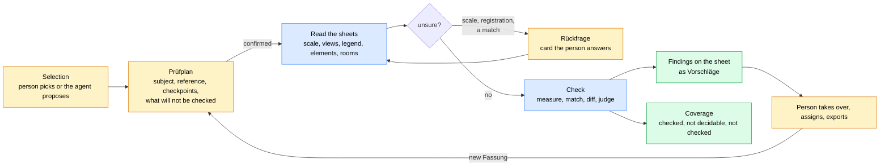

# Checking drawings: comparisons and checks that land on the sheet

*Concept, 2026-11-23. Written from a product owner's brief (the five jobs below)
and a read of the code and the roadmap on that date. Builds on
[plan-measurement-from-drawings.md](./plan-measurement-from-drawings.md) and its
[build specification](./drawing-measurement-build-spec.md), which own scale and
measuring; on [revisions.md](../architecture/revisions.md), which owns comparing
Fassungen; and on [document-annotations.md](../architecture/document-annotations.md),
which owns marks on a page. Where this file and one of those disagree on their
own subject, they win.*

**This is a concept. Nothing in it is built beyond what
[Where we are](#where-we-are) lists.** The decisions under
[Open questions](#open-questions-for-the-product-owner) are the product owner's.

## The star

An architect selects two or more documents, or asks the agent to pick them, and
says what to check: „Stimmt der Grundriss mit dem Raumbuch?“, „Was hat sich
zwischen Index C und D geändert?“, „Passen die Durchbrüche der Haustechnik zu
unserem Stand?“. The agent shows which Fassungen it will hold against which, and
what it will check, before it starts. It then reads the sheets the way a
colleague does: it knows the scale of each view, what each hatch stands for,
which line is a wall and which room a stamp belongs to. Every result is a mark
on the sheet, at the place it is about, with the evidence beside it: the
printed figure, the measured span and its tolerance, the row of the list, the
clause. What the agent could not check, and why, is a list of its own and is
visible on the sheet. Where it is unsure, it asks before it guesses.

## What the architect expects when this is done

These are the statements the feature is judged by. Each one names the job it
comes from.

1. „Ich sehe vor dem Start, welche Dateien in welcher Fassung verglichen werden,
   und kann das ändern.“ (all five)
2. „Jedes Ergebnis steht im Plan, an der richtigen Stelle, nicht nur im Chat.“
   (all five)
3. „Eine Zahl, die der Agent nennt, stimmt, oder er sagt, dass sie nicht
   entscheidbar ist.“ (1, 3, 5)
4. „Ich bekomme eine Änderungsliste zwischen zwei Ständen, und jede Änderung ist
   im Plan markiert.“ (2)
5. „Ich sehe, welche Fachplanerpläne auf einem veralteten Stand von uns
   beruhen, und wo ihre Durchbrüche mit unserer Planung kollidieren.“ (4)
6. „Ich sehe, wo derselbe Bauteil in Grundriss, Ansicht und Schnitt
   unterschiedlich groß ist.“ (5)
7. „Ich weiß, was nicht geprüft wurde.“ (all five)
8. „Ich kann die Ergebnisse übernehmen, verteilen und beim nächsten Stand
   wieder prüfen lassen.“ (all five)

## One shape for five jobs

The five jobs look different and are one act: **hold a subject against a
reference and say, at a place on the sheet, where they disagree.** What changes
is what the reference is and how a place on one is found on the other.

| # | Job | Subject (*Gegenstand*) | Reference (*Grundlage*) | How a place is matched | What a result says |
|---|---|---|---|---|---|
| 1 | Drawing against a table: norms, a Raumbuch, a Türliste | sheets | a table of requirements or target values | by key: room number, door number, element type | row X demands A, the sheet shows B |
| 2 | Two Fassungen of one sheet | the newer Fassung | the older Fassung | geometric: the two sheets laid on each other | added, removed, moved, figure changed |
| 3 | A question about a sheet | sheets | one requirement, from the question or the law | by what the question names: „die Türen im EG“, „der Fluchtweg von Raum 2.04“ | met, not met, not decidable, with the measured value |
| 4 | Consultant drawings against our own | TGA or Tragwerk sheets | our own sheets, in the Fassung the consultant should have used | geometric, across different plots and scales, via the axis grid | a Durchbruch without a wall, a Schlitz in a load-bearing wall, a collision, a stale basis |
| 5 | Consistency of one set (*Stimmigkeit*) | every view of one element | the other views of it | by element: axis, level, label | Grundriss says 1,50, Ansicht says 1,35 |

So the feature is one workflow with five ways to fill it, not five features:

Three objects carry it, and two of them exist:

- **The Prüfplan** is what a run will compare and check, shown for approval
  before it starts. The word and the pattern exist for research
  (*Rechercheplan*, with *Grundlage* and *Ausgeschlossen*, in
  [`CONTEXT.md`](../../CONTEXT.md)). This is the answer to „the user should
  understand which selection the agent made“.
- **The Befund** is one checkpoint checked: *erfüllt*, *nicht erfüllt*, *offen*,
  *nicht anwendbar* (`CONTEXT.md`). It gains a place on a sheet.
- **The Anmerkung** is how a Befund appears on the sheet: a mark on one page of
  one Fassung, born a *Vorschlag* when the agent sets it, the office's once a person
  takes it over, carried to the next Fassung when it still holds. This exists in
  full ([document-annotations.md](../architecture/document-annotations.md)).
  What it lacks is shapes beyond a point and a box, and a link back to the run
  and the checkpoint it came from.

## Where we are

Checked in the code on 2026-11-23.

| Piece | State | Where |
|---|---|---|
| Comparing two Fassungen by eye | Built: side by side, overlaid (older cyan, newer orange) or swiped, page by page. Same page number on both sides; no alignment of the two plots | `ui/features/documents/components/revision-compare/` |
| Change boxes on a newer page | Built: one vision call per page pair, at most 12 boxes with a sentence each, cached. Quality on real drawings unmeasured; boxes are a model's guess at the place. Where the office switched it on, a new Fassung gets them as proposed Hinweis marks on at most 3 pages | `packages/agent/src/agent/knowledge/revision_compare.py`, card `revision_compare`; job `apps/workspace/bff/revision-notice/job.ts` |
| What changed, as text | Built: pages aligned by text, values that moved in printed lines, dimension strings from the drawing reading, the Plankopf | `agent/knowledge/revision_diff.py`, `list_files(compare_to=…)` |
| Two tables row by row | Built: xlsx, csv and tables in a PDF, rows matched by a key column, a deviation names column, both values and both places | `agent/knowledge/table_diff.py` |
| Two different documents compared | Built for two files through `compare_to`. Three or more, or a file against a Norm, is the agent reading and holding them together by itself | `browse/compare.py` |
| Plankopf: number, Index, Stand | Built: read off the title block, one per document | `RevisionFacts`, `browse/rows.py` |
| References between documents | Built: norms, laws, plan numbers („siehe EP-05“), named documents, no model | `knowledge_layer/references.py` |
| Findings across a project | Built: missing document, missing plan, contradiction of a fact between two documents, contradiction with the project profile, incomplete read. No *stale basis* finding | `apps/workspace/bff/documents/findings.ts` |
| Documents that disagree, marked | Built: the `document_check` job, a headless turn that proposes Hinweis marks where documents contradict each other | `apps/workspace/bff/document-check/` |
| What a drawing contains | Built: per view a segment with entities, quantities, compositions and verbatim dimension strings, read by a vision model from the page image; a scale as a string | `visual_schema.py`, `visual_analysis.py` |
| Looking at a region | Built: `look` renders a page or a region crop and the model reads it; the reader sees where it looked. Six looks a turn, two of them whole pages. Returns pixels, no text, no scale | `tools/look/`, `common/image_view_budget.py`, ADR-0128 |
| Moving the person's viewer | Built: `show_in_viewer` with `highlight_region` and `compare_revisions`, one call per answer, a proposal to the viewer | `tools/viewer/register.py`, ADR-0144 |
| Marks on a page | Built: shapes `point` and `region` (a box), kinds Hinweis, Frage, Mangel, no severity; Vorschlag until taken over; threads, Zuständige, Frist, carried to a new Fassung, Offene Punkte and Protokoll per project. The agent sets them through `canvas__mark`, at most 20 a call | migration `0138_document_annotations.sql`, `bff/annotations/`, `tools/canvas/` |
| Choosing documents for the work | A turn carries one focus document; there is no way to select several for a turn. The research plan lets a person pick Grundlage and Ausgeschlossen, up to 20 | `common/wire_v2.py`, `bff/runs/plan-documents.ts`, `PlanChecklist.tsx` |
| Scale and measuring on a PDF | Planned in full, not built: sheet reader, scale per region with a person's confirmation, `drawing_measure` with `clearance`, `distance`, `path`, `area` and a three-valued verdict | [build spec](./drawing-measurement-build-spec.md) |
| The Prüfbuch | Built for the IFC model only: results computed from the model on request, a person's confirmations stored, BCF export | `bff/bim/rules.ts`, `bim_check_confirmations`, `bff/bim/bcf.ts` |
| Befunde of a report | Built for research: met, not met, open, not applicable, referenced by document, section and page; no place on the page | `agent/common/findings.py` |
| Delegated work | Built: an Aufgabe runs as the requester, kinds `compliance_check`, `submission_check`, `document`, `revision`. `compliance_check` answers in the thread and files nothing | ADR-0051, `bff/tasks/delegation.ts` |
| Code the agent runs | Built, off in production: JavaScript in an isolate, reads up to 10 project documents. No Python, so none of the geometry libraries the backend has | `apps/code-runner`, [agent-code-execution.md](../design/agent-code-execution.md) |

So the pieces for job 2 exist as a first version, the pieces for job 1 exist for
tables but not for a sheet as one side, job 5 has a first version for facts
stated in text, and jobs 3 and 4 lack what every one of them needs: a sheet
that is measurable and understood, and a result that is more than a box. No job
has a way to choose its documents and see that choice before the work starts.

## What the agent needs to be able to do

The capabilities, in the order they build on each other. Each says what it is,
who does the work (the engine, meaning deterministic code on the file's vector
data, or a model), and whether it exists. The rule from the measurement plan
holds for all of them: **the engine measures, the model points, the Bestimmung
judges.** A number never passes through a language model.

### C0. Choose the documents, visibly

A person selects several documents in Dateien („Abgleichen…“) or names them in
the chat; or the agent proposes the set: the current Fassung of each sheet by
Dokumentart and Plankopf, the consultant sheets that reference ours, the list
the question names. Either way the Prüfplan shows each document with its
Fassung, why it was chosen, and what was left out (an older Fassung, a sheet of
another building), and the person changes it before the run.

- **Who:** the agent proposes from the listing, the Plankopf and the reference
  graph; the person confirms.
- **State:** the research plan's Grundlage and Ausgeschlossen
  (`PlanChecklist.tsx`, up to 20 documents) is the pattern to reuse. A turn
  today carries one focus document; selecting several in Dateien is new.

### C1. Read a sheet exactly

The page's size, format, rotation and whether it is a scan; every character
with its position and direction; every line with its width, dash and colour;
the PDF's layers; the stored viewports with their scale. Read once per Fassung
and page, cached.

- **Who:** engine (PDFium, pdfminer).
- **State:** specified as slice 1 of the
  [build spec](./drawing-measurement-build-spec.md#1-the-reader-and-look-returns-the-text-in-its-crop),
  not built.
- **Needed by:** every job. Without it, every figure is read off pixels and an A0
  sheet is read at about 49 dpi.

### C2. Calibrate the scale

A scale belongs to a region of a page (a sheet carries several), has a state
(`verified` by a person, `estimated` and corroborated by the sheet's own
figures, or `uncalibrated`), and a person's value always wins. The agent proposes,
the person confirms in a card or sets two points on the sheet.

- **Who:** engine proposes and checks; a person confirms.
- **State:** specified as slices 2, 4, 5 and 6 of the build spec, not built.
- **Needed by:** 1, 3, 4, 5. Job 2 can do without it when both Fassungen share a
  plot; it needs it when one was re-plotted.

### C3. Measure on the sheet

Clear width between two faces, distance, a path's length, an area, each with an
interval and its provenance, and a verdict against a threshold that can be
*nicht entscheidbar*. A person measures the same way in the Prüfansicht.

- **Who:** engine; the model only says where.
- **State:** specified as slices 3, 7 and 8 of the build spec, not built.
- **Needed by:** 1 (minimum widths, areas), 3 (escape routes, door widths),
  4 (opening sizes), 5 (the same dimension in two views).

### C4. Understand a sheet

What a colleague sees when they look at a sheet, as data with places:

| What | How | Who |
|---|---|---|
| **Views and their kind** (Grundriss EG, Schnitt A-A, Ansicht Süd, Detail 3) | the page map of the ingestion plan (L0) gives the boxes; the title of each view is printed text near it | model locates, engine reads the text |
| **The legend** | the legend box, its swatches and their labels | model locates, engine reads |
| **Hatches as materials** | a hatch on a vector sheet is a fill pattern or a repeated set of parallel lines inside a closed outline. The engine finds closed regions and their pattern (angle, spacing, cross-hatch, solid). Each pattern is matched to the legend swatch with the same pattern; where there is no legend, to the convention (ÖNORM A 6240-2, DIN 1356-1) and marked as a convention, not as read | engine finds and matches; model only where the pattern is a raster |
| **Elements** | walls (two parallel lines with a hatch or a fill between them), openings (a gap in a wall with a door swing or a window symbol), stairs (parallel treads and an arrow), columns, shafts. Each with its outline and the figures printed on it | engine proposes candidates from geometry; model confirms on a crop and names them; every element keeps its outline |
| **Rooms** | the room stamp (number, name, area, floor finish, height) and the outline it sits in | engine reads the stamp (`rooms` in the build spec) and closes the outline from wall faces; model resolves an ambiguous stamp |
| **Axis grid and levels** | axis labels in circles at the sheet edge, their lines; level marks (±0,00, +3,05) | engine; this is what makes jobs 4 and 5 possible, because axes and levels are the coordinates every discipline shares |
| **Section and detail marks** | section line A-A, detail bubble 3/A-501 | page map finds them, engine reads the label, the reference graph resolves the target sheet |

- **State:** the vision reading per view exists (`visual_schema.py`), but its
  places are page boxes and its numbers come from pixels. Legend, hatches,
  elements as outlines, axes and levels from the vector file are new.
- **Hardest part:** walls and rooms from linework. Real sheets mix wall faces,
  furniture, dimensions and hatches on one layer. Archicad's PDF layers (all
  three pilot offices) name what a line is and should be used where present;
  where absent, candidates from geometry plus a model confirming on a crop.
  This is the capability to measure first on the corpus.

### C5. Lay two sheets on each other (registration)

Find the transform that brings one sheet's region onto another's: shift,
rotation and scale, per region, with the residual error. Needed whenever two
sheets were not plotted identically, which is the rule for consultant drawings
(TGA at 1:50 against our 1:100, another title block, another origin) and common
for a re-plotted Fassung.

- **How:** first the axis grid (C4): two axes in each direction on both sheets
  fix the transform exactly, and the labels say which axis is which. Where there
  is no grid, matching wall corners and line intersections (robust point
  matching with outlier rejection) on a region both sheets share. The result
  states the residual at the control points and refuses when it exceeds a
  tolerance.
- **Who:** engine; the person confirms like a scale (*Passpunkte* shown on both
  sheets, two clicks each to correct).
- **State:** new. Today's overlay puts page 1 on page 1 at the same pixel; the
  revisions doc names „compare is page for page“ as a known limit.

### C6. Find the differences between two sheets

After registration: the lines and characters present on one side only, grouped
into change regions (a moved wall is two removed and two added lines close
together; a changed figure is a text change on a dimension line). Each region is
then classified on a crop pair: *Maß geändert*, *Wand verschoben*, *Öffnung neu*,
*Raum umbenannt*, *Bauteil entfallen*.

- **Who:** engine finds every difference and its exact outline; the model names
  each region and writes the change list. The engine also reports what it
  ignored (line-weight and colour changes, title block, revision cloud,
  hatch density) so the person can switch those back on.
- **State:** the vision call that boxes up to 12 changes exists and stays as the
  route for scans. The geometric diff is new; it makes every change found, not
  the twelve a model noticed, and puts each one exactly.

### C7. Read the reference as checkpoints

Turn the *Grundlage* into checkpoints (*Prüfpunkte*) the run works through, each
with what it applies to, what it demands, and where that stands:

| Reference | Checkpoint |
|---|---|
| Raumbuch (xlsx, PDF table) | per room: area, clear height, floor finish, door width, as the row says; matched by room number |
| Norm table in a PDF | per row: element type, property, operator, value, unit, the passage |
| Law or OIB clause | the requirement as the catalog holds it, with `applies_when` ([compliance-derivation-graph.md](./compliance-derivation-graph.md#31-the-requirement-catalog-the-compiled-rulebook)); the rulesets of ADR-0166 where they exist |
| The person's question | one checkpoint, or a few, written by the agent and shown |
| Durchbruchsliste of a consultant | per opening: position (axis, level), size, UK/OK, purpose |

- **Who:** tables by the engine where the ingestion read them as tables
  (`table_diff.py` already matches rows); the mapping of columns to properties
  and of a prose clause to a checkpoint by the model, shown in the Prüfplan for
  the person to correct.
- **Licensed norms:** a checkpoint compiled from an office's licensed ÖNORM is
  derived licensed content. ADR-0164 lets licensed text exist only inside the
  model call. Whether a stored checkpoint („Türbreite ≥ 0,90 m, ÖNORM B 1600,
  Tab. 3“) is a fact or a copy is an open question for the product owner.

### C8. Match places across documents

Say which thing on one side is which thing on the other: room 2.04 on the sheet
is row 2.04 of the Raumbuch; axis C on the TGA sheet is axis C on ours; the
balcony between axes 3 and 5 on level +6,10 in the Grundriss is the one in
Ansicht Süd. Every match carries how it was made (same key, same axes and
level, registration, a model's reading) and is shown, because a wrong match
produces a confident wrong finding.

- **Who:** engine by key and coordinates; model for the rest; a person for what
  stays ambiguous.

### C9. Put the result on the sheet

| What the Anmerkung needs | State |
|---|---|
| A point, a box | built |
| A line, a polyline, a polygon (a measured span, an escape route, a room outline, a moved wall) | specified as slice 8 of the build spec |
| A revision cloud around a change region | new, a polygon drawn as a cloud |
| A dimension drawn with its value and tolerance | new, a line with a label |
| One finding on several sheets (a balcony in Grundriss and Ansicht; a Durchbruch on the TGA sheet and on ours) | new: linked marks, each on its own page, opening the other |
| The run and the checkpoint a mark came from | new: a reference from the mark to the run and the checkpoint |
| Showing one run's marks as a layer, switching it off | new in the Prüfansicht |
| A sheet exported with its marks | the Protokoll exists as a list; a PDF of the sheet with the marks drawn is new |

### C10. Say what was not checked

Every run ends with its coverage, per checkpoint and per sheet: *geprüft*
(with the verdict), *nicht entscheidbar* (with what would decide it: a verified
scale, a section, a printed figure), *nicht geprüft* (out of the Prüfplan,
unreadable, a scan, a view the run did not reach). On the sheet the regions the
run did not read are shaded. The coverage is part of the result, never a
footnote; the coverage record of the ingestion
(`knowledge_layer/ingest/coverage.py`) and the `Coverage: insufficient` line
of search are the precedents.

### C11. Ask when unsure

The questions a run asks are typed, so the answer is stored and reaches the next
step: confirm a scale (planned, a proposed change), confirm a registration
(new, same pattern), confirm a match („Ist *Abstellraum* im Plan Raum 1.04 im
Raumbuch?“), choose between two readings of a figure. Each is a proposed change
(ADR-0105) with a card, so it waits in the inbox when nobody is in the chat. A
run that needs an answer to go on pauses (ADR-0140, proposed); until that
exists, it checks what it can, marks the rest *nicht entscheidbar* with the
open question, and the person re-runs.

## The five jobs in detail

### 1. A drawing against a table

**First version: Grundriss against Raumbuch.** It is the largest job the pilot
offices named (area schedules, room programme, funding lists: six conversations,
half a day to three days per pass, from the measurement plan's count), and it
needs no scale for its first half.

- **Prüfplan:** which sheets (the Grundrisse of the current Fassung, by
  Dokumentart and Plankopf), which list, which columns are compared (area,
  height, floor finish), the key (room number), the tolerance for areas.
- **Check:** room stamps read exactly (C1, `rooms`) and matched to rows by
  number (C8); printed values compared like `table_diff.py` compares two tables.
  A room in the list and not on a sheet, and the reverse, are findings. Then,
  with a verified scale, the stamp's area against the area of the room's
  outline (C3, C4): a printed area that does not match the drawn room is the
  error nobody finds by hand.
- **On the sheet:** each deviation a mark on the room stamp; the room outline as
  a polygon when the area was measured.
- **Then:** a Türliste against the doors on the sheet (count and clear width);
  a norm table against elements (C7).

### 2. Two Fassungen of a sheet

- **Prüfplan:** which two Fassungen, and which page of one is which page of the
  other, paired by Plankopf number and view title rather than by page number
  (the revisions doc names page-for-page pairing as a limit).
- **Check:** registration (C5), geometric and text diff (C6), each change region
  named. Printed figures that changed are listed with both values.
- **On the sheet:** each change a cloud on the newer Fassung, the same place
  outlined on the older one; the change list beside the sheet, each row opening
  its place. Switches for what was ignored.
- **Then:** the change list as a document (an Aktenvermerk, a
  Planänderungsliste for the Planlauf), and open marks of the older Fassung
  checked against the changes: a mark whose place changed is pointed out when
  it is carried over.

### 3. A question about a sheet

This is the review canvas's draw-a-box-and-ask, which the product owner calls
the best thing the agent does (ADR-0128), with a sheet that is measurable.

- **Prüfplan:** for a question, inline and short: „Ich prüfe die lichten Breiten
  aller Türen im EG gegen 0,80 m (OIB-RL 4, 2.4.2) auf Blatt A-101, Fassung D.
  Maßstab 1:100 bestätigt.“ No confirmation step for a single question; the
  person sees it and can stop or correct.
- **Check:** the requirement from the law corpus or the question (C7), the
  elements it names (C4), measured (C3) or read where printed (a printed figure
  beats a measurement).
- **On the sheet:** each element checked gets a mark with its value, interval
  and verdict; a path for an escape route with its length.
- **Answer:** the count by verdict, the failures named, what was not decidable
  and why, in the chat, each linking to its mark.

### 4. Consultant drawings against our own

- **Prüfplan:** the consultant's sheets (TGA, Tragwerk), our sheets they should
  rest on, and the Fassung each consultant sheet names as its basis.
- **Check, cheapest first:**
  1. **Stale basis.** A consultant's Plankopf or a note names the
     architect's sheet and Index it rests on („Grundlage: A-101 Index C“). The
     reference graph and the Plankopf already hold both; a basis older than our
     current Fassung is a finding without reading a line. A new kind beside the
     existing findings in `findings.ts`.
  2. **Durchbrüche and Schlitze against walls and slabs.** Read the openings
     from the consultant's Durchbruchsliste (a table) or from their symbols on
     the sheet (C4), with size, axis and level; register the sheets (C5); look
     up what our sheet has at that place: a wall, which material (hatch, C4),
     load-bearing by the Tragwerk sheet or the legend. Findings: an opening in
     no wall, an opening in a load-bearing wall without a matching note in the
     Tragwerk, an opening our sheet does not show, a Schlitz deeper than the wall
     allows.
  3. **Collisions in plan.** Shafts, ducts and main runs against our walls,
     beams and openings, after registration. This is two-dimensional and says
     so: a collision in plan is a candidate, the height decides it, and the
     height is in a section or the model.
- **On the sheet:** each finding linked on both sheets.
- **Where a model exists:** a TGA or structural IFC against ours is a clash
  check in three dimensions, far more exact than any of this. The IFC path
  (ADR-0045, the Prüfbuch) should take it whenever both models exist, and the
  run should say so in its Prüfplan.

### 5. Consistency of one set (*Stimmigkeit*)

- **Prüfplan:** which sheets form the set (Grundrisse, Schnitte, Ansichten,
  Nachweise such as the Flächen- or Stellplatznachweis), and which kinds of fact
  are compared.
- **Check, cheapest first:**
  1. **Facts across documents.** The dossier already lifts printed facts
     (Geschosse, GFZ, Höhen, Flächen), `findings.ts` already reports two
     documents stating one fact differently, and the `document_check` job
     already marks such places as Vorschläge. Extend the facts to what a set
     shares: level marks, total heights, storey heights, the axis spacing.
  2. **Dimensions of one element across views.** Match the element by axes and
     level (C8); compare its printed dimensions, and where not printed its
     measured ones (C3) on each view. The balcony width in Grundriss, Ansicht
     and Nachweis is this.
  3. **Counts.** Windows on a façade in the Ansicht against openings in that
     wall in the Grundriss; storeys in the Schnitt against Grundrisse held.
- **On the sheet:** one finding, linked marks on every view involved, each
  showing its value.

## How the result looks

The place is the Prüfansicht, which already holds marks, threads and live
presence. It gains:

- **Two sheets at once**, side by side or registered and overlaid, for jobs
  2, 4 and 5; the comparison view of the revisions feature grows into this
  rather than a second viewer being built.
- **The run as a layer.** Every mark of one run, toggled together, filtered by
  verdict; the list of findings beside the sheet, each row moving the sheet to
  its place (ADR-0144's viewer actions do this today for one region).
- **Each mark shows its evidence** in its card: the printed figure, the measured
  span with its tolerance and scale state, the Raumbuch row, the clause; and
  its verdict.
- **Shaded regions the run did not read**, and the not-checked list in the
  run's summary.
- **Taking over in bulk:** a person takes over, dismisses or assigns many
  Vorschläge at once; each still records who decided.
- **Out of the product:** the findings as a Protokoll (exists), the sheet as a
  PDF with the marks drawn on it (new), a change list as a document (the
  agent writes documents today), BCF where a model is involved (exists for IFC).

In the chat, the answer stays short: what was checked, the count by verdict,
the findings that matter, the not-checked list, and a card that opens the run
on the sheet. The result lives on the sheet, not in the answer.

## The rules every check keeps

Inherited from the measurement plan, and extended to comparisons:

1. **The engine measures and finds, the model points and names.** No length,
   area, count or difference is produced by a vision model where the vector
   file can give it. On a scan the run says it is reading pixels, and gives no
   verdict that depends on a dimension.
2. **A printed figure beats a measurement.** Where both exist and disagree,
   both are shown and that is a finding.
3. **Three values.** Every verdict is met, not met, or not decidable with the
   reason. A value near the threshold is not decidable.
4. **No finding without a place and its evidence.** A finding that cannot be
   placed is a coverage entry, not a finding.
5. **The selection is shown before the work.** A run never compares a Fassung
   the person did not see in the Prüfplan; a superseded Fassung is named as one.
6. **Every match is shown with how it was made**, so a wrong match is visible
   before its finding is believed.
7. **What was not checked is part of the result.**
8. **Vorschläge until a person takes them over.** Unchanged from the Anmerkung.

## Architecture, in outline

Detail belongs in a build specification per slice, as the measurement plan has.
What this concept fixes:

- **Headless first.** Every step a person takes (start a run, confirm a
  Prüfplan, confirm a registration, take findings over) is an operation in the
  catalog before it is a button, so the office's own agents run checks through
  the door (ADR-0122, [agent-surface.md](../architecture/agent-surface.md)).
- **Chat for a question, an Aufgabe for a check.** Job 3 runs inside a turn. Jobs
  1, 2, 4 and 5 over a set of sheets are an Aufgabe (ADR-0051) with a new kind
  beside `compliance_check` and `revision`, run as the requester, its run a
  message in the thread (ADR-0062), its Prüfplan approved like a
  Rechercheplan.
- **One drawing tool.** Every bound tool costs about a thousand tokens on every
  turn and the tool prefix sits near its ceiling (build spec, decision 12). The
  new operations (`elements`, `legend`, `register`, `diff`) join
  `drawing_measure` as operations, not as tools.
- **The engine where the build spec puts it.** Reading in
  `knowledge_layer/sheet/`, everything that reasons about geometry in
  `agent/drawings/`, plain values across the boundary.
- **Records.** A run, its checkpoints and its findings are server records the
  UI, the agent and the door read alike. A finding links to its Anmerkungen.
  Whether this is the Prüfbuch widened from the model to the drawings
  (the direction [compliance-derivation-graph.md](./compliance-derivation-graph.md)
  and VISION.md name: one record of what applies and what is shown) or a record
  of its own is the first architecture decision, and an ADR.
- **A new Fassung re-runs.** A run is tied to Fassungen. When one is replaced,
  the run is offered again on the new one and the findings are compared: which
  are fixed, which are new, which still hold. The Prüfbuch's regression idea,
  for drawings.
- **Observable.** Every model call in a run is a Langfuse generation under the
  run's trace; pixels are left out as `revision_compare` does today.
- **Restricted folders, held uploads, licensed copies** keep their rules: a
  restricted folder is not compared by a model, a held upload is invisible,
  licensed text stays inside the model call.

## Slices

Each ships alone and serves a named expectation. The measurement build spec's
slices are the ground floor and are not repeated; this list says where they are
needed.

| # | Slice | Needs | Serves | Size |
|---|---|---|---|---|
| 0 | **Corpus.** From the pilot offices: Fassung pairs of one sheet, a TGA and a Tragwerk set with the architect's sheets they rest on, a Raumbuch with its Grundrisse, one full Einreichung set. Measure: share with layers, with an axis grid, with a Durchbruchsliste as a table, with a basis Index on the consultant's Plankopf | nothing | every choice below | 2 to 3 days |
| 1 | **Stale consultant basis.** A finding when a consultant sheet rests on an older Fassung of ours, from Plankopf and references | built pieces | expectation 5, first half | S |
| 2 | **Raumbuch against room stamps.** Stamps read exactly, matched by number, compared by column; marks on the stamps | build spec slice 1 and `rooms` | 2, 7 | M |
| 3 | **Prüfplan and run record.** Selection shown and confirmed, the run as an Aufgabe, findings linked to marks, coverage, the run as a layer | 2 | 1, 2, 7, 8 | M to L |
| 4 | **Questions answered on the sheet.** Job 3 on a verified scale; line, path and polygon marks | build spec slices 2 to 6 and 8 | 3 | the build spec |
| 5 | **Fassung comparison, exact.** Pages paired by Plankopf, registration, geometric diff, change list, clouds on both sides; same-name versions compared too | C1, C5, C6 | 4 | L |
| 6 | **Understanding a sheet.** Legend, hatches as materials, walls, openings, rooms as outlines, axes, levels | C1; corpus numbers for walls | 1, 3, 4, 5 | L, research-grade for walls |
| 7 | **Consultant openings against our walls.** Durchbruchsliste or symbols, registration by axes, findings on both sheets | 5, 6 | 5, second half | L |
| 8 | **Consistency of a set.** Levels, heights and axis spacing as facts; one element across views; counts | 6 | 6 | M to L |
| 9 | **Norm tables as checkpoints.** After the licence question is answered | 3, 6 | 1 | M |
| 10 | **Re-run on a new Fassung**, findings compared | 3 | 8 | M |

Slices 1 and 2 need no scale and no new reading of geometry and already change
what offices feel. Slice 3 is what turns separate answers into the workflow.
Slice 5 replaces a model's guess with every change, placed exactly.

## How we will know it worked

- **Ground truth we make.** The build spec's PDF writer draws sheets at known
  dimensions. Change them in known ways (a wall moved by 10 cm, a figure
  changed, a door removed, a room renamed, a Durchbruch added) and score the
  comparison: every planted change found and placed within its tolerance, no
  change reported where none was planted. The same for a Raumbuch with planted
  deviations and a set with one inconsistent balcony.
- **Release gates.** No finding whose place is off by more than its stated
  tolerance; no number outside its interval (the measurement plan's gate); every
  run carries its coverage.
- **On the pilots' files.** Recall of changes against a person's own
  Planänderungsliste for the same two Fassungen; how many Vorschläge are taken
  over, corrected or dismissed (the proposal decision score exists in
  Langfuse); how often a Prüfplan is changed before it runs.
- **In use.** Whether offices stop printing two Fassungen to lay them on a
  light table, and stop leaving the product to check a Raumbuch.

## Deliberately not doing

| Not doing | Why |
|---|---|
| A vision model's numbers | The measurement plan's evidence: right units, wrong number, stated with confidence |
| 3D clash detection from 2D sheets | A collision in plan is a candidate; the height decides. Where models exist, the IFC path does it properly |
| A CAD editor | The agent marks and checks; the office changes the drawing in Archicad or Revit |
| Signing a check | The agent prepares and checks; a person decides and signs (VISION.md) |
| Phone photos of sheets | Perspective on a raster that already cannot resolve the margins that matter |
| Converting PDF to DWG as the route | Adds no information |

## Open questions for the product owner

1. **Which job first.** Proposed: slices 1 and 2 (stale basis, Raumbuch) because
   they need nothing unbuilt and answer the largest named job, then the
   measurement build spec, then slice 3. A different order is a product call.
2. **The corpus.** Everything about walls, hatches and registration rests on
   files we do not have yet: the pilot offices' Fassung pairs, consultant sets
   and Raumbücher.
3. **The record.** Widen the Prüfbuch from the model to the drawings, or a record
   of its own for drawing checks.
4. **Licensed norms as checkpoints.** Is „Türbreite ≥ 0,90 m, ÖNORM B 1600,
   Tab. 3“ stored as a checkpoint a fact or a copy of licensed content
   (ADR-0164)?
5. **How sure is sure enough to put a mark.** Below which confidence does a
   match or an element become a Rückfrage instead of a Vorschlag? A number per
   kind, from the corpus.
6. **Consultant files in DWG or IFC.** One office receives DWG from consultants;
   nobody uploads it yet. Do consultants send PDFs, DWG or IFC to the pilots?
   It decides whether job 4 is a 2D feature or the IFC path's.
7. **The words in the product.** „Abgleich“ for the run, „Prüfplan“ for what it
   will do: check against the office's own usage before they reach the copy
   (`CONTEXT.md`, the explain test of [naming.md](../contributing/naming.md)).
